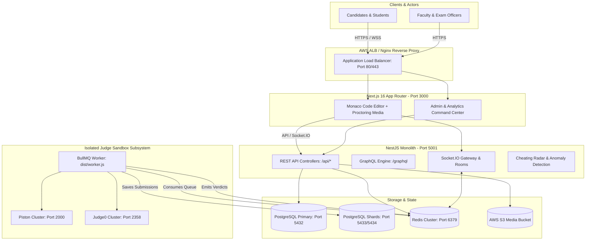

# CodeSkill: Enterprise Algorithmic Assessment & Technical Learning Platform

CodeSkill is a high-concurrency, enterprise-grade technical examination and algorithmic learning platform engineered for universities, engineering departments, and corporate technical evaluations. Built to handle massive concurrent assessment surges (1,000+ simultaneous candidates per session) with zero downtime, CodeSkill provides an end-to-end ecosystem spanning real-time proctoring, dual-sandbox automated code execution (Judge0 + Piston), 128-bucket database sharding, and interactive skill learning.

---

## Documentation Suite Index

| Documentation File | Scope & Contents |
| :--- | :--- |
| [`AGENTS.md`](./AGENTS.md) | **AI Agent Runbook:** Repository invariants, coding conventions, and exact test/validation commands. |
| [`docs/ENVIRONMENT_AND_CONFIG.md`](./docs/ENVIRONMENT_AND_CONFIG.md) | **Configuration Reference:** 100% of environment variables (121 keys), process roles, and runtime flags. |
| [`docs/ARCHITECTURE.md`](./docs/ARCHITECTURE.md) | **System Architecture:** End-to-end design, dual Judge0/Piston sandboxes, consistent sharding, and Cheating Radar. |
| [`docs/DATABASE.md`](./docs/DATABASE.md) | **Database Reference:** ER diagram, all 49 tables/entities, 128-bucket sharding, and partitioning rules. |
| [`docs/API_REFERENCE.md`](./docs/API_REFERENCE.md) | **API Reference:** Exhaustive catalog of all 115 REST routes, GraphQL schema, and WebSocket protocols. |
| [`docs/BACKEND_MODULES.md`](./docs/BACKEND_MODULES.md) | **Backend Architecture:** All NestJS modules, providers, BullMQ queue processors, and PDF report generator. |
| [`docs/FRONTEND.md`](./docs/FRONTEND.md) | **Frontend Architecture:** App Router (103 pages, 5 layouts, 5 route handlers), all 130 components, and hooks. |
| [`docs/INFRASTRUCTURE_AND_OPERATIONS.md`](./docs/INFRASTRUCTURE_AND_OPERATIONS.md) | **Infrastructure & Ops:** 22 AWS Terraform modules, 3 environments, CI/CD, and k6 load testing suites. |

---

## High-Level System Architecture



---

## Monorepo Directory Tree

```
codeskill/
├── .github/workflows/          # CI/CD deployment and validation pipelines
├── backend-nestjs/             # NestJS API, Apollo GraphQL, BullMQ Judge worker
│   ├── src/                    # Controllers, modules, services, entities, DTOs
│   │   ├── admin/              # Administrative reporting and management controllers
│   │   ├── assessments/        # Standardized exam creation, scheduling, and results
│   │   ├── audit/              # Activity logging, Cheating Radar, and alert webhooks
│   │   ├── auth/               # JWT authentication, session tokens, password hashing
│   │   ├── bugs/               # Issue tracking and screenshot attachments
│   │   ├── common/             # Guards, interceptors, filters, decorators, and CORS
│   │   ├── config/             # App, database, Redis, JWT, and AWS configuration
│   │   ├── contests/           # Live coding contests, re-attempts, and leaderboards
│   │   ├── database/           # TypeORM entities, migrations, and sharding engine
│   │   ├── execution/          # Piston & Judge0 sandboxes, language adapters, complexity analyzer
│   │   ├── gateway/            # Socket.IO real-time WebSocket gateway
│   │   ├── learning/           # Interactive courses, modules, lessons, exercises, XP ledger
│   │   ├── problems/           # Algorithmic problem bank, testcases, and configs
│   │   ├── questions/          # Question banks, topics, and authoring tools
│   │   ├── redis/              # Redis service, OTP storage, and pub/sub relays
│   │   ├── reports/            # Official PDF generation via @react-pdf/renderer
│   │   ├── submissions/        # Submission ingestion and verdict routing
│   │   └── users/              # User profiles, institutional tenants, and enrollments
│   └── test/                   # Unit, integration, and e2e test suites
├── deployment/                 # Production Dockerfiles, compose files, and Nginx configs
│   ├── judges/                 # Judge0 and Piston execution node configurations
│   ├── monitoring/             # Uptime Kuma monitoring stack and WhatsApp alert relay
│   └── piston/                 # Piston service manifests and upstream lockfiles
├── docs/                       # Complete engineering audit and reference documentation
├── frontend-v2/                # Next.js 16 App Router web application
│   ├── src/app/                # App Router routes (103 pages, layouts, and route handlers)
│   ├── src/components/         # 130 reusable UI and domain components
│   ├── src/config/             # Axios API client, base URLs, and interceptors
│   ├── src/context/            # Auth and Theme context providers
│   ├── src/hooks/              # Custom hooks (proctoring media, timers, problem progress)
│   ├── src/lib/                # Pure utility functions, execution pollers, and formatters
│   └── src/store/              # Zustand state store
├── scripts/                    # Database backups, admin seeders, and k6 load tests
├── terraform/                  # AWS infrastructure definitions across 22 modules
│   ├── environments/           # dev, production, and judges environments
│   ├── load-tests/             # Infrastructure stress-testing configurations
│   ├── modules/                # 22 reusable child Terraform modules
│   └── userdata/               # EC2 bootstrap launch templates
├── docker-compose.yml          # Local development multi-container orchestration
├── ecosystem.config.js         # PM2 production process manager definition
└── package.json                # Monorepo root script runner
```

---

## Prerequisites

- **Node.js:** v22.x (LTS)
- **Package Manager:** npm v10.x+
- **Container Runtime:** Docker Desktop / Docker Engine 24+ and Docker Compose v2+
- **Database Services:** PostgreSQL 15+ and Redis 7+
- **Execution Backend:** Piston API (Port 2000) or Judge0 (Port 2358)

---

## Quick Start: Local Development Setup

### 1. Clone & Install Dependencies
```bash
git clone https://github.com/sazamansari/codeskill.git
cd codeskill
npm run install:all
```

### 2. Start Supporting Infrastructure (PostgreSQL & Redis)
```bash
# Start PostgreSQL and Redis via Docker Compose
docker compose up -d postgres redis

# (Optional) Start submission shard databases
docker compose --profile shards up -d
```

### 3. Initialize Database Schema & Seed Data
```bash
# Apply baseline migrations under advisory locks
npm run db:migrate --prefix backend-nestjs

# Bootstrap initial administrator credentials
npm run admin:bootstrap --prefix backend-nestjs
```

### 4. Launch Development Servers
```bash
# Terminal 1: Backend API (Port 5001)
npm run start:dev --prefix backend-nestjs

# Terminal 2: Frontend Web App (Port 3000)
npm run dev --prefix frontend-v2
```

---

## Complete npm Script Command Reference

| Command | Subsystem | Action Performed |
| :--- | :--- | :--- |
| `npm run local:init` | Root | Runs `scripts/init_local_dev.js` to initialize local environment files. |
| `npm run local:services:up` | Root | Starts local PostgreSQL and Redis containers in detached mode. |
| `npm run local:services:down` | Root | Stops all local containers. |
| `npm run build` | Root | Installs dependencies and builds both backend and frontend. |
| `npm start` | Root | Starts backend, judge worker, and frontend under PM2 (`ecosystem.config.js`). |
| `npm run restart` | Root | Restarts PM2 services with environment variable updates. |
| `npm run stop` | Root | Gracefully terminates PM2 services. |
| `npm run start:dev` | Backend | Runs NestJS in watch mode (`port 5001`). |
| `npm run start:prod` | Backend | Executes compiled backend API (`node dist/main`). |
| `npm run db:migrate` | Backend | Executes schema migration runner under advisory lock. |
| `npm run audit:backfill`| Backend | Backfills historical audit milestones and timeline records. |
| `npm run db:shards:migrate` | Backend | Migrates submission records to configured PostgreSQL shards. |
| `npm test` | Backend | Runs full backend Jest test suite in band. |
| `npm run dev` | Frontend | Starts Next.js development server with Webpack on `localhost:3000`. |
| `npm run build` | Frontend | Compiles production Next.js build. |
| `npm run typecheck` | Frontend | Executes TypeScript compiler typecheck (`tsc --noEmit`). |
| `npm test` | Frontend | Runs frontend Jest test suite. |