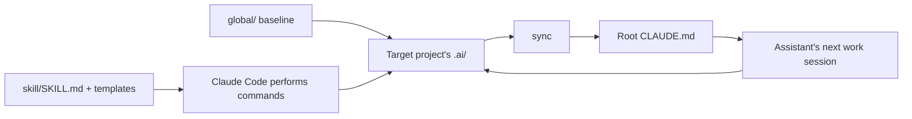

# codeskill repository overview

Reviewed on 12 October 2026 (India time). Repository: [thesatellite-ai/codeskill](https://github.com/thesatellite-ai/codeskill), confirmed by you after `maazansari/codeskill` could not be resolved.

Source revision: [`b63c63042dc8bd50c576f2728feeac7846efbc6e`](https://github.com/thesatellite-ai/codeskill/commit/b63c63042dc8bd50c576f2728feeac7846efbc6e). All 47 tracked files were inspected. Findings below distinguish written instructions from behavior verified by execution.

## 1. What the repository does

codeskill supplies an AI coding assistant with a persistent project notebook. That notebook contains coding rules, preferences, past corrections, decisions, task plans, session history, and summaries of codebase areas. The assistant reads these records before work and updates them during or after work.

The implementation consists of **46 Markdown files and one `.gitignore`**, totaling about 3,020 Markdown lines. Its central component is an 828-line `skill/SKILL.md` that tells Claude Code how to perform commands. There is no executable command parser, server, database, compiled application, package manifest, installer script, or background service in the tracked tree. “Learning” means saving and reusing written records; the repository does not implement model training.

The automatic session and learning behavior is requested through a generated instruction file. It depends on the assistant following those instructions. The repository supplies no executable hooks that enforce them. [Command specification](https://github.com/thesatellite-ai/codeskill/blob/b63c63042dc8bd50c576f2728feeac7846efbc6e/skill/SKILL.md), [generated context template](https://github.com/thesatellite-ai/codeskill/blob/b63c63042dc8bd50c576f2728feeac7846efbc6e/skill/templates/claude-md.md).

## 2. Repository map

| Location | Actual contents | What you change here |
|---|---|---|
| `README.md` | Installation and conceptual overview | User-facing explanation and examples |
| `skill/SKILL.md` | Command routing and procedures | Command behavior, paths, lifecycle, recovery |
| `skill/templates/` | 15 Markdown templates | Output structure and metadata conventions |
| `global/RULES.md` | 99 lines of baseline rules | Shared coding constraints |
| `global/taste.md` | Preferences attributed to `@khanakia` | Shared naming, structure, and style preferences |
| `global/behaviours/` | Six profiles plus their README | Mode-specific instructions |
| `global/skills/` | 12 technology guides with `globs` metadata | Guidance for relevant file types |
| `global/patterns/go.md` | Go examples | Reusable implementation patterns |
| `global/snippets/` | An index and four Go snippet templates | Concrete scaffolding examples |
| `global/prompts/INDEX.md` | Empty catalog | Future shared prompt entries |
| `global/memory/INDEX.md` | Empty feedback/decision catalog | Future shared memory entries |
| `.gitignore` | Editor artifacts, `CLAUDE.md`, `/research` | Repository tracking policy |

The 15 templates cover generated Claude context, behavior, feedback, decisions, incidents, sessions, activity logs, snapshots, plans, plan indexes, tasks, task indexes, task archive logs, code snippets, and prompt snippets. The README mentions a `research/` directory, but it is absent from the tracked tree and ignored as a repolink-managed location. Its contents were unavailable for this review. [Repository tree](https://github.com/thesatellite-ai/codeskill/tree/b63c63042dc8bd50c576f2728feeac7846efbc6e), [ignore rules](https://github.com/thesatellite-ai/codeskill/blob/b63c63042dc8bd50c576f2728feeac7846efbc6e/.gitignore).

## 3. How the pieces connect

There are three distinct locations:

1. **This repository** holds the reusable skill and baseline content.
2. **The assistant's skill directory** points to `skill/`, so the assistant can invoke `/codeskill` procedures.
3. **A target project** receives `.ai/global/` and its own `.ai/` records. `sync` assembles a root `CLAUDE.md` from the selected records.

`CLAUDE.md` is a generated view. Change its source rules, preferences, hotfixes, or template, then regenerate it. The intended precedence for preferences is global content followed by project overrides; exact conflict resolution for contradictory rules is not specified.

The global directory is **manually copied**, so different projects get independent copies. Changes to the central baseline do not automatically propagate. The `global_candidate` memory tag suggests a lesson might belong upstream, but no automatic publishing or cross-project synchronization mechanism is supplied. [Initialization and sync](https://github.com/thesatellite-ai/codeskill/blob/b63c63042dc8bd50c576f2728feeac7846efbc6e/skill/SKILL.md#L40-L109), [feedback scope](https://github.com/thesatellite-ai/codeskill/blob/b63c63042dc8bd50c576f2728feeac7846efbc6e/skill/SKILL.md#L262-L289).

## 4. Context loading and memory

| Tier | Intended content | When used |
|---|---|---|
| 0 | Rules, preferences, active hotfixes, active behavior | Included in generated Claude context |
| 1 | Architecture, stack, patterns, domain guidance | Relevant to the current work |
| 2 | Task workflows | When performing that workflow |
| 3 | Longer reference guides | When a deeper explanation is needed |

The intent is to keep routine context compact and load detail when needed. The generated context also contains operational instructions, session continuation details, workflow indexes, and links, so its total size depends on the target project's actual content. README token-saving figures are estimates: no measurement script, benchmark dataset, or results artifact is supplied. [Tier design and estimates](https://github.com/thesatellite-ai/codeskill/blob/b63c63042dc8bd50c576f2728feeac7846efbc6e/README.md#L79-L138).

The memory loop saves corrections as feedback, applies them during the current conversation, and promotes recurring problems into rules or active hotfixes. Incident recurrence of two or more triggers a hotfix; learning/session procedures suggest permanent rules after three or more feedback occurrences. Hotfix review considers 30 days without recurrence. Counts and recurrence metadata need clearer definitions for consistent execution. [Learning procedure](https://github.com/thesatellite-ai/codeskill/blob/b63c63042dc8bd50c576f2728feeac7846efbc6e/skill/SKILL.md#L131-L162), [incident and hotfix procedures](https://github.com/thesatellite-ai/codeskill/blob/b63c63042dc8bd50c576f2728feeac7846efbc6e/skill/SKILL.md#L324-L379).

Snapshots are Markdown summaries with a Git revision and watched file patterns. The assistant compares revisions before reusing a summary. They are an exploration cache maintained by the assistant, with no separate cache engine.

## 5. Command reference

These are **assistant chat commands**, using the `/codeskill` prefix. They are not installed shell binaries.

| Area | Commands in the specification |
|---|---|
| Setup | `init`, `sync`, `status`, `help` |
| Modes | `behaviour list`, `behaviour <name>` |
| Sessions | `session start`, `session end`, `continue`, `save-state` |
| Lessons | `learn <lesson>`, `feedback <correction>`, `decide <title>` |
| Mistakes | `incident <description>`, `hotfix add <description>`, `hotfix review` |
| Snapshots | `snapshot list`, `snapshot check <topic>`, `snapshot create <topic>`, `snapshot refresh <topic>`, `snapshot refresh --all` |
| Reuse | `snippet <name>`, `prompt <name>` |
| Plans | `plan <title>`, `plan list`, `plan archive <slug>` |
| Tasks | `task add <description>`, `task list`, `task start <id>`, `task done <id>`, `task fail <id> <reason>`, `task next`, `task archive`, `task show <id>` |
| Handoffs | `handoff <plan-slug>`, `handoff list` |
| Search | `memory search <query>` |
| Maintenance | `health`, `compress`, `recover` |
| Export | `export cursor`, `export copilot` |

Tasks are individual YAML-frontmatter Markdown records, mirrored in `.ai/TASKS.md`. Their states are `pending`, `inprogress`, `completed`, and `failed`. Completed/failed task files can move to `.ai/memory/tasks/`. Plans live in `.ai/plans/features/`, and handoffs document interfaces for downstream repositories. `task next` selects the first eligible pending entry; it does not specify sorting by priority. [Complete command help](https://github.com/thesatellite-ai/codeskill/blob/b63c63042dc8bd50c576f2728feeac7846efbc6e/skill/SKILL.md#L748-L817).

## 6. Modes and technology coverage

| Mode shipped | Purpose |
|---|---|
| `default` | Routine coding |
| `careful` | Additional confirmation and verification for sensitive changes |
| `review` | Read-only review and findings |
| `debug` | Reproduce, form hypotheses, make focused changes |
| `scaffold` | Follow workflows and reuse snippets |
| `docs-writer` | Documentation structure, prose, examples, and checks |

The technology guides cover Go, Ent, Gin, GraphQL/gqlgen, NATS, cron scheduling, tracing, PKL configuration, TypeScript, React, Next.js, and Go testing. The four supplied snippets cover an Ent schema, service CRUD, a GraphQL resolver/schema, and Gin handlers. [Modes](https://github.com/thesatellite-ai/codeskill/tree/b63c63042dc8bd50c576f2728feeac7846efbc6e/global/behaviours), [technology guides](https://github.com/thesatellite-ai/codeskill/tree/b63c63042dc8bd50c576f2728feeac7846efbc6e/global/skills).

The baseline strongly reflects the author's Go monorepo. It assumes packages and paths such as `lace/`, `saas/pkg/`, `dbent/`, `gozap`, `goerr`, and `app.GetPlugins().EntDB.Client`, plus specific Task commands. These packages are references, not dependencies bundled by codeskill. Policies such as disabling database foreign-key constraints, requiring PKL instead of environment access, and using base64 GraphQL uploads are project choices that should be reviewed before copying. Preferences carry `@khanakia` attribution; replace or adapt them deliberately for your project. [Baseline rules](https://github.com/thesatellite-ai/codeskill/blob/b63c63042dc8bd50c576f2728feeac7846efbc6e/global/RULES.md), [Go guide](https://github.com/thesatellite-ai/codeskill/blob/b63c63042dc8bd50c576f2728feeac7846efbc6e/global/skills/golang.md), [taste](https://github.com/thesatellite-ai/codeskill/blob/b63c63042dc8bd50c576f2728feeac7846efbc6e/global/taste.md).

## 7. Current maturity

As of this review, GitHub reports one branch (`main`, unprotected), two commits, no published releases, and no open issues or pull requests. The substantive initial commit is from April 2026. The latest commit, on 11 October 2026, changes only `.gitignore` to ignore `/research`. [History](https://github.com/thesatellite-ai/codeskill/commits/main/), [latest change](https://github.com/thesatellite-ai/codeskill/commit/b63c63042dc8bd50c576f2728feeac7846efbc6e), [releases](https://github.com/thesatellite-ai/codeskill/releases), [issues](https://github.com/thesatellite-ai/codeskill/issues).

The tracked tree has no automated tests, CI workflows, executable validation tools, license file, contribution guide, or versioned release contract. GitHub metadata also reports no license. The review therefore establishes the content and consistency of the specification, not end-to-end reliability in Claude Code. Current assessment: a useful, opinionated starting point for project memory, with several integration details still needing validation.

## 8. Findings to address before relying on it

| Finding | Evidence and effect | Practical change |
|---|---|---|
| Snapshot freshness misses local changes | Checks compare `<hash>` against `HEAD`. Staged, unstaged, and untracked edits are absent. Reproduced in a disposable Git repository. | Include working tree, index, and untracked watched files; define pathspec handling and missing-history behavior. |
| Behavior selection has no explicit state record | `behaviour` regenerates context, but no state file is defined. `sync` defaults to the project `default.md`; global behavior fallback is unspecified. | Define persistent selection and project-over-global resolution. |
| Global guide/snippet discovery is incomplete | The work checklist points to project domain rules. `snippet` searches only the project index. No general loader for global guides' `globs` metadata is specified. | Add an explicit lookup order and routing table for project and global content. |
| Root continuation file is not covered by generated ignore rule | `save-state` writes root `CONTINUATION.md`, but `.ai/.gitignore` applies only inside `.ai/`. Reproduced with `git check-ignore`. | Store the file inside `.ai/` or add a root ignore rule. |
| Compression uses a different memory index | Initialization and feedback update `.ai/memory/INDEX.md`; compression checks `memory/feedback/INDEX.md`. | Choose one canonical index and use it consistently. |
| README is behind the tracked content | It says 11 templates and five modes; there are 15 and six. It omits `learn`, handoffs, and much of task management. It lists `task <description>` instead of `task add <description>`. | Refresh documentation from the actual command specification. |
| Sixth mode is not integrated into initialization | `docs-writer.md` exists globally, but `init` creates only five local modes and mode selection checks only local files. | Include the mode or implement global fallback. |
| Feedback recurrence lacks a schema | Promotion depends on occurrence counts, but feedback metadata has no count/history fields and duplicate handling only says to update the entry. | Record occurrences and dates, and distinguish incident versus feedback thresholds. |
| Exports omit key context | Cursor/Copilot export procedures read project rules, taste, and patterns; they do not include global baseline, hotfixes, active behavior, or memory protocols. | Define the intended export scope and test resulting host files. |
| Gin snippet is incomplete | It registers `Update` and `Delete` methods that are not supplied. `Create` binds a request but passes an empty input to the service. | Supply the missing methods and map validated request fields before reuse. |

Source locations: [snapshots](https://github.com/thesatellite-ai/codeskill/blob/b63c63042dc8bd50c576f2728feeac7846efbc6e/skill/SKILL.md#L384-L413), [behavior and sync](https://github.com/thesatellite-ai/codeskill/blob/b63c63042dc8bd50c576f2728feeac7846efbc6e/skill/SKILL.md#L81-L127), [global lookup checklist](https://github.com/thesatellite-ai/codeskill/blob/b63c63042dc8bd50c576f2728feeac7846efbc6e/skill/templates/claude-md.md#L74-L80), [continuation and export](https://github.com/thesatellite-ai/codeskill/blob/b63c63042dc8bd50c576f2728feeac7846efbc6e/skill/SKILL.md#L711-L744), [compression](https://github.com/thesatellite-ai/codeskill/blob/b63c63042dc8bd50c576f2728feeac7846efbc6e/skill/SKILL.md#L678-L692), [Gin snippet](https://github.com/thesatellite-ai/codeskill/blob/b63c63042dc8bd50c576f2728feeac7846efbc6e/global/snippets/go/gin-handler.md#L28-L73).

Other specification gaps: Git identity does not establish a GitHub username; feature-plan archive does not explicitly create its destination directory; fractional subtask IDs need a convention compatible with integer ID allocation; health scoring has weights but no defined scoring rubric; session records do not explicitly capture the next action required by the generated context. These are ambiguities in the written procedures, not observed failures of an executable runtime.

Tracking also needs a conscious policy. Generated `.ai/.gitignore` excludes logs, active task files, and decisions, while the task master checklist, feedback, snapshots, and archived tasks are not excluded by that file. The generated activity logs record prompts and identity. The skill says never to store secrets, but supplies no automatic redaction. Review what each project will share before enabling that logging. [Initialization tracking policy](https://github.com/thesatellite-ai/codeskill/blob/b63c63042dc8bd50c576f2728feeac7846efbc6e/skill/SKILL.md#L64-L75), [activity logging](https://github.com/thesatellite-ai/codeskill/blob/b63c63042dc8bd50c576f2728feeac7846efbc6e/skill/SKILL.md#L188-L247).

## 9. How to start using or changing it

For using it in another project:

1. Read and adapt `global/RULES.md` and `global/taste.md` to that project's stack and your preferences.
2. Follow the README's Claude Code skill-directory setup. Create the target `.ai/` parent before copying `global/`; the README's copy command assumes that parent exists.
3. Run `/codeskill init` in the assistant chat, then review the generated files and `CLAUDE.md`. Copying globals first makes `.ai/` exist, so the initialization procedure will ask about overwriting; its stated intent is to preserve logs and memory.
4. Exercise `sync`, a behavior switch, one feedback entry, a snapshot, a task lifecycle, and session continuation in a disposable project.
5. Address snapshot freshness and behavior persistence before depending on them in daily work.

For developing this repository:

| Intended change | Main files | Useful validation |
|---|---|---|
| Add/change a command | `skill/SKILL.md`, `README.md`, applicable template | Exercise it in an initialized sample project |
| Change automatic assistant behavior | `skill/templates/claude-md.md` | Regenerate context and inspect the result |
| Add a mode | `global/behaviours/<name>.md`, mode README, initialization/help/template lists | Select it, sync, restart, confirm persistence |
| Add technology guidance | `global/skills/<topic>.md`, routing instructions | Confirm the relevant files cause it to be loaded |
| Add reusable code | `global/snippets/`, snippet index | Instantiate placeholders and compile in an appropriate target project |
| Change metadata or paths | Templates and every producing/reading command | Check round trips, indexes, archives, and ignore rules |

No npm, pip, Go, or Rust build is needed for codeskill itself. Git and filesystem operations support the documented workflows, while Claude Code provides command interpretation and tool execution. Cursor and Copilot have export instructions. The reviewed source contains no native Codex `AGENTS.md` export or dedicated Codex setup; compatibility was not tested.

## 10. Review scope and saved artifacts

The confirmed source was cloned to `/private/tmp/codeskill-repo-review-20261012` for inspection. Your original local directory contained an initialized Git repository with no commits, remote, or source files. This review adds this report there; it does not install codeskill or initialize its `.ai/` system.

Validation performed: complete tracked-file inspection, file/count inventory, commit and repository metadata inspection, and isolated Git reproductions of snapshot freshness and continuation ignore behavior. Actual supplied snippet index links resolve; a plan-index link is a commented placeholder example. No Claude Code integration run, export run, or Go snippet compilation was performed, and no such results are claimed. The inspected source checkout remains clean.
