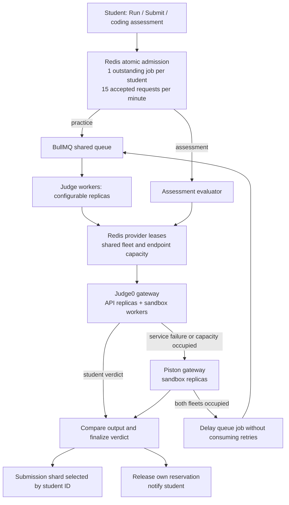

# Judge0 primary, Piston fallback

CodeSkill sends each test case to Judge0 first. A transport error, unhealthy sandbox, unavailable runtime, open circuit, or full primary fleet sends that test case to Piston. A compilation error, runtime error, time limit, or incorrect answer is a student verdict and does not trigger fallback. CodeSkill compares stdout against the authoritative expected answer locally; neither provider receives expected answers. Hidden results remain redacted before storage and WebSocket delivery.



## Local Docker setup

The local judges run in separate dedicated Colima VMs. Judge0 1.13.1 uses cgroup v1; Piston uses cgroup v2. Only each judge's configuration folder is mounted into its VM. Application source, application PostgreSQL, submission shards, credentials, and the application Redis are not mounted into the execution hosts. Compose networks deny outbound traffic during student execution, and Piston's public gateway blocks package-management routes. Upstream sandbox containers need privileged access; isolation therefore includes the dedicated VM/host, not just Docker.

On this Mac the VM disk images are stored under `/Volumes/ps5/codeskill-judges/vm-disks`. Keep the drive connected while the VMs run; stop both profiles before disconnecting it or ejecting the drive. Disconnecting an active disk can cause guest I/O errors. Their sockets and control files stay on the internal filesystem because the drive uses exFAT. Existing Colima disk paths point to the verified external images.

Actual local smoke tests showed compilation and JVM startup exceeding native-host budgets under x86 emulation. The local backend uses `JUDGE_TIME_LIMIT_MULTIPLIER=5` (within the hard provider caps), Piston run/compile limits of 10/120 seconds, a 145-second Piston HTTP deadline, and Judge0 request/submission deadlines of 15/180 seconds. Judge0 sandbox workers allow 120 seconds for compilation; backend student execution remains capped at ten seconds. Local Judge0 polling is 1.5 seconds, with a one-second worker idle interval, to reduce emulation overhead. Piston's local Compose environment sets `PISTON_RUN_TIMEOUT_MS=10000` and `PISTON_COMPILE_TIMEOUT_MS=120000`. Native production hosts should use multiplier 1 and measured normal compiler budgets as shown in the environment example. Returned timing measurements are actual execution times. Judge0's server compilation file cap allows compiled artifacts up to 32 MiB while submitted run output remains bounded to 64 KiB.

Piston replicas use a private cgroup namespace and the supplied startup script. This avoids upstream's shared-directory collision and keeps job cgroups inside each replica's Docker limits. Only the gateways join the ingress bridge; execution services remain on the internal sandbox network. This allows localhost port publication without permitting sandbox network access.

```bash
# Repeat starts preserve the VM state and its cgroup settings.
colima start codeskill-judge0 --activate=false --ssh-agent=false --ssh-config=false
colima start codeskill-piston --activate=false --ssh-agent=false --ssh-config=false
node scripts/judges/configure.mjs

# These wrappers select the correct daemon and a separate Docker CLI config.
bash scripts/judges/local.sh judge0 pull
bash scripts/judges/local.sh piston pull
bash scripts/judges/local.sh judge0 up -d --scale judge0-worker=2
bash scripts/judges/local.sh piston up -d --scale piston=2
```

Before enabling execution, pin `JUDGE0_IMAGE` and `PISTON_IMAGE` in the ignored `.local-dev/judges-<provider>/compose.env` to the pulled `repository@sha256:...` digest. Generated Judge0 authentication/database/Redis secrets live in `.local-dev/judges-judge0/judge0.conf` with file mode 600. Configuration creates an immutable container-readable copy inside the mode-700 directory because Judge0 runs under a different uid. Its filename contains a content hash, and `JUDGE0_CONTAINER_CONFIG` selects it. After editing the private source, run configuration and `up -d` so Compose recreates the affected mounts. A container restart alone can retain an old file inode. Secrets are preserved on repeated configuration runs.

Piston initially has no runtimes. Provision a reviewed manifest through the temporary `deployment/judges/piston.provision.yaml` override, using one replica and no student traffic. Its readonly `/codeskill-provision` mount contains `provision.mjs` and the exact package manifest. Run the installer inside that container with `PISTON_TRUSTED_PROVISIONING=yes` and `PISTON_PROVISION_URL=http://127.0.0.1:2000/api/v2`, then save the verified registry report. The manifest maps frontend languages to package names, versions, and runtime names; C and C++ may share one GCC package. The installer deduplicates shared packages. Restore the sealed network before starting both replicas; keep the packages volume. Copy the report's `versions` into `PISTON_RUNTIME_VERSIONS` on every API and judge worker.

`bash scripts/judges/provision-local.sh <manifest.json>` automates the temporary override, installer, registry verification, and sealed-network restoration, preserving the packages volume. It restores the sealed setup even if installation fails. Manifest format: `[{"frontendLanguage":"python","package":"python","version":"<exact-semver>","runtimeLanguage":"python"}]`. Keep the original manifest for reproducible deployment.

The provisioning wrapper also applies reviewed runtime scripts: Java 15 compiles with `javac` before running the compiled class, so compilation has its own budget; TypeScript 5 uses pinned `@types/node@18.15.3` declarations for stdin/file APIs and skips checking trusted declaration files while still checking student source. The archive checksum is verified before extraction, and npm lifecycle scripts are disabled. These scripts live in `scripts/judges/patch-runtimes.cjs` and are applied before the packages volume becomes readonly. Initial Judge0 worker startup can take several minutes under x86 emulation; inspect each worker process for `resque ... Waiting for 1.13.1` and use live execution checks for readiness.

Judge0 1.13.1's `/workers` endpoint calls Resque's process-based pruning inside the API container. With separate PID namespaces this can unregister a live worker in another container, making its count unreliable. CodeSkill checks language/runtime endpoints and uses its own Redis capacity leases; it does not call `/workers`. Inspect Docker processes or read the judge Redis worker registry directly for fleet diagnostics.

Judge0's TypeScript 3.7 compiler similarly needs Node declarations. Configuration obtains checksum-pinned `@types/node@12.12.25`, matching its Node 12 runtime. Each worker mounts these readonly and installs a CLI wrapper that invokes the original vendor compiler with `--skipLibCheck` and an explicit type root. Student source remains type checked; standard Node stdin/file imports work on both providers. Worker scripts also use content-addressed filenames so Compose reloads changed bind mounts.

## Environment settings

The complete execution settings are in [`deployment/judges/backend.env.example`](../../deployment/judges/backend.env.example). Append them to `backend-nestjs/.env`, preserving database, sharding, authentication, and pet settings. Set the generated `JUDGE0_AUTH_TOKEN` server-side. The frontend needs no judge URL or key.

| Setting | Local value | Purpose |
| --- | --- | --- |
| `CODE_EXECUTION_PROVIDER` | `judge0` | Primary Judge0 with Piston fallback; this is also the default |
| `JUDGE0_BASE_URL` | `http://127.0.0.1:2358` | Judge0 gateway |
| `JUDGE0_AUTH_TOKEN` | Generated `AUTHN_TOKEN` | Self-hosted Judge0 authentication |
| `PISTON_BASE_URL` | `http://127.0.0.1:2001/api/v2` | Piston gateway |
| `PISTON_RUNTIME_VERSIONS` | Verified JSON map | Exact installed fallback runtimes; `{}` disables all |
| `MAX_CONCURRENT_JOBS_PER_USER` | `1` | Shared limit for queued/running Run, Submit, and coding assessments |
| `SUBMISSION_RATE_LIMIT_PER_MINUTE` | `15` | Redis sliding window for accepted requests |
| `MAX_QUEUE_WAITING` | `500` | Global outstanding reservation cap, including active work |
| `WORKER_CONCURRENCY` | `2` | Jobs handled per BullMQ worker |
| `JUDGE_TEST_CASE_CONCURRENCY` | `2` | Maximum simultaneous test cases per Judge0 submission |
| `EXECUTION_JOB_LEASE_MS` | `900000` | Reservation expiry and maximum queue age |
| `EXECUTION_HEARTBEAT_MS` | `15000` | Renew a claimed job while execution is active |

Launch API processes with `PROCESS_ROLE=api` and judge workers with `PROCESS_ROLE=judge`. `ENABLE_EMBEDDED_JUDGE=false` prevents an extra judge worker in the API. Restart both after changing execution settings.

## Scaling for deployment

Compose supports horizontal replicas without fixed container names. Judge0 API replicas share its own database/Redis and token polling can use any API replica. Each Judge0 replica runs one Resque worker directly, with graceful `SIGQUIT` shutdown; adding replicas increases sandbox slots. The nested worker manager and scheduler are omitted: Judge0 jobs are immediate, while CodeSkill's BullMQ owns delays/retries. This reduces startup CPU and memory, particularly under emulation. Piston replicas share the installed packages volume and keep their execution jobs separate. Nginx uses Docker DNS and least connections to discover replica addresses.

```bash
# Increase dedicated-host resources before increasing replicas.
bash scripts/judges/local.sh judge0 up -d --scale judge0-api=2 --scale judge0-worker=4
bash scripts/judges/local.sh piston up -d --scale piston=4

# Application judge workers can scale independently; restart with updated env.
JUDGE_WORKER_INSTANCES=4 pm2 start ecosystem.config.js --only codeskill-worker
```

For dedicated Linux hosts use `docker compose --env-file <host-compose.env> -f deployment/judges/<provider>.compose.yaml ...` instead of the Mac wrapper. Set `JUDGE_CONFIG_DIR` to that host's generated configuration directory, use immutable images, and put the gateways on the private network. Adjust gateway bind addresses/firewall rules explicitly for private-host access; local Compose publishes loopback only. The 3 GiB local VM settings are development sizing, not a production capacity recommendation. Size memory/CPU and run load tests before setting production caps. Judge0 and Piston hosts should have no application/cloud credentials and no unrestricted access to internal services.

Use `JUDGE0_BASE_URLS` / `PISTON_BASE_URLS` JSON arrays for up to eight independent private endpoints per provider. Arrays take precedence over a single URL. Every API and worker must use the same endpoint list, credentials, runtime pins, and Redis connection. For two eight-slot endpoints, set that provider's `GLOBAL_MAX_CONCURRENT=16` and `NODE_MAX_CONCURRENT=8`. When one URL fronts several replicas, its node limit describes the whole gateway's capacity. The per-process `MAX_CONCURRENT_EXECUTIONS` bounds local HTTP activity. Keep the global and node caps within the measured available sandbox capacity.

The shared Redis leases select the least occupied eligible endpoint. Per-process circuit breakers skip repeatedly failing endpoints and probe recovery after cooldown. Metadata health checks do not reset an execution circuit. Lease IDs are unique: late cleanup cannot remove a newer request's capacity slot. Redis outage rejects new executions rather than allowing unbounded work. Scaling is configurable horizontal replication and load balancing; cloud autoscaling infrastructure remains a deployment task.

## Submission rules and failure handling

- Practice requests reserve atomically after validation, before database persistence/queue insertion. Simultaneous requests across API instances share the same allowance. Identical outstanding payloads return 409; other requests over user/rate limits return 429, and a full global queue returns 503. Requests rejected by admission do not consume the sliding-window quota. Coding assessment evaluation reserves the same user allowance before evaluating the attempt.
- Run and Submit use a unique reservation ID as the BullMQ job ID. Worker ownership and heartbeats retain the reservation through retries. Successful completion, terminal failure, queue insertion failure, and queued cancellation release only that job's reservation.
- Running submissions cannot be cancelled. A failed queue removal leaves their reservation intact. Stalled duplicate workers delay until the original ownership is released/expired, without consuming execution retries.
- If both healthy fleets are full, a practice job waits in BullMQ with jitter and keeps the student's slot. Infrastructure outages use bounded retries; final outages become a system error, not an incorrect answer. Coding assessment service failures preserve the attempt for retry.
- All in-flight test cases finish or time out before a failing submission releases its reservation. Queued jobs older than the configured lease duration expire. Leases also recover capacity if a process dies. Submission row locks prevent duplicate scoring on job replay.
- Judge0 uses asynchronous submissions. A lost connection after acceptance can leave a sandbox execution running while Piston handles fallback. Sandbox worker limits still apply, and only one stored verdict is committed. Judge versions differ, so use common language features and maintain cross-provider problem smoke tests.

## Validation

```bash
cd backend-nestjs
npm run build
npm test -- --watchman=false --runInBand --testTimeout=30000
npm run test:judges:integration
npm run test:shards:integration
```

Unit tests verify asynchronous Judge0 payloads/polling, measurements and verdicts, fallback and no-fallback cases, provider circuits, queue insertion failure, cancellation races, capacity deferral, and reservation ownership. The Redis integration uses randomly namespaced keys and checks 30 simultaneous admissions, duplicates, rate/global limits, cross-worker endpoint capacity, and late lease release. The sharding integration uses disposable databases and verifies that queue processing still routes persisted results correctly.

Use `scripts/piston/smoke.mjs` against the verified registry and `npm run test:judges:live` for actual Docker execution. The live test checks six languages on each provider, primary preference, real primary endpoint failure/fallback, and verdict consistency. Live sandbox tests are distinct from mock transport and Redis tests.

Primary references: [Judge0 API](https://ce.judge0.com/), [Judge0 1.13.1 release](https://github.com/judge0/judge0/releases/tag/v1.13.1), [Piston](https://github.com/engineer-man/piston), [Colima profiles](https://colima.run/docs/profiles/).
