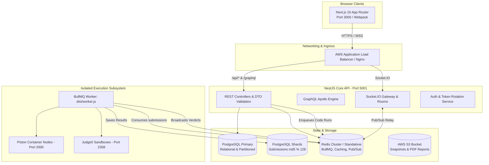
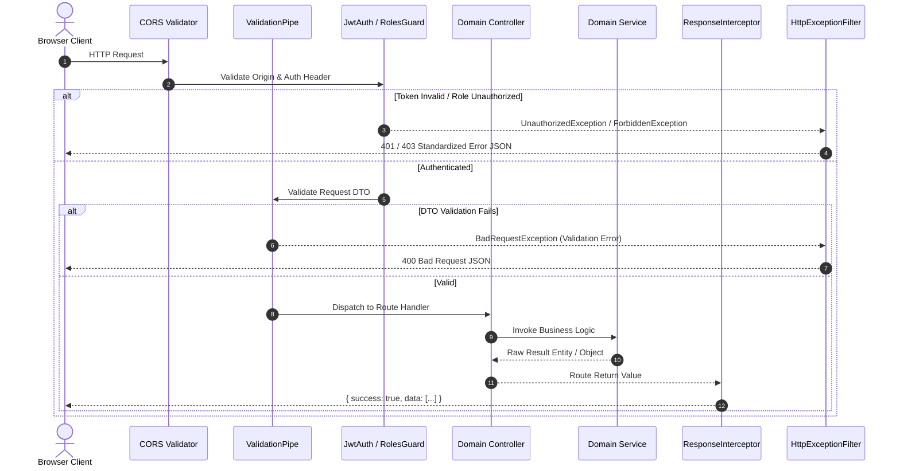
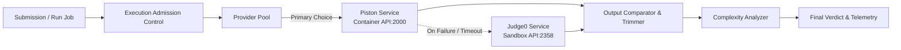

# CodeSkill System Architecture & Technical Design

> **Ground-Truth Audit Document**  
> Source of truth: Monorepo code on `origin/main`. Covers system design, request lifecycles, dual sandbox execution engines, consistent sharding, real-time Cheating Radar, and the multi-tenant RBAC security matrix.

---

## Table of Contents

- [1. Monorepo High-Level Architecture](#1-monorepo-high-level-architecture)
- [2. Request & Response Lifecycle](#2-request--response-lifecycle)
- [3. Dual Code Execution Engine (Judge0 + Piston)](#3-dual-code-execution-engine-judge0--piston)
- [4. 128-Bucket Submission Sharding Engine](#4-128-bucket-submission-sharding-engine)
- [5. Declarative Audit Partitioning & Cheating Radar](#5-declarative-audit-partitioning--cheating-radar)
- [6. Multi-Tenant Role-Based Access Control (RBAC) Matrix](#6-multi-tenant-role-based-access-control-rbac-matrix)

---

## 1. Monorepo High-Level Architecture

CodeSkill is composed of two primary application packages and dedicated infrastructure modules:



---

## 2. Request & Response Lifecycle

Incoming HTTP requests traverse a standardized NestJS pipeline:



- **Global Middleware:** Raw and JSON body parsers with a 50MB payload limit (`backend-nestjs/src/main.ts`).
- **CORS:** Dynamic origin verification via `resolveAllowedCorsOrigins()` in `common/cors.util.ts`.
- **Validation Pipe:** Global `ValidationPipe` with `transform: true` and `whitelist: true` strips unvalidated fields.
- **Response Interceptor:** `common/interceptors/response.interceptor.ts` standardizes response envelopes.
- **Exception Filter:** `common/filters/http-exception.filter.ts` catches all HTTP and unhandled exceptions, sanitizing internal error stacks.

---

## 3. Dual Code Execution Engine (Judge0 + Piston)

CodeSkill implements an isolated, high-resilience code execution pipeline with active failover:



1. **Admission Control (`execution-admission.service.ts`):**
   - Global execution concurrency limit: Default 50.
   - Queue depth throttle: Max 1,000 pending execution requests before shedding non-assessment runs.
2. **Provider Pool (`provider-pool.ts`):**
   - Maintains a health-checked pool of execution endpoints with round-robin load distribution.
   - Automatic failover: If Piston experiences connectivity drops or timeouts, submissions automatically fall back to Judge0.
3. **Language Adapters (`language-adapters.ts`):**
   - Normalizes compilers and runtimes for C (`gcc`), C++ (`g++`), Java (`openjdk`), Python (`python3`), JavaScript (`node`), and Go.
   - Injects student solutions into test harness templates.
4. **Output Comparison (`output-comparison.ts`):**
   - Evaluates outputs against testcase standards using exact match, whitespace-trimmed, case-insensitive, or float-tolerance algorithms.
5. **Complexity Analyzer (`complexity-analyzer.ts`):**
   - AST-based pattern analyzer estimating time and space complexity ($O(1)$, $O(\log N)$, $O(N)$, $O(N^2)$) to flag brute-force submissions.

---

## 4. 128-Bucket Submission Sharding Engine

To prevent database contention during campus-wide assessment surges, submissions are distributed across isolated PostgreSQL instances:

- **Consistent Hash Algorithm:**
  ```typescript
  bucket = md5(userId.toLowerCase()).readUInt32BE(0) % 128
  ```
- **Routing Layer (`SubmissionStore` in `src/database/sharding/submission-store.ts`):**
  - Maps each of the 128 buckets to a physical database shard.
  - Read and write operations take `userId` as an essential parameter to route queries directly to the target shard.
  - If no shards are configured (`SUBMISSION_SHARDS` unset), queries fall back transparently to the primary PostgreSQL database.

---

## 5. Declarative Audit Partitioning & Cheating Radar

### Monthly Range Partitioning
- Applied to `audit_logs` and `submissions` using PostgreSQL declarative partitioning (`declarative-partitioning.ts`).
- Automatically creates rolling monthly tables (e.g., `audit_logs_y2026m10`, `audit_logs_y2026m11`).

### Cheating Radar Service (`cheating-radar.service.ts`)
- **Sliding Window Analytics:**
  - In-memory 10-minute sliding window tracking active IP addresses per student.
  - 3-minute sliding window detecting rapid violation bursts (tab switches, fullscreen exits, devtools openings).
- **Anomaly Detection Types:**
  - `MULTI_IP_SAME_STUDENT`: Student submitting from multiple distinct network IPs simultaneously.
  - `VIOLATION_BURST`: More than 5 proctoring violations recorded in under 3 minutes.
  - `BROWSER_INTEGRITY_TAMPER`: DevTools opened or screen capture disabled.
- **Alert Webhook Dispatcher (`alert-webhook.service.ts`):**
  - Formats and dispatches incident payloads to Discord, Slack, and WhatsApp relays with HMAC SHA-256 signatures.

---

## 6. Multi-Tenant Role-Based Access Control (RBAC) Matrix

CodeSkill defines strict role boundaries across university, corporate, and administrative users:

| System Role | Target Persona | Scope of Permissions |
| :--- | :--- | :--- |
| `super_admin` | Platform Owners | Unrestricted access across all tenants, system settings, global analytics, and user account management. |
| `admin` | Institutional Administrators | Full administrative control over university assessments, contests, question banks, and student records. |
| `student_admin` | Student Coordinators | Permissions to import students, reset credentials, and audit student rosters. |
| `assessment_admin` | Exam Officers | Restricted to creating, scheduling, and monitoring assessments and reviewing proctoring logs. |
| `university_admin` | University Dean / Director | Read and report access across university cohorts, batches, and candidate results. |
| `teacher` | Faculty & Instructors | Creation and management of classroom problems, question banks, learning modules, and batch performance. |
| `company` / `recruiter` | Corporate Partners | Management of job listings, candidate applications, and recruitment coding assessments. |
| `student` | Learners & Candidates | Standard access: taking assessments, practicing problems, enrolled courses, certificates, and personal profile. |