# CodeSkill Backend Modules & Service Architecture

> **Ground-Truth Audit Document**  
> Source of truth: NestJS modules, providers, controllers, and background processors on `origin/main`. Covers 100% of modules, services, queues, PDF generators, and utility libraries.

---

## Table of Contents

- [1. Architectural Overview & Module Tree](#1-architectural-overview--module-tree)
- [2. Comprehensive Module Catalog](#2-comprehensive-module-catalog)
- [3. BullMQ Queue Processors & Background Workers](#3-bullmq-queue-processors--background-workers)
- [4. Guards, Interceptors, Filters & Decorators](#4-guards-interceptors-filters--decorators)
- [5. PDF Report & Certificate Generation Engine](#5-pdf-report--certificate-generation-engine)
- [6. Shared Core Utilities](#6-shared-core-utilities)

---

## 1. Architectural Overview & Module Tree

The backend is structured as a modular NestJS monolith with clear domain boundaries:

```mermaid
graph TD
    AppModule --> DatabaseModule
    AppModule --> RedisModule
    AppModule --> AuthModule
    AppModule --> GatewayModule
    AppModule --> AssessmentsModule
    AppModule --> ContestsModule
    AppModule --> ProblemsModule
    AppModule --> QuestionsModule
    AppModule --> SubmissionsModule
    AppModule --> ExecutionModule
    AppModule --> AuditModule
    AppModule --> ExamSecurityModule
    AppModule --> LearningModule
    AppModule --> AdminModule
    AppModule --> BugsModule
    AppModule --> StudentsModule
    AppModule --> UsersModule
    AppModule --> HealthModule
```

---

## 2. Comprehensive Module Catalog

### `AdminModule`
- **File:** `backend-nestjs/src/admin/admin.module.ts`
- **Imported Modules:** `SubmissionShardingModule`, `AuthModule`, `TypeOrmModule.forFeature([       User`, `Problem`, `ProblemMetadata`, `ProblemStatement`, `ProblemConfig`, `ProblemTestCase`, `Contest`, `ContestAttempt`, `ContestReattemptGrant`, `Company`, `University`, `Submission`, `Assessment`, `Question`
- **Registered Controllers:** `AdminDashboardController`, `AdminUsersController`, `AdminProblemsController`, `AdminContestsController`, `AdminCompaniesController`, `AdminUniversitiesController`, `AdminActivityController`
- **Registered Providers:** `AdminService`
- **Exported Symbols:** `AdminService`

---

### `AnalyticsModule`
- **File:** `backend-nestjs/src/analytics/analytics.module.ts`
- **Imported Modules:** `forwardRef(() => AssessmentsModule)`, `TypeOrmModule.forFeature([       AssessmentAttempt`, `Assessment`, `Question`, `ExamSecurityEvent`, `AuditLog`, `User`, `Submission`
- **Registered Controllers:** `AnalyticsController`
- **Registered Providers:** `AnalyticsService`
- **Exported Symbols:** None

---

### `AppModule`
- **File:** `backend-nestjs/src/app.module.ts`
- **Imported Modules:** `ConfigModule.forRoot({       isGlobal: true`, `load: [         appConfig`, `databaseConfig`, `redisConfig`, `jwtConfig`, `awsConfig`, `oauthConfig`, `adminConfig`
- **Registered Controllers:** `AppController`
- **Registered Providers:** `AppService`, `{       provide: APP_GUARD`, `useClass: SmartThrottlerGuard`, `}`, `{       provide: APP_FILTER`, `useClass: HttpExceptionFilter`, `}`, `{       provide: APP_INTERCEPTOR`, `useClass: ResponseInterceptor`, `}`, `{       provide: APP_INTERCEPTOR`, `useClass: LoggingInterceptor`, `}`
- **Exported Symbols:** None

---

### `AssessmentsModule`
- **File:** `backend-nestjs/src/assessments/assessments.module.ts`
- **Imported Modules:** `ExecutionModule`, `BullModule.registerQueue({ name: 'submissions' })`, `S3Module`, `TypeOrmModule.forFeature([       Assessment`, `AssessmentAttempt`, `Question`, `AuditLog`, `User`
- **Registered Controllers:** `AssessmentsAdminController`, `AssessmentsStudentController`
- **Registered Providers:** `AssessmentsService`
- **Exported Symbols:** `AssessmentsService`

---

### `AuditModule`
- **File:** `backend-nestjs/src/audit/audit.module.ts`
- **Imported Modules:** `TypeOrmModule.forFeature([AuditLog`
- **Registered Controllers:** None
- **Registered Providers:** `ActivityLogService`, `AlertWebhookService`, `CheatingRadarService`
- **Exported Symbols:** `ActivityLogService`, `AlertWebhookService`, `CheatingRadarService`

---

### `AuthModule`
- **File:** `backend-nestjs/src/auth/auth.module.ts`
- **Imported Modules:** `S3Module`, `TypeOrmModule.forFeature([UserEntity`, `RefreshToken`
- **Registered Controllers:** `AuthController`
- **Registered Providers:** `AuthService`, `JwtStrategy`, `TokenService`, `LoginThrottleService`
- **Exported Symbols:** `JwtStrategy`, `PassportModule`, `TokenService`, `AuthService`

---

### `BugsModule`
- **File:** `backend-nestjs/src/bugs/bugs.module.ts`
- **Imported Modules:** `TypeOrmModule.forFeature([BugReport`, `BugImage`, `BugComment`, `BugActivity`
- **Registered Controllers:** `BugsController`
- **Registered Providers:** `BugsService`
- **Exported Symbols:** None

---

### `CampusModule`
- **File:** `backend-nestjs/src/campus/campus.module.ts`
- **Imported Modules:** `TypeOrmModule.forFeature([       University`, `UniversityUser`, `Batch`, `StudentEnrollment`, `User`
- **Registered Controllers:** `CampusController`
- **Registered Providers:** `CampusService`
- **Exported Symbols:** `CampusService`

---

### `CompaniesModule`
- **File:** `backend-nestjs/src/companies/companies.module.ts`
- **Imported Modules:** `TypeOrmModule.forFeature([Company`, `Job`, `CompanyUser`, `Application`
- **Registered Controllers:** `CompaniesController`, `CompanyController`
- **Registered Providers:** `CompaniesService`
- **Exported Symbols:** `CompaniesService`

---

### `ContestsModule`
- **File:** `backend-nestjs/src/contests/contests.module.ts`
- **Imported Modules:** `SubmissionShardingModule`, `ProblemsModule`, `TypeOrmModule.forFeature([       Contest`, `ContestAttempt`, `ContestReattemptGrant`, `Question`, `ProblemMetadata`
- **Registered Controllers:** `ContestsController`
- **Registered Providers:** `ContestsService`
- **Exported Symbols:** `ContestsService`

---

### `DatabaseModule`
- **File:** `backend-nestjs/src/database/database.module.ts`
- **Imported Modules:** `TypeOrmModule.forRootAsync({       inject: [ConfigService`
- **Registered Controllers:** None
- **Registered Providers:** `DatabaseAutoMigrationService`
- **Exported Symbols:** `TypeOrmModule`, `DatabaseAutoMigrationService`

---

### `SubmissionShardingModule`
- **File:** `backend-nestjs/src/database/sharding/sharding.module.ts`
- **Imported Modules:** `TypeOrmModule.forFeature([Submission`, `User`
- **Registered Controllers:** None
- **Registered Providers:** `SubmissionShardRegistry`, `SubmissionStore`
- **Exported Symbols:** `SubmissionStore`, `SubmissionShardRegistry`

---

### `DiscussionsModule`
- **File:** `backend-nestjs/src/discussions/discussions.module.ts`
- **Imported Modules:** `TypeOrmModule.forFeature([Discussion`, `DiscussionReply`
- **Registered Controllers:** `DiscussionsController`
- **Registered Providers:** `DiscussionsService`
- **Exported Symbols:** `DiscussionsService`

---

### `EmailModule`
- **File:** `backend-nestjs/src/emails/email.module.ts`
- **Imported Modules:** None
- **Registered Controllers:** None
- **Registered Providers:** `EmailService`
- **Exported Symbols:** `EmailService`

---

### `ExamSecurityModule`
- **File:** `backend-nestjs/src/exam-security/exam-security.module.ts`
- **Imported Modules:** `TypeOrmModule.forFeature([Assessment`, `ExamSession`, `ExamSecurityEvent`
- **Registered Controllers:** `ExamSecurityController`
- **Registered Providers:** `ExamSecurityService`
- **Exported Symbols:** `ExamSecurityService`

---

### `ExecutionAdmissionModule`
- **File:** `backend-nestjs/src/execution/admission/execution-admission.module.ts`
- **Imported Modules:** `RedisModule`
- **Registered Controllers:** None
- **Registered Providers:** `ExecutionAdmissionService`
- **Exported Symbols:** `ExecutionAdmissionService`

---

### `ExecutionModule`
- **File:** `backend-nestjs/src/execution/execution.module.ts`
- **Imported Modules:** `ExecutionAdmissionModule`, `SubmissionShardingModule`, `TypeOrmModule.forFeature([Submission`, `User`
- **Registered Controllers:** `ExecutionController`
- **Registered Providers:** `ExecutionService`, `PistonService`, `Judge0Service`, `SubmissionRateLimitGuard`, `...judgeProviders`
- **Exported Symbols:** `ExecutionService`

---

### `GatewayModule`
- **File:** `backend-nestjs/src/gateway/gateway.module.ts`
- **Imported Modules:** `AuthModule`, `TypeOrmModule.forFeature([Contest`
- **Registered Controllers:** None
- **Registered Providers:** `AppGateway`
- **Exported Symbols:** `AppGateway`

---

### `HealthModule`
- **File:** `backend-nestjs/src/health/health.module.ts`
- **Imported Modules:** None
- **Registered Controllers:** `HealthController`
- **Registered Providers:** `HealthResolver`
- **Exported Symbols:** None

---

### `LearningModule`
- **File:** `backend-nestjs/src/learning/learning.module.ts`
- **Imported Modules:** `TypeOrmModule.forFeature([       LearningPath`, `LearningPathCourse`, `Course`, `CourseModule`, `Lesson`, `CourseExercise`, `LearningEnrollment`, `LessonProgress`, `CourseProgress`, `PathProgress`, `XPLedger`, `BadgeDefinition`, `StudentBadge`, `CertificateTemplate`, `Certificate`, `CertificateEvent`, `User`, `Problem`, `Submission`
- **Registered Controllers:** `LearningController`, `AdminLearningController`, `CertificateVerificationController`
- **Registered Providers:** `LearningService`, `PracticeService`, `GamificationService`, `CertificationService`, `AdminLearningService`, `LearningAutoSeedService`
- **Exported Symbols:** `LearningService`, `PracticeService`, `GamificationService`, `CertificationService`, `AdminLearningService`, `LearningAutoSeedService`

---

### `StructuredLoggerModule`
- **File:** `backend-nestjs/src/observability/logger/logger.module.ts`
- **Imported Modules:** `PinoLoggerModule.forRootAsync({       useFactory: () => {         const targets: any[`
- **Registered Controllers:** None
- **Registered Providers:** None
- **Exported Symbols:** `PinoLoggerModule`

---

### `ObservabilityModule`
- **File:** `backend-nestjs/src/observability/observability.module.ts`
- **Imported Modules:** `StructuredLoggerModule`
- **Registered Controllers:** `MetricsController`, `HealthAndTelemetryController`
- **Registered Providers:** `RequestContextService`, `MetricsService`, `SandboxTelemetryService`, `{       provide: APP_INTERCEPTOR`, `useClass: HttpMetricsInterceptor`, `}`, `{       provide: APP_INTERCEPTOR`, `useClass: WsCorrelationInterceptor`, `}`
- **Exported Symbols:** `RequestContextService`, `MetricsService`, `SandboxTelemetryService`, `StructuredLoggerModule`

---

### `PetModule`
- **File:** `backend-nestjs/src/pet/pet.module.ts`
- **Imported Modules:** `ProblemsModule`
- **Registered Controllers:** `PetController`
- **Registered Providers:** `PetService`
- **Exported Symbols:** None

---

### `ProblemsModule`
- **File:** `backend-nestjs/src/problems/problems.module.ts`
- **Imported Modules:** `TypeOrmModule.forFeature([ProblemEntity`, `ProblemMetadata`, `Question`
- **Registered Controllers:** `ProblemsController`
- **Registered Providers:** `ProblemsService`
- **Exported Symbols:** `ProblemsService`

---

### `QuestionsModule`
- **File:** `backend-nestjs/src/questions/questions.module.ts`
- **Imported Modules:** `DatabaseModule`, `RedisModule`
- **Registered Controllers:** `QuestionsController`, `QuestionBanksController`
- **Registered Providers:** `QuestionsService`
- **Exported Symbols:** `QuestionsService`

---

### `RedisModule`
- **File:** `backend-nestjs/src/redis/redis.module.ts`
- **Imported Modules:** `EmailModule`
- **Registered Controllers:** None
- **Registered Providers:** `RedisService`, `CacheService`, `OtpService`, `ThrottlerRedisStorageService`
- **Exported Symbols:** `RedisService`, `CacheService`, `OtpService`, `ThrottlerRedisStorageService`

---

### `ReportsModule`
- **File:** `backend-nestjs/src/reports/reports.module.ts`
- **Imported Modules:** `TypeOrmModule.forFeature([AssessmentAttempt`, `Assessment`, `Question`
- **Registered Controllers:** `ReportsController`
- **Registered Providers:** None
- **Exported Symbols:** None

---

### `S3Module`
- **File:** `backend-nestjs/src/s3/s3.module.ts`
- **Imported Modules:** None
- **Registered Controllers:** None
- **Registered Providers:** `S3Service`
- **Exported Symbols:** `S3Service`

---

### `StudentsModule`
- **File:** `backend-nestjs/src/students/students.module.ts`
- **Imported Modules:** `DatabaseModule`, `EmailModule`, `TypeOrmModule.forFeature([User`, `AuditLog`, `EmailJob`
- **Registered Controllers:** `StudentsController`
- **Registered Providers:** `StudentsService`, `CredentialEmailProcessor`
- **Exported Symbols:** `StudentsService`

---

### `SubmissionsModule`
- **File:** `backend-nestjs/src/submissions/submissions.module.ts`
- **Imported Modules:** `SubmissionShardingModule`, `TypeOrmModule.forFeature([Submission`, `User`
- **Registered Controllers:** `SubmissionsController`
- **Registered Providers:** `SubmissionsService`
- **Exported Symbols:** `SubmissionsService`

---

### `UsersModule`
- **File:** `backend-nestjs/src/users/users.module.ts`
- **Imported Modules:** `TypeOrmModule.forFeature([UserEntity`, `ProblemEntity`
- **Registered Controllers:** `UsersController`
- **Registered Providers:** `UsersService`
- **Exported Symbols:** `UsersService`

---

## 3. BullMQ Queue Processors & Background Workers

CodeSkill defines two dedicated BullMQ queue processors:

### 1. `JudgeProcessor` (`backend-nestjs/src/execution/judge.processor.ts`)
- **Queue Name:** `submissions`
- **Concurrency:** Governed by `WORKER_CONCURRENCY` (Default: `4`).
- **Responsibilities:**
  - Dequeues student code submissions.
  - Routes execution through `ExecutionService` (Piston / Judge0).
  - Redacts hidden testcases and reference solutions before emitting live WebSocket telemetry.
  - Updates submission records on physical shards via `SubmissionStore`.
  - Updates student user statistics (`totalSubmissions`, `acceptedSubmissions`) via atomic SQL operations.

### 2. `CredentialEmailProcessor` (`backend-nestjs/src/students/credential-email.processor.ts`)
- **Queue Name:** `credential-email`
- **Responsibilities:**
  - Batches and dispatches automated student onboarding credentials and password-reset emails.
  - Integrates with AWS Simple Email Service (SES) with exponential backoff and rate-limit smoothing.

---

## 4. Guards, Interceptors, Filters & Decorators

| Name | Type | Source File | Purpose |
| :--- | :--- | :--- | :--- |
| `JwtAuthGuard` | Guard | `src/common/guards/jwt-auth.guard.ts` | Validates Bearer access tokens and attaches authenticated user entity to `req.user`. |
| `RolesGuard` | Guard | `src/common/guards/roles.guard.ts` | Enforces RBAC permissions declared via `@Roles(...)`. |
| `LocalAuthGuard` | Guard | `src/auth/strategies/local.strategy.ts` | Authenticates username/email + password during login. |
| `OptionalJwtAuthGuard` | Guard | `src/common/guards/optional-jwt-auth.guard.ts` | Allows guest access while attaching user entity if token is provided. |
| `ResponseInterceptor` | Interceptor | `src/common/interceptors/response.interceptor.ts` | Enforces `{ success: true, data: [...] }` response envelope. |
| `HttpExceptionFilter` | Filter | `src/common/filters/http-exception.filter.ts` | Standardizes error envelopes and redacts internal stack traces in production. |
| `@CurrentUser()` | Decorator | `src/common/decorators/current-user.decorator.ts` | Extracts authenticated user object from request context. |
| `@Roles(...)` | Decorator | `src/common/decorators/roles.decorator.ts` | Attaches metadata defining required roles for route execution. |
| `@Public()` | Decorator | `src/common/decorators/public.decorator.ts` | Explicitly bypasses global authentication guards. |

---

## 5. PDF Report & Certificate Generation Engine

CodeSkill utilizes `@react-pdf/renderer` (`backend-nestjs/src/reports/`) to programmatically render official, verifiable academic documents:

1. **Candidate Assessment Performance Reports (`candidate-report.tsx`):**
   - Generates standardized 2-page PDF audit reports with problem-level points, pass/fail status, proctoring penalties, and official institutional seals.
2. **Course Completion Certificates (`certificate.service.ts`):**
   - Issues cryptographically verifiable completion certificates with unique credential IDs and verification URLs (`/verify/[credentialId]`).

---

## 6. Shared Core Utilities

| Utility File | Purpose |
| :--- | :--- |
| `src/audit/client-ip.util.ts` | Robust proxy-aware client IP extraction (supporting CloudFront, AWS ALB, Nginx headers). |
| `src/audit/object-diff.util.ts` | Performs deep recursive diffing of entity modifications for administrative audit logs. |
| `src/auth/password.util.ts` | Secure Argon2/bcrypt password hashing, constant-time comparison, and entropy validation. |
| `src/common/cors.util.ts` | Resolves whitelisted origins against environment variables and prevents wildcard credentials. |