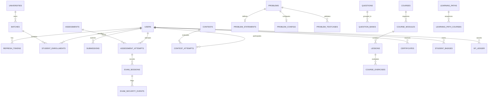

# CodeSkill Database & Sharding Reference

> **Ground-Truth Audit Document**  
> Source of truth: TypeORM entities on `origin/main`, declarative partitioning runners, and PostgreSQL submission sharding configuration. Covers 100% of tables (49 entities), columns, relations, indices, partitioning schemes, and migration runbooks.

---

## Table of Contents

- [1. Database Architecture & ER Diagram](#1-database-architecture--er-diagram)
- [2. Exhaustive Table & Entity Catalog (All 49 Tables)](#2-exhaustive-table--entity-catalog-all-49-tables)
  - [Core User & Authentication Domain](#core-user--authentication-domain)
  - [University, Campus & Company Tenant Domain](#university-campus--company-tenant-domain)
  - [Problem Bank & Question Authoring Domain](#problem-bank--question-authoring-domain)
  - [Assessments & Contest Lifecycle Domain](#assessments--contest-lifecycle-domain)
  - [Exam Security, Proctoring & Audit Domain](#exam-security-proctoring--audit-domain)
  - [Interactive Learning & Gamification Domain (16 Tables)](#interactive-learning--gamification-domain-16-tables)
  - [Submissions Domain](#submissions-domain)
  - [Bug Tracking & Activity Log Domain](#bug-tracking--activity-log-domain)
  - [Discussions & System Jobs Domain](#discussions--system-jobs-domain)
- [3. Declarative Partitioning Architecture](#3-declarative-partitioning-architecture)
- [4. 128-Bucket Submission Sharding Topology](#4-128-bucket-submission-sharding-topology)
- [5. Migration, Backfill & Schema Runbooks](#5-migration-backfill--schema-runbooks)

---

## 1. Database Architecture & ER Diagram



---

## 2. Exhaustive Table & Entity Catalog (All 49 Tables)

### Core User & Authentication Domain

#### Table: `users` (Entity: `User`)
- **Source File:** `backend-nestjs/src/database/entities/user.entity.ts`
- **Indices:** `['isAssessmentStudent']; ['role']`

| Column Name | TypeScript Type | Primary Key | Nullable | Decorator Metadata |
| :--- | :--- | :--- | :--- | :--- |
| `id` | `string` | **PK** | No | `@Entity('users')`<br>`@Index(['isAssessmentStudent'])` |
| `mongoId` | `string` | No | Yes | `@Column({ nullable: true })` |
| `name` | `string` | No | No | `@Column({ length: 50 })` |
| `username` | `string` | No | Yes | `@Column({ unique: true, nullable: true })` |
| `email` | `string` | No | No | `@Column({ unique: true })` |
| `password` | `string` | No | Yes | `@Column({ select: false, nullable: true })` |
| `type` | `'varchar',` | No | No | `@Column({` |
| `uid` | `string` | No | Yes | `@Column({ unique: true, nullable: true })` |
| `forcePasswordChange` | `boolean` | No | No | `@Column({ default: false })` |
| `isAssessmentStudent` | `boolean` | No | No | `@Column({ default: false })` |
| `mfaEnabled` | `boolean` | No | No | `@Column({ default: false })` |
| `mfaSecret` | `string` | No | Yes | `@Column({ select: false, nullable: true })` |
| `isActive` | `boolean` | No | No | `@Column({ default: true })` |
| `tokenVersion` | `number` | No | No | `@Column({ type: 'int', default: 0 })` |
| `studentProfile` | `{` | No | No | `@Column({ type: 'jsonb', default: {} })` |
| `authProvider` | `string` | No | No | `@Column({ default: 'local' })` |
| `googleId` | `string` | No | Yes | `@Column({ nullable: true })` |
| `githubId` | `string` | No | Yes | `@Column({ nullable: true })` |
| `linkedinId` | `string` | No | Yes | `@Column({ nullable: true })` |
| `avatar` | `string` | No | No | `@Column({ default: '' })` |
| `bio` | `string` | No | No | `@Column({ length: 200, default: '' })` |
| `isAdmin` | `boolean` | No | No | `@Column({ default: false })` |
| `profile` | `{` | No | No | `@Column({ type: 'jsonb', default: {} })` |
| `stats` | `{` | No | No | `@Column({ type: 'jsonb', default: {} })` |
| `solvedProblems` | `string[]` | No | No | `@Column('text', { array: true, default: '{}' })` |
| `bookmarkedProblems` | `string[]` | No | No | `@Column('text', { array: true, default: '{}' })` |
| `badges` | `{` | No | No | `@Column({ type: 'jsonb', default: [] })` |
| `activityMap` | `Record<string, number>` | No | No | `@Column({ type: 'jsonb', default: {} })` |
| `notes` | `Record<string, string>` | No | No | `@Column({ type: 'jsonb', default: {} })` |
| `lastActive` | `Date` | No | No | `@Column({ type: 'timestamp', default: () => 'CURRENT_TIMESTAMP' })` |
| `lastSolveDate` | `Date` | No | Yes | `@Column({ type: 'timestamp', nullable: true })` |
| `createdAt` | `Date` | No | No | `@CreateDateColumn()` |
| `updatedAt` | `Date` | No | No | `@UpdateDateColumn()` |

---

#### Table: `refresh_tokens` (Entity: `RefreshToken`)
- **Source File:** `backend-nestjs/src/database/entities/refresh-token.entity.ts`
- **Indices:** `['userId']; ['familyId']; { unique: true }`

| Column Name | TypeScript Type | Primary Key | Nullable | Decorator Metadata |
| :--- | :--- | :--- | :--- | :--- |
| `id` | `string` | **PK** | No | `@Entity('refresh_tokens')`<br>`@Index(['userId'])` |
| `userId` | `string` | No | No | `@Column({ type: 'uuid' })` |
| `tokenHash` | `string` | No | No | `@Index({ unique: true })`<br>`@Column({ type: 'varchar', length: 64 })` |
| `familyId` | `string` | No | No | `@Column({ type: 'uuid' })` |
| `expiresAt` | `Date` | No | No | `@Column({ type: 'timestamptz' })` |
| `revokedAt` | `Date | null` | No | Yes | `@Column({ type: 'timestamptz', nullable: true })` |
| `replacedById` | `string | null` | No | Yes | `@Column({ type: 'uuid', nullable: true })` |
| `createdAt` | `Date` | No | No | `@CreateDateColumn({ type: 'timestamptz' })` |

---

### University, Campus & Company Tenant Domain

#### Table: `universities` (Entity: `University`)
- **Source File:** `backend-nestjs/src/database/entities/university.entity.ts`

| Column Name | TypeScript Type | Primary Key | Nullable | Decorator Metadata |
| :--- | :--- | :--- | :--- | :--- |
| `id` | `string` | **PK** | No | `@Entity('universities')`<br>`@PrimaryGeneratedColumn('uuid')` |
| `mongoId` | `string` | No | Yes | `@Column({ nullable: true })` |
| `name` | `string` | No | No | `@Column()` |
| `username` | `string` | No | No | `@Column({ unique: true })` |
| `domain` | `string` | No | No | `@Column()` |
| `logo` | `string` | No | No | `@Column({ default: '' })` |
| `coverImage` | `string` | No | No | `@Column({ default: '' })` |
| `location` | `string` | No | No | `@Column({ default: '' })` |
| `website` | `string` | No | No | `@Column({ default: '' })` |
| `description` | `string` | No | No | `@Column({ type: 'text', default: '' })` |
| `contactEmail` | `string` | No | No | `@Column({ default: '' })` |
| `tier` | `string` | No | No | `@Column({ default: '' })` |
| `establishedYear` | `number` | No | Yes | `@Column({ nullable: true })` |
| `isVerified` | `boolean` | No | No | `@Column({ default: false })` |
| `created_by_id` | `string` | No | No | `@Column()` |
| `createdAt` | `Date` | No | No | `@CreateDateColumn()` |
| `updatedAt` | `Date` | No | No | `@UpdateDateColumn()` |

**Relations:**

| Property | Target Entity | Relation Type |
| :--- | :--- | :--- |
| `createdBy` | `User` | Many-to-One |

---

#### Table: `university_users` (Entity: `UniversityUser`)
- **Source File:** `backend-nestjs/src/database/entities/university-user.entity.ts`
- **Indices:** `['university_id', 'user_id'], { unique: true }`

| Column Name | TypeScript Type | Primary Key | Nullable | Decorator Metadata |
| :--- | :--- | :--- | :--- | :--- |
| `id` | `string` | **PK** | No | `@Entity('university_users')`<br>`@Index(['university_id', 'user_id'], { unique: true })` |
| `mongoId` | `string` | No | Yes | `@Column({ nullable: true })` |
| `university_id` | `string` | No | No | `@Column()` |
| `user_id` | `string` | No | No | `@Column()` |
| `role` | `string` | No | No | `@Column({ default: 'Professor' })` |
| `department` | `string` | No | No | `@Column({ default: '' })` |
| `isActive` | `boolean` | No | No | `@Column({ default: true })` |
| `createdAt` | `Date` | No | No | `@CreateDateColumn()` |
| `updatedAt` | `Date` | No | No | `@UpdateDateColumn()` |

**Relations:**

| Property | Target Entity | Relation Type |
| :--- | :--- | :--- |
| `university` | `University` | Many-to-One |
| `user` | `User` | Many-to-One |

---

#### Table: `batches` (Entity: `Batch`)
- **Source File:** `backend-nestjs/src/database/entities/batch.entity.ts`
- **Indices:** `['university_id', 'name'], { unique: true }`

| Column Name | TypeScript Type | Primary Key | Nullable | Decorator Metadata |
| :--- | :--- | :--- | :--- | :--- |
| `id` | `string` | **PK** | No | `@Entity('batches')`<br>`@Index(['university_id', 'name'], { unique: true })` |
| `mongoId` | `string` | No | Yes | `@Column({ nullable: true })` |
| `university_id` | `string` | No | No | `@Column()` |
| `name` | `string` | No | No | `@Column()` |
| `department` | `string` | No | No | `@Column({ default: '' })` |
| `graduationYear` | `number` | No | No | `@Column()` |
| `inviteCode` | `string` | No | No | `@Column({ unique: true })` |
| `created_by_id` | `string` | No | No | `@Column()` |
| `createdAt` | `Date` | No | No | `@CreateDateColumn()` |
| `updatedAt` | `Date` | No | No | `@UpdateDateColumn()` |

**Relations:**

| Property | Target Entity | Relation Type |
| :--- | :--- | :--- |
| `university` | `University` | Many-to-One |
| `createdBy` | `User` | Many-to-One |

---

#### Table: `student_enrollments` (Entity: `StudentEnrollment`)
- **Source File:** `backend-nestjs/src/database/entities/student-enrollment.entity.ts`
- **Indices:** `['batch_id', 'student_id'], { unique: true }; ['university_id', 'student_id'], { unique: true }`

| Column Name | TypeScript Type | Primary Key | Nullable | Decorator Metadata |
| :--- | :--- | :--- | :--- | :--- |
| `id` | `string` | **PK** | No | `@Entity('student_enrollments')`<br>`@Index(['batch_id', 'student_id'], { unique: true })` |
| `mongoId` | `string` | No | Yes | `@Column({ nullable: true })` |
| `university_id` | `string` | No | No | `@Column()` |
| `batch_id` | `string` | No | No | `@Column()` |
| `student_id` | `string` | No | No | `@Column()` |
| `rollNumber` | `string` | No | No | `@Column({ default: '' })` |
| `isActive` | `boolean` | No | No | `@Column({ default: true })` |
| `createdAt` | `Date` | No | No | `@CreateDateColumn()` |
| `updatedAt` | `Date` | No | No | `@UpdateDateColumn()` |

**Relations:**

| Property | Target Entity | Relation Type |
| :--- | :--- | :--- |
| `university` | `University` | Many-to-One |
| `batch` | `Batch` | Many-to-One |
| `student` | `User` | Many-to-One |

---

#### Table: `companies` (Entity: `Company`)
- **Source File:** `backend-nestjs/src/database/entities/company.entity.ts`

| Column Name | TypeScript Type | Primary Key | Nullable | Decorator Metadata |
| :--- | :--- | :--- | :--- | :--- |
| `id` | `string` | **PK** | No | `@Entity('companies')`<br>`@PrimaryGeneratedColumn('uuid')` |
| `mongoId` | `string` | No | Yes | `@Column({ nullable: true })` |
| `name` | `string` | No | No | `@Column()` |
| `username` | `string` | No | No | `@Column({ unique: true })` |
| `logo` | `string` | No | No | `@Column({ default: '' })` |
| `coverImage` | `string` | No | No | `@Column({ default: '' })` |
| `industry` | `string` | No | No | `@Column({ default: '' })` |
| `website` | `string` | No | No | `@Column({ default: '' })` |
| `description` | `string` | No | No | `@Column({ type: 'text', default: '' })` |
| `headquarters` | `string` | No | No | `@Column({ default: '' })` |
| `companySize` | `string` | No | No | `@Column({ default: '' })` |
| `foundedYear` | `number` | No | Yes | `@Column({ nullable: true })` |
| `email` | `string` | No | Yes | `@Column({ nullable: true })` |
| `phone` | `string` | No | Yes | `@Column({ nullable: true })` |
| `socialLinks` | `Record<string, string>` | No | Yes | `@Column({ type: 'jsonb', nullable: true, default: {} })` |
| `techStack` | `string[]` | No | Yes | `@Column({ type: 'jsonb', nullable: true, default: [] })` |
| `benefits` | `string[]` | No | Yes | `@Column({ type: 'jsonb', nullable: true, default: [] })` |
| `hiringStatus` | `string` | No | No | `@Column({ default: 'Actively Hiring' })` |
| `isVerified` | `boolean` | No | No | `@Column({ default: false })` |
| `created_by_id` | `string` | No | No | `@Column()` |
| `createdAt` | `Date` | No | No | `@CreateDateColumn()` |
| `updatedAt` | `Date` | No | No | `@UpdateDateColumn()` |

**Relations:**

| Property | Target Entity | Relation Type |
| :--- | :--- | :--- |
| `createdBy` | `User` | Many-to-One |

---

#### Table: `company_users` (Entity: `CompanyUser`)
- **Source File:** `backend-nestjs/src/database/entities/company-user.entity.ts`
- **Indices:** `['company_id', 'user_id'], { unique: true }`

| Column Name | TypeScript Type | Primary Key | Nullable | Decorator Metadata |
| :--- | :--- | :--- | :--- | :--- |
| `id` | `string` | **PK** | No | `@Entity('company_users')`<br>`@Index(['company_id', 'user_id'], { unique: true })` |
| `mongoId` | `string` | No | Yes | `@Column({ nullable: true })` |
| `company_id` | `string` | No | No | `@Column()` |
| `user_id` | `string` | No | No | `@Column()` |
| `role` | `string` | No | No | `@Column({ default: 'Recruiter' })` |
| `designation` | `string` | No | No | `@Column({ default: '' })` |
| `isActive` | `boolean` | No | No | `@Column({ default: true })` |
| `createdAt` | `Date` | No | No | `@CreateDateColumn()` |
| `updatedAt` | `Date` | No | No | `@UpdateDateColumn()` |

**Relations:**

| Property | Target Entity | Relation Type |
| :--- | :--- | :--- |
| `company` | `Company` | Many-to-One |
| `user` | `User` | Many-to-One |

---

#### Table: `jobs` (Entity: `Job`)
- **Source File:** `backend-nestjs/src/database/entities/job.entity.ts`

| Column Name | TypeScript Type | Primary Key | Nullable | Decorator Metadata |
| :--- | :--- | :--- | :--- | :--- |
| `id` | `string` | **PK** | No | `@Entity('jobs')`<br>`@PrimaryGeneratedColumn('uuid')` |
| `mongoId` | `string` | No | Yes | `@Column({ nullable: true })` |
| `company_id` | `string` | No | No | `@Column()` |
| `title` | `string` | No | No | `@Column()` |
| `description` | `string` | No | No | `@Column({ type: 'text' })` |
| `skills` | `string[]` | No | No | `@Column({ type: 'jsonb', default: [] })` |
| `experienceLevel` | `string` | No | No | `@Column({ default: 'Entry Level' })` |
| `salaryRange` | `any` | No | Yes | `@Column({ type: 'jsonb', nullable: true, default: {} })` |
| `location` | `string` | No | Yes | `@Column({ nullable: true })` |
| `workplaceType` | `string` | No | No | `@Column({ default: 'Remote' })` |
| `employmentType` | `string` | No | No | `@Column({ default: 'Full-time' })` |
| `status` | `string` | No | No | `@Column({ default: 'Published' })` |
| `applicationDeadline` | `Date` | No | Yes | `@Column({ type: 'timestamp', nullable: true })` |
| `created_by_id` | `string` | No | No | `@Column()` |
| `createdAt` | `Date` | No | No | `@CreateDateColumn()` |
| `updatedAt` | `Date` | No | No | `@UpdateDateColumn()` |

**Relations:**

| Property | Target Entity | Relation Type |
| :--- | :--- | :--- |
| `company` | `Company` | Many-to-One |
| `createdBy` | `User` | Many-to-One |

---

#### Table: `applications` (Entity: `Application`)
- **Source File:** `backend-nestjs/src/database/entities/application.entity.ts`
- **Indices:** `['job_id', 'user_id'], { unique: true }`

| Column Name | TypeScript Type | Primary Key | Nullable | Decorator Metadata |
| :--- | :--- | :--- | :--- | :--- |
| `id` | `string` | **PK** | No | `@Entity('applications')`<br>`@Index(['job_id', 'user_id'], { unique: true })` |
| `mongoId` | `string` | No | Yes | `@Column({ nullable: true })` |
| `job_id` | `string` | No | No | `@Column()` |
| `company_id` | `string` | No | No | `@Column()` |
| `user_id` | `string` | No | No | `@Column()` |
| `stage` | `string` | No | No | `@Column({ default: 'Applied' })` |
| `resumeUrl` | `string` | No | No | `@Column({ default: '' })` |
| `coverLetter` | `string` | No | No | `@Column({ type: 'text', default: '' })` |
| `notes` | `string` | No | No | `@Column({ type: 'text', default: '' })` |
| `assessmentScore` | `number` | No | Yes | `@Column({ type: 'float', nullable: true })` |
| `createdAt` | `Date` | No | No | `@CreateDateColumn()` |
| `updatedAt` | `Date` | No | No | `@UpdateDateColumn()` |

**Relations:**

| Property | Target Entity | Relation Type |
| :--- | :--- | :--- |
| `job` | `Job` | Many-to-One |
| `company` | `Company` | Many-to-One |
| `user` | `User` | Many-to-One |

---

### Problem Bank & Question Authoring Domain

#### Table: `problems` (Entity: `Problem`)
- **Source File:** `backend-nestjs/src/database/entities/problem.entity.ts`
- **Indices:** `{ unique: true }`

| Column Name | TypeScript Type | Primary Key | Nullable | Decorator Metadata |
| :--- | :--- | :--- | :--- | :--- |
| `id` | `string` | **PK** | No | `@Entity('problems')`<br>`@PrimaryGeneratedColumn('uuid')` |
| `title` | `string` | No | No | `@Column({ type: 'varchar', length: 255 })` |
| `slug` | `string` | No | No | `@Index({ unique: true })`<br>`@Column({ type: 'varchar', length: 255, unique: true })` |
| `description` | `string` | No | No | `@Column({ type: 'text' })` |
| `inputFormat` | `string` | No | Yes | `@Column({ type: 'text', nullable: true })` |
| `outputFormat` | `string` | No | Yes | `@Column({ type: 'text', nullable: true })` |
| `examples` | `any[]` | No | No | `@Column({ type: 'jsonb', default: [] })` |
| `visibility` | `string` | No | No | `@Column({ type: 'varchar', length: 50, default: 'Published' })` |
| `type` | `'varchar',` | No | No | `@Column({` |
| `constraints` | `string` | No | Yes | `@Column({ type: 'text', nullable: true })` |
| `tags` | `string[]` | No | No | `@Column('text', { array: true, default: '{}' })` |
| `timeLimit` | `number` | No | No | `@Column({ type: 'int', default: 2000 })` |
| `memoryLimit` | `number` | No | No | `@Column({ type: 'int', default: 256 })` |
| `supportedLanguages` | `string[]` | No | No | `@Column('text', { array: true, default: '{}' })` |
| `starterCode` | `Record<string, string>` | No | No | `@Column({ type: 'jsonb', default: {} })` |
| `testCases` | `{` | No | No | `@Column({ type: 'jsonb', default: [] })` |
| `hints` | `string[]` | No | No | `@Column('text', { array: true, default: '{}' })` |
| `editorial` | `string` | No | Yes | `@Column({ type: 'text', nullable: true })` |
| `stats` | `{` | No | No | `@Column({ type: 'jsonb', default: {} })` |
| `isPublished` | `boolean` | No | No | `@Column({ default: false })` |
| `createdAt` | `Date` | No | No | `@CreateDateColumn()` |
| `updatedAt` | `Date` | No | No | `@UpdateDateColumn()` |

---

#### Table: `problem_statements` (Entity: `ProblemStatement`)
- **Source File:** `backend-nestjs/src/database/entities/problem-statement.entity.ts`

| Column Name | TypeScript Type | Primary Key | Nullable | Decorator Metadata |
| :--- | :--- | :--- | :--- | :--- |
| `id` | `string` | **PK** | No | `@Entity('problem_statements')`<br>`@PrimaryGeneratedColumn('uuid')` |
| `mongoId` | `string` | No | Yes | `@Column({ nullable: true })` |
| `metadata_id` | `string` | No | No | `@Column()` |
| `description` | `string` | No | No | `@Column({ type: 'text' })` |
| `inputFormat` | `string` | No | Yes | `@Column({ type: 'text', nullable: true })` |
| `outputFormat` | `string` | No | Yes | `@Column({ type: 'text', nullable: true })` |
| `constraints` | `string` | No | Yes | `@Column({ type: 'text', nullable: true })` |
| `samples` | `Array<{ input?: string` | No | Yes | `@Column({ type: 'jsonb', default: [] })` |
| `createdAt` | `Date` | No | No | `@CreateDateColumn()` |
| `updatedAt` | `Date` | No | No | `@UpdateDateColumn()` |

**Relations:**

| Property | Target Entity | Relation Type |
| :--- | :--- | :--- |
| `metadata` | `ProblemMetadata` | One-to-One |

---

#### Table: `problem_configs` (Entity: `ProblemConfig`)
- **Source File:** `backend-nestjs/src/database/entities/problem-config.entity.ts`

| Column Name | TypeScript Type | Primary Key | Nullable | Decorator Metadata |
| :--- | :--- | :--- | :--- | :--- |
| `id` | `string` | **PK** | No | `@Entity('problem_configs')`<br>`@PrimaryGeneratedColumn('uuid')` |
| `mongoId` | `string` | No | Yes | `@Column({ nullable: true })` |
| `metadata_id` | `string` | No | No | `@Column()` |
| `supportedLanguages` | `string[]` | No | No | `@Column({ type: 'jsonb', default: [] })` |
| `timeLimit` | `number` | No | No | `@Column({ default: 2000 })` |
| `memoryLimit` | `number` | No | No | `@Column({ default: 256 })` |
| `cpuLimit` | `number` | No | No | `@Column({ default: 1 })` |
| `stackSize` | `number` | No | No | `@Column({ default: 8 })` |
| `outputLimit` | `number` | No | No | `@Column({ default: 10 })` |
| `maxSourceCodeSize` | `number` | No | No | `@Column({ default: 1048576 }) // 1024 * 1024` |
| `executionMode` | `string` | No | No | `@Column({ default: 'standard' })` |
| `functionSignature` | `any` | No | Yes | `@Column({ type: 'jsonb', nullable: true })` |
| `exactOutput` | `boolean` | No | No | `@Column({ default: false })` |
| `enableCustomInput` | `boolean` | No | No | `@Column({ default: true })` |
| `allowMultipleFiles` | `boolean` | No | No | `@Column({ default: false })` |
| `enableFileUpload` | `boolean` | No | No | `@Column({ default: false })` |
| `defaultLanguage` | `string` | No | Yes | `@Column({ type: 'varchar', length: 50, nullable: true })` |
| `starterCode` | `Record<string, string>` | No | Yes | `@Column({ type: 'jsonb', nullable: true, default: {} })` |
| `referenceSolution` | `Record<string, string>` | No | Yes | `@Column({ type: 'jsonb', nullable: true, default: {} })` |
| `hasCustomChecker` | `boolean` | No | No | `@Column({ default: false })` |
| `customCheckerCode` | `Record<string, string>` | No | Yes | `@Column({ type: 'jsonb', nullable: true, default: {} })` |
| `createdAt` | `Date` | No | No | `@CreateDateColumn()` |
| `updatedAt` | `Date` | No | No | `@UpdateDateColumn()` |

**Relations:**

| Property | Target Entity | Relation Type |
| :--- | :--- | :--- |
| `metadata` | `ProblemMetadata` | One-to-One |

---

#### Table: `problem_testcases` (Entity: `ProblemTestCase`)
- **Source File:** `backend-nestjs/src/database/entities/problem-testcase.entity.ts`

| Column Name | TypeScript Type | Primary Key | Nullable | Decorator Metadata |
| :--- | :--- | :--- | :--- | :--- |
| `id` | `string` | **PK** | No | `@Entity('problem_testcases')`<br>`@PrimaryGeneratedColumn('uuid')` |
| `mongoId` | `string` | No | Yes | `@Column({ nullable: true })` |
| `metadata_id` | `string` | No | No | `@Column()` |
| `cases` | `Array<{ input?: string` | No | Yes | `@Column({ type: 'jsonb', default: [] })` |
| `s3BucketUrl` | `string` | No | Yes | `@Column({ nullable: true })` |
| `testCaseGeneratorCode` | `string` | No | Yes | `@Column({ type: 'text', nullable: true })` |
| `createdAt` | `Date` | No | No | `@CreateDateColumn()` |
| `updatedAt` | `Date` | No | No | `@UpdateDateColumn()` |

**Relations:**

| Property | Target Entity | Relation Type |
| :--- | :--- | :--- |
| `metadata` | `ProblemMetadata` | One-to-One |

---

#### Table: `problem_metadata` (Entity: `ProblemMetadata`)
- **Source File:** `backend-nestjs/src/database/entities/problem-metadata.entity.ts`

| Column Name | TypeScript Type | Primary Key | Nullable | Decorator Metadata |
| :--- | :--- | :--- | :--- | :--- |
| `id` | `string` | **PK** | No | `@Entity('problem_metadata')`<br>`@PrimaryGeneratedColumn('uuid')` |
| `mongoId` | `string` | No | Yes | `@Column({ nullable: true })` |
| `title` | `string` | No | No | `@Column()` |
| `slug` | `string` | No | No | `@Column({ unique: true })` |
| `difficulty` | `string` | No | No | `@Column({ default: 'Easy' })` |
| `categories` | `string[]` | No | No | `@Column({ type: 'jsonb', default: [] })` |
| `tags` | `string[]` | No | No | `@Column({ type: 'jsonb', default: [] })` |
| `author_id` | `string` | No | Yes | `@Column({ nullable: true })` |
| `visibility` | `string` | No | No | `@Column({ default: 'Draft' })` |
| `metaTitle` | `string` | No | Yes | `@Column({ nullable: true })` |
| `metaDescription` | `string` | No | Yes | `@Column({ type: 'text', nullable: true })` |
| `keywords` | `string[]` | No | No | `@Column({ type: 'jsonb', default: [] })` |
| `stats` | `Record<string, any>` | No | No | `@Column({ type: 'jsonb', default: { totalSubmissions: 0, acceptedSubmissions: 0, acceptanceRate: 0 } })` |
| `createdAt` | `Date` | No | No | `@CreateDateColumn()` |
| `updatedAt` | `Date` | No | No | `@UpdateDateColumn()` |

**Relations:**

| Property | Target Entity | Relation Type |
| :--- | :--- | :--- |
| `author` | `User` | Many-to-One |
| `statement` | `ProblemStatement` | One-to-One |
| `config` | `ProblemConfig` | One-to-One |
| `testCases` | `ProblemTestCase` | One-to-One |

---

#### Table: `questions` (Entity: `Question`)
- **Source File:** `backend-nestjs/src/database/entities/question.entity.ts`
- **Indices:** `['topic', 'difficulty', 'status']; ['topic', 'subtopic']; ['status', 'createdAt']; ['aiGenerated', 'status']`

| Column Name | TypeScript Type | Primary Key | Nullable | Decorator Metadata |
| :--- | :--- | :--- | :--- | :--- |
| `id` | `string` | **PK** | No | `@Entity('questions')`<br>`@Index(['topic', 'difficulty', 'status'])` |
| `mongoId` | `string` | No | Yes | `@Column({ type: 'varchar', nullable: true })` |
| `question` | `string` | No | No | `@Column({ type: 'text' })` |
| `options` | `string[]` | No | No | `@Column('text', { array: true, default: '{}' })` |
| `correctAnswer` | `number` | No | No | `@Column({ type: 'int', default: 0 })` |
| `explanation` | `string` | No | No | `@Column({ type: 'text', default: '' })` |
| `codeSnippet` | `string` | No | Yes | `@Column({ type: 'text', nullable: true })` |
| `topic` | `string` | No | No | `@Column({ type: 'varchar', length: 100 })` |
| `subtopic` | `string` | No | No | `@Column({ type: 'varchar', length: 100, default: '' })` |
| `type` | `'varchar',` | No | No | `@Column({` |
| `marks` | `number` | No | No | `@Column({ type: 'float', default: 1 })` |
| `negativeMarks` | `number` | No | No | `@Column({ type: 'float', default: 0 })` |
| `language` | `string` | No | No | `@Column({ type: 'varchar', length: 50, default: 'general' })` |
| `type` | `'varchar',` | No | No | `@Column({` |
| `type` | `'varchar',` | No | No | `@Column({` |
| `created_by_id` | `string` | No | Yes | `@Column({ type: 'uuid', nullable: true })` |
| `aiGenerated` | `boolean` | No | No | `@Column({ default: false })` |
| `aiProvider` | `string` | No | Yes | `@Column({ type: 'varchar', length: 50, nullable: true })` |
| `aiModel` | `string` | No | Yes | `@Column({ type: 'varchar', length: 100, nullable: true })` |
| `generatedAt` | `Date` | No | Yes | `@Column({ type: 'timestamp', nullable: true })` |
| `approved_by_id` | `string` | No | Yes | `@Column({ type: 'uuid', nullable: true })` |
| `approvedAt` | `Date` | No | Yes | `@Column({ type: 'timestamp', nullable: true })` |
| `rejectedReason` | `string` | No | Yes | `@Column({ type: 'text', nullable: true })` |
| `tags` | `string[]` | No | No | `@Column('text', { array: true, default: '{}' })` |
| `metadata` | `Record<string, any>` | No | No | `@Column({ type: 'jsonb', default: {} })` |
| `title` | `string` | No | Yes | `@Column({ type: 'varchar', length: 255, nullable: true })` |
| `slug` | `string | null` | No | Yes | `@Column({ type: 'varchar', length: 255, unique: true, nullable: true })` |
| `description` | `string` | No | Yes | `@Column({ type: 'text', nullable: true })` |
| `correctAnswers` | `number[]` | No | Yes | `@Column('int', { array: true, default: '{}' })` |
| `code` | `string` | No | Yes | `@Column({ type: 'text', nullable: true })` |
| `expectedOutput` | `string` | No | Yes | `@Column({ type: 'text', nullable: true })` |
| `problemStatement` | `string` | No | Yes | `@Column({ type: 'text', nullable: true })` |
| `constraints` | `string[]` | No | Yes | `@Column('text', { array: true, default: '{}' })` |
| `examples` | `Array<{ input: string` | No | Yes | `@Column({ type: 'jsonb', default: [] })` |
| `inputFormat` | `string` | No | Yes | `@Column({ type: 'text', nullable: true })` |
| `outputFormat` | `string` | No | Yes | `@Column({ type: 'text', nullable: true })` |
| `starterCode` | `Array<{ language: string` | No | Yes | `@Column({ type: 'jsonb', default: [] })` |
| `supportedLanguages` | `string[]` | No | Yes | `@Column('text', { array: true, default: '{}' })` |
| `hideMainMethod` | `boolean` | No | Yes | `@Column({ type: 'boolean', default: false })` |
| `functionSignature` | `string` | No | Yes | `@Column({ type: 'text', nullable: true })` |
| `timeLimit` | `number` | No | Yes | `@Column({ type: 'int', default: 1000 })` |
| `memoryLimit` | `number` | No | Yes | `@Column({ type: 'int', default: 256 })` |
| `testCases` | `Array<{` | No | Yes | `@Column({ type: 'jsonb', default: [] })` |
| `referenceSolutions` | `Array<{ language: string` | No | Yes | `@Column({ type: 'jsonb', default: [] })` |
| `hints` | `string[]` | No | Yes | `@Column('text', { array: true, default: '{}' })` |
| `createdAt` | `Date` | No | No | `@CreateDateColumn()` |
| `updatedAt` | `Date` | No | No | `@UpdateDateColumn()` |

**Relations:**

| Property | Target Entity | Relation Type |
| :--- | :--- | :--- |
| `createdBy` | `User` | Many-to-One |
| `approvedBy` | `User` | Many-to-One |

---

#### Table: `question_banks` (Entity: `QuestionBank`)
- **Source File:** `backend-nestjs/src/database/entities/question-bank.entity.ts`
- **Indices:** `['topic', 'name']; ; `

| Column Name | TypeScript Type | Primary Key | Nullable | Decorator Metadata |
| :--- | :--- | :--- | :--- | :--- |
| `id` | `string` | **PK** | No | `@Entity('question_banks')`<br>`@Index(['topic', 'name'])` |
| `name` | `string` | No | No | `@Column({ type: 'varchar', length: 255 })` |
| `description` | `string` | No | No | `@Column({ type: 'text', default: '' })` |
| `questions` | `string[]` | No | No | `@Column('uuid', { array: true, default: '{}' })` |
| `topic` | `string` | No | No | `@Index()`<br>`@Column({ type: 'varchar', length: 255 })` |
| `isPublic` | `boolean` | No | No | `@Column({ default: false })` |
| `tags` | `string[]` | No | No | `@Column('text', { array: true, default: '{}' })` |
| `createdBy_id` | `string` | No | No | `@Index()`<br>`@Column({ type: 'uuid' })` |
| `createdAt` | `Date` | No | No | `@CreateDateColumn()` |
| `updatedAt` | `Date` | No | No | `@UpdateDateColumn()` |

**Relations:**

| Property | Target Entity | Relation Type |
| :--- | :--- | :--- |
| `createdBy` | `User` | Many-to-One |

---

### Assessments & Contest Lifecycle Domain

#### Table: `assessments` (Entity: `Assessment`)
- **Source File:** `backend-nestjs/src/database/entities/assessment.entity.ts`
- **Indices:** `['status', 'startTime', 'endTime']; ['targetBatches']; ['targetDepartments']; ['targetStudentIds']; ['targetGroups']; ['targetSemesters']; ['targetSections']`

| Column Name | TypeScript Type | Primary Key | Nullable | Decorator Metadata |
| :--- | :--- | :--- | :--- | :--- |
| `id` | `string` | **PK** | No | `@Entity('assessments')`<br>`@Index(['status', 'startTime', 'endTime'])` |
| `title` | `string` | No | No | `@Column({ type: 'varchar', length: 255 })` |
| `code` | `string` | No | No | `@Column({ type: 'varchar', length: 255, unique: true })` |
| `description` | `string` | No | No | `@Column({ type: 'text', default: '' })` |
| `type` | `'varchar',` | No | No | `@Column({` |
| `type` | `'varchar',` | No | No | `@Column({` |
| `durationMinutes` | `number` | No | No | `@Column({ type: 'int', default: 60 })` |
| `totalMarks` | `number` | No | No | `@Column({ type: 'float', default: 0 })` |
| `passingMarks` | `number` | No | No | `@Column({ type: 'float', default: 0 })` |
| `negativeMarking` | `boolean` | No | No | `@Column({ default: true })` |
| `mongoId` | `string` | No | Yes | `@Column({ type: 'varchar', nullable: true })` |
| `questions` | `string[]` | No | No | `@Column('text', { array: true, default: '{}' })` |
| `sections` | `Array<{` | No | No | `@Column({ type: 'jsonb', default: [] })` |
| `targetBatches` | `string[]` | No | No | `@Column('text', { array: true, default: '{}' })` |
| `targetDepartments` | `string[]` | No | No | `@Column('text', { array: true, default: '{}' })` |
| `targetCourses` | `string[]` | No | No | `@Column('text', { array: true, default: '{}' })` |
| `targetSections` | `string[]` | No | No | `@Column('text', { array: true, default: '{}' })` |
| `targetGroups` | `string[]` | No | No | `@Column('text', { array: true, default: '{}' })` |
| `targetStudentIds` | `string[]` | No | No | `@Column('text', { array: true, default: '{}' })` |
| `targetSemesters` | `string[]` | No | No | `@Column('text', { array: true, default: '{}' })` |
| `startTime` | `Date` | No | Yes | `@Column({ type: 'timestamp', nullable: true })` |
| `endTime` | `Date` | No | Yes | `@Column({ type: 'timestamp', nullable: true })` |
| `shuffleQuestions` | `boolean` | No | No | `@Column({ default: true })` |
| `shuffleOptions` | `boolean` | No | No | `@Column({ default: true })` |
| `showResultImmediately` | `boolean` | No | No | `@Column({ default: true })` |
| `allowReview` | `boolean` | No | No | `@Column({ default: true })` |
| `lockSectionsSequentially` | `boolean` | No | No | `@Column({ default: false })` |
| `resultDisplaySettings` | `{` | No | No | `@Column({ type: 'jsonb', default: {} })` |
| `allowedAttempts` | `number` | No | No | `@Column({ type: 'int', default: 1 })` |
| `mode` | `string` | No | No | `@Column({ type: 'varchar', length: 50, default: 'fully_proctored' })` |
| `submissionPolicy` | `string` | No | No | `@Column({ type: 'varchar', length: 50, default: 'auto' })` |
| `proctoring` | `{` | No | No | `@Column({ type: 'jsonb', default: {} })` |
| `securityPolicy` | `{` | No | No | `@Column({ type: 'jsonb', default: {} })` |
| `type` | `'varchar',` | No | No | `@Column({` |
| `created_by_id` | `string` | No | Yes | `@Column({ type: 'uuid', nullable: true })` |
| `instructions` | `string[]` | No | No | `@Column('text', { array: true, default: '{}' })` |
| `createdAt` | `Date` | No | No | `@CreateDateColumn()` |
| `updatedAt` | `Date` | No | No | `@UpdateDateColumn()` |

**Relations:**

| Property | Target Entity | Relation Type |
| :--- | :--- | :--- |
| `createdBy` | `User` | Many-to-One |

---

#### Table: `assessment_attempts` (Entity: `AssessmentAttempt`)
- **Source File:** `backend-nestjs/src/database/entities/assessment-attempt.entity.ts`
- **Indices:** `['assessmentId', 'studentId']; ['assessmentId', 'score']; ['assessmentId', 'status']; ['studentUid', 'status']; ['startedAt']; ['submittedAt']; ['status']; ; `

| Column Name | TypeScript Type | Primary Key | Nullable | Decorator Metadata |
| :--- | :--- | :--- | :--- | :--- |
| `id` | `string` | **PK** | No | `@Entity('assessment_attempts')`<br>`@Index(['assessmentId', 'studentId'])` |
| `assessmentId` | `string` | No | Yes | `@Index()`<br>`@Column({ name: 'assessment_id', type: 'uuid', nullable: true })` |
| `studentId` | `string` | No | Yes | `@Index()`<br>`@Column({ name: 'student_id', type: 'uuid', nullable: true })` |
| `mongoId` | `string` | No | Yes | `@Column({ type: 'varchar', nullable: true })` |
| `studentUid` | `string` | No | No | `@Column({ type: 'varchar', length: 100 })` |
| `studentName` | `string` | No | No | `@Column({ type: 'varchar', length: 255 })` |
| `studentEmail` | `string` | No | No | `@Column({ type: 'varchar', length: 255 })` |
| `type` | `'varchar',` | No | No | `@Column({` |
| `startedAt` | `Date` | No | No | `@Column({ type: 'timestamp', default: () => 'CURRENT_TIMESTAMP' })` |
| `submittedAt` | `Date` | No | Yes | `@Column({ type: 'timestamp', nullable: true })` |
| `timeSpentSeconds` | `number` | No | No | `@Column({ type: 'int', default: 0 })` |
| `responses` | `any[]` | No | No | `@Column({ type: 'jsonb', default: [] })` |
| `questionOrder` | `string[]` | No | No | `@Column('text', { array: true, default: '{}' })` |
| `score` | `number` | No | No | `@Column({ type: 'float', default: 0 })` |
| `rawScore` | `number` | No | No | `@Column({ type: 'float', default: 0 })` |
| `proctoringPenalty` | `number` | No | No | `@Column({ type: 'float', default: 0 })` |
| `mode` | `string` | No | Yes | `@Column({ type: 'varchar', length: 50, nullable: true })` |
| `submissionPolicy` | `string` | No | Yes | `@Column({ type: 'varchar', length: 50, nullable: true })` |
| `highestScore` | `number` | No | Yes | `@Column({ type: 'float', nullable: true, default: 0 })` |
| `attemptNumber` | `number` | No | Yes | `@Column({ type: 'int', default: 1 })` |
| `resumeCount` | `number` | No | No | `@Column({ type: 'int', default: 0 })` |
| `maxScore` | `number` | No | No | `@Column({ type: 'float', default: 0 })` |
| `percentage` | `number` | No | No | `@Column({ type: 'float', default: 0 })` |
| `passed` | `boolean` | No | No | `@Column({ default: false })` |
| `totalAttempted` | `number` | No | No | `@Column({ type: 'int', default: 0 })` |
| `totalCorrect` | `number` | No | No | `@Column({ type: 'int', default: 0 })` |
| `totalWrong` | `number` | No | No | `@Column({ type: 'int', default: 0 })` |
| `totalSkipped` | `number` | No | No | `@Column({ type: 'int', default: 0 })` |
| `accuracy` | `number` | No | No | `@Column({ type: 'float', default: 0 })` |
| `tabSwitchCount` | `number` | No | No | `@Column({ type: 'int', default: 0 })` |
| `fullscreenExitCount` | `number` | No | No | `@Column({ type: 'int', default: 0 })` |
| `violations` | `any[]` | No | No | `@Column({ type: 'jsonb', default: [] })` |
| `captures` | `Array<{ type: string` | No | Yes | `@Column({ type: 'jsonb', default: [] })` |
| `disqualifiedReason` | `string` | No | Yes | `@Column({ type: 'text', nullable: true, default: '' })` |
| `createdAt` | `Date` | No | No | `@CreateDateColumn()` |
| `updatedAt` | `Date` | No | No | `@UpdateDateColumn()` |

**Relations:**

| Property | Target Entity | Relation Type |
| :--- | :--- | :--- |
| `assessment` | `Assessment` | Many-to-One |
| `student` | `User` | Many-to-One |

---

#### Table: `contests` (Entity: `Contest`)
- **Source File:** `backend-nestjs/src/database/entities/contest.entity.ts`

| Column Name | TypeScript Type | Primary Key | Nullable | Decorator Metadata |
| :--- | :--- | :--- | :--- | :--- |
| `id` | `string` | **PK** | No | `@Entity('contests')`<br>`@PrimaryGeneratedColumn('uuid')` |
| `mongoId` | `string` | No | Yes | `@Column({ nullable: true })` |
| `title` | `string` | No | No | `@Column()` |
| `slug` | `string` | No | No | `@Column({ unique: true })` |
| `description` | `string` | No | No | `@Column({ type: 'text' })` |
| `startTime` | `Date` | No | No | `@Column({ type: 'timestamp' })` |
| `endTime` | `Date` | No | No | `@Column({ type: 'timestamp' })` |
| `problems` | `string[]` | No | No | `@Column('text', { array: true, default: '{}' })` |
| `contestFormat` | `string` | No | No | `@Column({ type: 'varchar', length: 20, default: 'coding' })` |
| `isPrivate` | `boolean` | No | No | `@Column({ default: false })` |
| `password` | `string` | No | Yes | `@Column({ nullable: true })` |
| `type` | `'jsonb',` | No | No | `@Column({` |
| `isPublished` | `boolean` | No | No | `@Column({ default: false })` |
| `resultsPublished` | `boolean` | No | No | `@Column({ default: false })` |
| `participants` | `string[]` | No | No | `@Column('text', { array: true, default: '{}' })` |
| `createdAt` | `Date` | No | No | `@CreateDateColumn()` |
| `updatedAt` | `Date` | No | No | `@UpdateDateColumn()` |

---

#### Table: `contest_attempts` (Entity: `ContestAttempt`)
- **Source File:** `backend-nestjs/src/database/entities/contest-attempt.entity.ts`
- **Indices:** `['contest_id', 'user_id', 'attemptNumber'], { unique: true }`

| Column Name | TypeScript Type | Primary Key | Nullable | Decorator Metadata |
| :--- | :--- | :--- | :--- | :--- |
| `id` | `string` | **PK** | No | `@Entity('contest_attempts')`<br>`@Index(['contest_id', 'user_id', 'attemptNumber'], { unique: true })` |
| `mongoId` | `string` | No | Yes | `@Column({ nullable: true })` |
| `contest_id` | `string` | No | No | `@Column()` |
| `user_id` | `string` | No | No | `@Column()` |
| `attemptNumber` | `number` | No | No | `@Column({ default: 1 })` |
| `score` | `number` | No | No | `@Column({ type: 'double precision', default: 0 })` |
| `problemsSolved` | `number` | No | No | `@Column({ default: 0 })` |
| `sessionId` | `string` | No | No | `@Column()` |
| `deviceFingerprint` | `string` | No | Yes | `@Column({ nullable: true })` |
| `status` | `string` | No | No | `@Column({ default: 'InProgress' })` |
| `startedAt` | `Date` | No | No | `@Column({ type: 'timestamp', default: () => 'CURRENT_TIMESTAMP' })` |
| `submittedAt` | `Date` | No | Yes | `@Column({ type: 'timestamp', nullable: true })` |
| `warnings` | `number` | No | No | `@Column({ default: 0 })` |
| `violations` | `Array<{ type: string` | No | Yes | `@Column({ type: 'jsonb', default: [] })` |
| `savedCode` | `Array<{ problemId: string` | No | No | `@Column({ type: 'jsonb', default: [] })` |
| `createdAt` | `Date` | No | No | `@CreateDateColumn()` |
| `updatedAt` | `Date` | No | No | `@UpdateDateColumn()` |

**Relations:**

| Property | Target Entity | Relation Type |
| :--- | :--- | :--- |
| `contest` | `Contest` | Many-to-One |
| `user` | `User` | Many-to-One |

---

#### Table: `contest_reattempt_grants` (Entity: `ContestReattemptGrant`)
- **Source File:** `backend-nestjs/src/database/entities/contest-reattempt-grant.entity.ts`
- **Indices:** `['contest_id', 'user_id', 'status']; ['contest_id']`

| Column Name | TypeScript Type | Primary Key | Nullable | Decorator Metadata |
| :--- | :--- | :--- | :--- | :--- |
| `id` | `string` | **PK** | No | `@Entity('contest_reattempt_grants')`<br>`@Index(['contest_id', 'user_id', 'status'])` |
| `contest_id` | `string` | No | No | `@Column()` |
| `user_id` | `string` | No | No | `@Column()` |
| `grantedBy` | `string` | No | Yes | `@Column({ nullable: true })` |
| `grantedByEmail` | `string` | No | No | `@Column({ default: '' })` |
| `reason` | `string` | No | No | `@Column({ type: 'text', default: '' })` |
| `allowedAttempts` | `number` | No | No | `@Column({ default: 1 })` |
| `usedAttempts` | `number` | No | No | `@Column({ default: 0 })` |
| `expiresAt` | `Date` | No | Yes | `@Column({ type: 'timestamp', nullable: true })` |
| `status` | `string` | No | No | `@Column({ default: 'ACTIVE' })` |
| `createdAt` | `Date` | No | No | `@CreateDateColumn()` |
| `updatedAt` | `Date` | No | No | `@UpdateDateColumn()` |

**Relations:**

| Property | Target Entity | Relation Type |
| :--- | :--- | :--- |
| `contest` | `Contest` | Many-to-One |
| `user` | `User` | Many-to-One |

---

### Exam Security, Proctoring & Audit Domain

#### Table: `exam_sessions` (Entity: `ExamSession`)
- **Source File:** `backend-nestjs/src/database/entities/exam-session.entity.ts`
- **Indices:** `['assessmentId', 'candidateId'], { unique: true }`

| Column Name | TypeScript Type | Primary Key | Nullable | Decorator Metadata |
| :--- | :--- | :--- | :--- | :--- |
| `id` | `string` | **PK** | No | `@Entity('exam_sessions')`<br>`@Index(['assessmentId', 'candidateId'], { unique: true })` |
| `mongoId` | `string` | No | Yes | `@Column({ nullable: true })` |
| `assessmentId` | `string` | No | No | `@Column({ name: 'assessment_id' })` |
| `candidateId` | `string` | No | No | `@Column({ name: 'candidate_id' })` |
| `status` | `string` | No | No | `@Column({ default: 'CREATED' })` |
| `secureMode` | `string` | No | No | `@Column({ default: 'DISABLED' })` |
| `clientType` | `string` | No | No | `@Column()` |
| `clientVersion` | `string` | No | Yes | `@Column({ nullable: true })` |
| `configKey` | `string` | No | Yes | `@Column({ nullable: true })` |
| `browserExamKeyVerified` | `boolean` | No | Yes | `@Column({ nullable: true })` |
| `startedAt` | `Date` | No | Yes | `@Column({ type: 'timestamp', nullable: true })` |
| `lastHeartbeatAt` | `Date` | No | Yes | `@Column({ type: 'timestamp', nullable: true })` |
| `expiresAt` | `Date` | No | No | `@Column({ type: 'timestamp' })` |
| `submittedAt` | `Date` | No | Yes | `@Column({ type: 'timestamp', nullable: true })` |
| `securityState` | `string` | No | No | `@Column({ default: 'CLEAN' })` |
| `violationCount` | `number` | No | No | `@Column({ default: 0 })` |
| `createdAt` | `Date` | No | No | `@CreateDateColumn()` |
| `updatedAt` | `Date` | No | No | `@UpdateDateColumn()` |

**Relations:**

| Property | Target Entity | Relation Type |
| :--- | :--- | :--- |
| `assessment` | `Assessment` | Many-to-One |
| `candidate` | `User` | Many-to-One |

---

#### Table: `exam_security_events` (Entity: `ExamSecurityEvent`)
- **Source File:** `backend-nestjs/src/database/entities/exam-security-event.entity.ts`
- **Indices:** `; ; `

| Column Name | TypeScript Type | Primary Key | Nullable | Decorator Metadata |
| :--- | :--- | :--- | :--- | :--- |
| `id` | `string` | **PK** | No | `@Entity('exam_security_events')`<br>`@PrimaryGeneratedColumn('uuid')` |
| `mongoId` | `string` | No | Yes | `@Column({ nullable: true })` |
| `sessionId` | `string` | No | No | `@Column({ name: 'session_id' })` |
| `candidateId` | `string` | No | No | `@Column({ name: 'candidate_id' })` |
| `assessmentId` | `string` | No | No | `@Column({ name: 'assessment_id' })` |
| `eventType` | `string` | No | No | `@Column()` |
| `severity` | `string` | No | No | `@Column({ default: 'INFO' })` |
| `metadata` | `Record<string, any>` | No | No | `@Column({ type: 'jsonb', default: {} })` |
| `createdAt` | `Date` | No | No | `@CreateDateColumn()` |
| `updatedAt` | `Date` | No | No | `@UpdateDateColumn()` |

**Relations:**

| Property | Target Entity | Relation Type |
| :--- | :--- | :--- |
| `session` | `ExamSession` | Many-to-One |
| `candidate` | `User` | Many-to-One |
| `assessment` | `Assessment` | Many-to-One |

---

#### Table: `audit_logs` (Entity: `AuditLog`)
- **Source File:** `backend-nestjs/src/database/entities/audit-log.entity.ts`
- **Indices:** `['action', 'timestamp']; ['targetType', 'target']; ['studentId', 'timestamp']; ; ; ; ; `

| Column Name | TypeScript Type | Primary Key | Nullable | Decorator Metadata |
| :--- | :--- | :--- | :--- | :--- |
| `id` | `string` | **PK** | No | `@Entity('audit_logs')`<br>`@Index(['action', 'timestamp'])` |
| `mongoId` | `string` | No | Yes | `@Column({ type: 'varchar', nullable: true })` |
| `actorId` | `string` | No | Yes | `@Column({ type: 'uuid', nullable: true })` |
| `actorEmail` | `string` | No | No | `@Column({ type: 'varchar', length: 255, default: '' })` |
| `action` | `string` | No | No | `@Index()`<br>`@Column({ type: 'varchar', length: 100 })` |
| `target` | `string` | No | No | `@Column({ type: 'varchar', length: 255, default: '' })` |
| `targetType` | `string` | No | No | `@Column({ type: 'varchar', length: 100, default: '' })` |
| `studentId` | `string` | No | Yes | `@Index()`<br>`@Column({ type: 'uuid', nullable: true })` |
| `attemptId` | `string` | No | Yes | `@Index()`<br>`@Column({ type: 'uuid', nullable: true })` |
| `assessmentId` | `string` | No | Yes | `@Index()`<br>`@Column({ type: 'uuid', nullable: true })` |
| `event` | `string` | No | Yes | `@Column({ type: 'varchar', length: 255, default: '', nullable: true })` |
| `riskWeight` | `number` | No | No | `@Column({ type: 'int', default: 0 })` |
| `ipAddress` | `string` | No | No | `@Column({ type: 'varchar', length: 255, default: '' })` |
| `userAgent` | `string` | No | No | `@Column({ type: 'text', default: '' })` |
| `metadata` | `Record<string, any>` | No | No | `@Column({ type: 'jsonb', default: {} })` |
| `timestamp` | `Date` | No | No | `@Index()`<br>`@CreateDateColumn()` |

**Relations:**

| Property | Target Entity | Relation Type |
| :--- | :--- | :--- |
| `actor` | `User` | Many-to-One |

---

### Interactive Learning & Gamification Domain (16 Tables)

#### Table: `courses` (Entity: `Course`)
- **Source File:** `backend-nestjs/src/learning/entities/course.entity.ts`
- **Indices:** `{ unique: true }; `

| Column Name | TypeScript Type | Primary Key | Nullable | Decorator Metadata |
| :--- | :--- | :--- | :--- | :--- |
| `id` | `string` | **PK** | No | `@Entity('courses')`<br>`@PrimaryGeneratedColumn('uuid')` |
| `title` | `string` | No | No | `@Column({ type: 'varchar', length: 255 })` |
| `slug` | `string` | No | No | `@Index({ unique: true })`<br>`@Column({ type: 'varchar', length: 255, unique: true })` |
| `description` | `string` | No | No | `@Column({ type: 'text', default: '' })` |
| `difficulty` | `'beginner' | 'intermediate' | 'advanced'` | No | No | `@Column({ type: 'varchar', length: 50, default: 'beginner' })` |
| `estimatedMinutes` | `number` | No | No | `@Column({ type: 'int', default: 60 })` |
| `status` | `'draft' | 'published' | 'archived'` | No | No | `@Index()`<br>`@Column({ type: 'varchar', length: 50, default: 'published' })` |
| `createdAt` | `Date` | No | No | `@CreateDateColumn()` |
| `updatedAt` | `Date` | No | No | `@UpdateDateColumn()` |

**Relations:**

| Property | Target Entity | Relation Type |
| :--- | :--- | :--- |
| `modules` | `CourseModule[]` | One-to-Many |
| `pathCourses` | `LearningPathCourse[]` | One-to-Many |

---

#### Table: `course_modules` (Entity: `CourseModule`)
- **Source File:** `backend-nestjs/src/learning/entities/course-module.entity.ts`
- **Indices:** ``

| Column Name | TypeScript Type | Primary Key | Nullable | Decorator Metadata |
| :--- | :--- | :--- | :--- | :--- |
| `id` | `string` | **PK** | No | `@Entity('course_modules')`<br>`@PrimaryGeneratedColumn('uuid')` |
| `courseId` | `string` | No | No | `@Index()`<br>`@Column({ type: 'uuid' })` |
| `title` | `string` | No | No | `@Column({ type: 'varchar', length: 255 })` |
| `description` | `string` | No | No | `@Column({ type: 'text', default: '' })` |
| `order` | `number` | No | No | `@Column({ type: 'int', default: 1 })` |
| `requiredTimeMinutes` | `number` | No | No | `@Column({ type: 'int', default: 2 })` |
| `requiredTimeSeconds` | `number` | No | No | `@Column({ type: 'int', default: 30 })` |
| `createdAt` | `Date` | No | No | `@CreateDateColumn()` |
| `updatedAt` | `Date` | No | No | `@UpdateDateColumn()` |

**Relations:**

| Property | Target Entity | Relation Type |
| :--- | :--- | :--- |
| `course` | `Course` | Many-to-One |
| `lessons` | `Lesson[]` | One-to-Many |

---

#### Table: `lessons` (Entity: `Lesson`)
- **Source File:** `backend-nestjs/src/learning/entities/lesson.entity.ts`
- **Indices:** `; `

| Column Name | TypeScript Type | Primary Key | Nullable | Decorator Metadata |
| :--- | :--- | :--- | :--- | :--- |
| `id` | `string` | **PK** | No | `@Entity('lessons')`<br>`@PrimaryGeneratedColumn('uuid')` |
| `moduleId` | `string` | No | No | `@Index()`<br>`@Column({ type: 'uuid' })` |
| `title` | `string` | No | No | `@Column({ type: 'varchar', length: 255 })` |
| `slug` | `string` | No | No | `@Index()`<br>`@Column({ type: 'varchar', length: 255 })` |
| `content` | `string` | No | No | `@Column({ type: 'text' })` |
| `learningObjectives` | `string[]` | No | No | `@Column('text', { array: true, default: '{}' })` |
| `order` | `number` | No | No | `@Column({ type: 'int', default: 1 })` |
| `type` | `'reading' | 'quiz' | 'coding' | 'debugging'` | No | No | `@Column({ type: 'varchar', length: 50, default: 'reading' })` |
| `passingScore` | `number` | No | No | `@Column({ type: 'int', default: 0 })` |
| `createdAt` | `Date` | No | No | `@CreateDateColumn()` |
| `updatedAt` | `Date` | No | No | `@UpdateDateColumn()` |

**Relations:**

| Property | Target Entity | Relation Type |
| :--- | :--- | :--- |
| `module` | `CourseModule` | Many-to-One |
| `exercises` | `CourseExercise[]` | One-to-Many |

---

#### Table: `course_exercises` (Entity: `CourseExercise`)
- **Source File:** `backend-nestjs/src/learning/entities/course-exercise.entity.ts`
- **Indices:** `; `

| Column Name | TypeScript Type | Primary Key | Nullable | Decorator Metadata |
| :--- | :--- | :--- | :--- | :--- |
| `id` | `string` | **PK** | No | `@Entity('course_exercises')`<br>`@PrimaryGeneratedColumn('uuid')` |
| `lessonId` | `string` | No | No | `@Index()`<br>`@Column({ type: 'uuid' })` |
| `title` | `string` | No | No | `@Column({ type: 'varchar', length: 255 })` |
| `type` | `'coding' | 'quiz' | 'debugging'` | No | No | `@Column({ type: 'varchar', length: 50, default: 'coding' })` |
| `problemId` | `string` | No | Yes | `@Index()`<br>`@Column({ type: 'uuid', nullable: true })` |
| `quizConfig` | `{` | No | Yes | `@Column({ type: 'jsonb', nullable: true })` |
| `starterCode` | `Record<string, string>` | No | Yes | `@Column({ type: 'jsonb', nullable: true })` |
| `hints` | `string[]` | No | No | `@Column('text', { array: true, default: '{}' })` |
| `marks` | `number` | No | No | `@Column({ type: 'int', default: 10 })` |
| `isMandatory` | `boolean` | No | No | `@Column({ type: 'boolean', default: true })` |
| `order` | `number` | No | No | `@Column({ type: 'int', default: 1 })` |
| `createdAt` | `Date` | No | No | `@CreateDateColumn()` |
| `updatedAt` | `Date` | No | No | `@UpdateDateColumn()` |

**Relations:**

| Property | Target Entity | Relation Type |
| :--- | :--- | :--- |
| `lesson` | `Lesson` | Many-to-One |

---

#### Table: `learning_paths` (Entity: `LearningPath`)
- **Source File:** `backend-nestjs/src/learning/entities/learning-path.entity.ts`
- **Indices:** `{ unique: true }; `

| Column Name | TypeScript Type | Primary Key | Nullable | Decorator Metadata |
| :--- | :--- | :--- | :--- | :--- |
| `id` | `string` | **PK** | No | `@Entity('learning_paths')`<br>`@PrimaryGeneratedColumn('uuid')` |
| `title` | `string` | No | No | `@Column({ type: 'varchar', length: 255 })` |
| `slug` | `string` | No | No | `@Index({ unique: true })`<br>`@Column({ type: 'varchar', length: 255, unique: true })` |
| `description` | `string` | No | No | `@Column({ type: 'text', default: '' })` |
| `difficulty` | `'beginner' | 'intermediate' | 'advanced'` | No | No | `@Column({ type: 'varchar', length: 50, default: 'beginner' })` |
| `iconUrl` | `string` | No | No | `@Column({ type: 'varchar', length: 255, default: '' })` |
| `estimatedHours` | `number` | No | No | `@Column({ type: 'int', default: 10 })` |
| `tags` | `string[]` | No | No | `@Column('text', { array: true, default: '{}' })` |
| `status` | `'draft' | 'published' | 'archived'` | No | No | `@Index()`<br>`@Column({ type: 'varchar', length: 50, default: 'draft' })` |
| `version` | `number` | No | No | `@Column({ type: 'int', default: 1 })` |
| `type` | `'jsonb',` | No | No | `@Column({` |
| `createdAt` | `Date` | No | No | `@CreateDateColumn()` |
| `updatedAt` | `Date` | No | No | `@UpdateDateColumn()` |

**Relations:**

| Property | Target Entity | Relation Type |
| :--- | :--- | :--- |
| `pathCourses` | `LearningPathCourse[]` | One-to-Many |

---

#### Table: `learning_path_courses` (Entity: `LearningPathCourse`)
- **Source File:** `backend-nestjs/src/learning/entities/learning-path-course.entity.ts`
- **Indices:** `; `

| Column Name | TypeScript Type | Primary Key | Nullable | Decorator Metadata |
| :--- | :--- | :--- | :--- | :--- |
| `id` | `string` | **PK** | No | `@Entity('learning_path_courses')`<br>`@Unique(['pathId', 'courseId'])` |
| `pathId` | `string` | No | No | `@Index()`<br>`@Column({ type: 'uuid' })` |
| `courseId` | `string` | No | No | `@Index()`<br>`@Column({ type: 'uuid' })` |
| `order` | `number` | No | No | `@Column({ type: 'int', default: 1 })` |
| `isMandatory` | `boolean` | No | No | `@Column({ type: 'boolean', default: true })` |
| `prerequisiteCourseIds` | `string[]` | No | No | `@Column('text', { array: true, default: '{}' })` |
| `createdAt` | `Date` | No | No | `@CreateDateColumn()` |
| `updatedAt` | `Date` | No | No | `@UpdateDateColumn()` |

**Relations:**

| Property | Target Entity | Relation Type |
| :--- | :--- | :--- |
| `path` | `LearningPath` | Many-to-One |
| `course` | `Course` | Many-to-One |

---

#### Table: `learning_enrollments` (Entity: `LearningEnrollment`)
- **Source File:** `backend-nestjs/src/learning/entities/learning-enrollment.entity.ts`
- **Indices:** `; `

| Column Name | TypeScript Type | Primary Key | Nullable | Decorator Metadata |
| :--- | :--- | :--- | :--- | :--- |
| `id` | `string` | **PK** | No | `@Entity('learning_enrollments')`<br>`@Unique(['studentId', 'pathId', 'pathVersion'])` |
| `studentId` | `string` | No | No | `@Index()`<br>`@Column({ type: 'uuid' })` |
| `pathId` | `string` | No | No | `@Index()`<br>`@Column({ type: 'uuid' })` |
| `pathVersion` | `number` | No | No | `@Column({ type: 'int', default: 1 })` |
| `status` | `'active' | 'completed' | 'dropped'` | No | No | `@Column({ type: 'varchar', length: 50, default: 'active' })` |
| `enrolledAt` | `Date` | No | No | `@CreateDateColumn()` |
| `completedAt` | `Date` | No | Yes | `@Column({ type: 'timestamp', nullable: true })` |
| `updatedAt` | `Date` | No | No | `@UpdateDateColumn()` |

---

#### Table: `lesson_progress` (Entity: `LessonProgress`)
- **Source File:** `backend-nestjs/src/learning/entities/lesson-progress.entity.ts`
- **Indices:** `; `

| Column Name | TypeScript Type | Primary Key | Nullable | Decorator Metadata |
| :--- | :--- | :--- | :--- | :--- |
| `id` | `string` | **PK** | No | `@Entity('lesson_progress')`<br>`@Unique(['studentId', 'lessonId'])` |
| `studentId` | `string` | No | No | `@Index()`<br>`@Column({ type: 'uuid' })` |
| `lessonId` | `string` | No | No | `@Index()`<br>`@Column({ type: 'uuid' })` |
| `status` | `'in_progress' | 'completed'` | No | No | `@Column({ type: 'varchar', length: 50, default: 'in_progress' })` |
| `score` | `number` | No | No | `@Column({ type: 'float', default: 0 })` |
| `completedAt` | `Date` | No | Yes | `@Column({ type: 'timestamp', nullable: true })` |
| `timeSpentSeconds` | `number` | No | No | `@Column({ type: 'int', default: 0 })` |
| `lastInteractedAt` | `Date` | No | No | `@Column({ type: 'timestamp', default: () => 'CURRENT_TIMESTAMP' })` |
| `createdAt` | `Date` | No | No | `@CreateDateColumn()` |
| `updatedAt` | `Date` | No | No | `@UpdateDateColumn()` |

---

#### Table: `course_progress` (Entity: `CourseProgress`)
- **Source File:** `backend-nestjs/src/learning/entities/course-progress.entity.ts`
- **Indices:** `; ; `

| Column Name | TypeScript Type | Primary Key | Nullable | Decorator Metadata |
| :--- | :--- | :--- | :--- | :--- |
| `id` | `string` | **PK** | No | `@Entity('course_progress')`<br>`@Unique(['studentId', 'courseId'])` |
| `studentId` | `string` | No | No | `@Index()`<br>`@Column({ type: 'uuid' })` |
| `courseId` | `string` | No | No | `@Index()`<br>`@Column({ type: 'uuid' })` |
| `pathId` | `string` | No | Yes | `@Index()`<br>`@Column({ type: 'uuid', nullable: true })` |
| `percentage` | `number` | No | No | `@Column({ type: 'float', default: 0 })` |
| `completedLessonsCount` | `number` | No | No | `@Column({ type: 'int', default: 0 })` |
| `totalLessonsCount` | `number` | No | No | `@Column({ type: 'int', default: 0 })` |
| `status` | `'in_progress' | 'completed'` | No | No | `@Column({ type: 'varchar', length: 50, default: 'in_progress' })` |
| `completedAt` | `Date` | No | Yes | `@Column({ type: 'timestamp', nullable: true })` |
| `createdAt` | `Date` | No | No | `@CreateDateColumn()` |
| `updatedAt` | `Date` | No | No | `@UpdateDateColumn()` |

---

#### Table: `path_progress` (Entity: `PathProgress`)
- **Source File:** `backend-nestjs/src/learning/entities/path-progress.entity.ts`
- **Indices:** `; `

| Column Name | TypeScript Type | Primary Key | Nullable | Decorator Metadata |
| :--- | :--- | :--- | :--- | :--- |
| `id` | `string` | **PK** | No | `@Entity('path_progress')`<br>`@Unique(['studentId', 'pathId'])` |
| `studentId` | `string` | No | No | `@Index()`<br>`@Column({ type: 'uuid' })` |
| `pathId` | `string` | No | No | `@Index()`<br>`@Column({ type: 'uuid' })` |
| `percentage` | `number` | No | No | `@Column({ type: 'float', default: 0 })` |
| `completedCoursesCount` | `number` | No | No | `@Column({ type: 'int', default: 0 })` |
| `totalCoursesCount` | `number` | No | No | `@Column({ type: 'int', default: 0 })` |
| `isCertified` | `boolean` | No | No | `@Column({ type: 'boolean', default: false })` |
| `status` | `'in_progress' | 'completed'` | No | No | `@Column({ type: 'varchar', length: 50, default: 'in_progress' })` |
| `completedAt` | `Date` | No | Yes | `@Column({ type: 'timestamp', nullable: true })` |
| `createdAt` | `Date` | No | No | `@CreateDateColumn()` |
| `updatedAt` | `Date` | No | No | `@UpdateDateColumn()` |

---

#### Table: `certificates` (Entity: `Certificate`)
- **Source File:** `backend-nestjs/src/learning/entities/certificate.entity.ts`
- **Indices:** `{ unique: true }; ; `

| Column Name | TypeScript Type | Primary Key | Nullable | Decorator Metadata |
| :--- | :--- | :--- | :--- | :--- |
| `id` | `string` | **PK** | No | `@Entity('certificates')`<br>`@Unique(['studentId', 'pathId'])` |
| `credentialId` | `string` | No | No | `@Index({ unique: true })`<br>`@Column({ type: 'varchar', length: 50, unique: true })` |
| `studentId` | `string` | No | No | `@Index()`<br>`@Column({ type: 'uuid' })` |
| `pathId` | `string` | No | No | `@Index()`<br>`@Column({ type: 'uuid' })` |
| `pathTitle` | `string` | No | No | `@Column({ type: 'varchar', length: 255 })` |
| `recipientName` | `string` | No | No | `@Column({ type: 'varchar', length: 255 })` |
| `status` | `'valid' | 'revoked' | 'expired'` | No | No | `@Column({ type: 'varchar', length: 50, default: 'valid' })` |
| `issueDate` | `Date` | No | No | `@Column({ type: 'timestamp', default: () => 'CURRENT_TIMESTAMP' })` |
| `metadata` | `{` | No | No | `@Column({ type: 'jsonb', default: {} })` |
| `pdfUrl` | `string` | No | Yes | `@Column({ type: 'text', nullable: true })` |
| `verificationUrl` | `string` | No | No | `@Column({ type: 'varchar', length: 255, default: '' })` |
| `createdAt` | `Date` | No | No | `@CreateDateColumn()` |
| `updatedAt` | `Date` | No | No | `@UpdateDateColumn()` |

**Relations:**

| Property | Target Entity | Relation Type |
| :--- | :--- | :--- |
| `events` | `CertificateEvent[]` | One-to-Many |

---

#### Table: `certificate_templates` (Entity: `CertificateTemplate`)
- **Source File:** `backend-nestjs/src/learning/entities/certificate-template.entity.ts`

| Column Name | TypeScript Type | Primary Key | Nullable | Decorator Metadata |
| :--- | :--- | :--- | :--- | :--- |
| `id` | `string` | **PK** | No | `@Entity('certificate_templates')`<br>`@PrimaryGeneratedColumn('uuid')` |
| `name` | `string` | No | No | `@Column({ type: 'varchar', length: 255 })` |
| `title` | `string` | No | No | `@Column({ type: 'varchar', length: 255, default: 'Certificate of Achievement' })` |
| `issuerTitle` | `string` | No | No | `@Column({ type: 'varchar', length: 255, default: 'Head of Technical Training' })` |
| `issuerName` | `string` | No | No | `@Column({ type: 'varchar', length: 255, default: 'Technical Training Team' })` |
| `issuerOrganization` | `string` | No | No | `@Column({ type: 'varchar', length: 255, default: 'CodeSkill · Chandigarh University' })` |
| `logoUrl` | `string` | No | No | `@Column({ type: 'varchar', length: 255, default: '' })` |
| `signatureUrl` | `string` | No | No | `@Column({ type: 'varchar', length: 255, default: '' })` |
| `badgeUrl` | `string` | No | No | `@Column({ type: 'varchar', length: 255, default: '' })` |
| `isDefault` | `boolean` | No | No | `@Column({ type: 'boolean', default: false })` |
| `createdAt` | `Date` | No | No | `@CreateDateColumn()` |
| `updatedAt` | `Date` | No | No | `@UpdateDateColumn()` |

---

#### Table: `certificate_events` (Entity: `CertificateEvent`)
- **Source File:** `backend-nestjs/src/learning/entities/certificate-event.entity.ts`
- **Indices:** ``

| Column Name | TypeScript Type | Primary Key | Nullable | Decorator Metadata |
| :--- | :--- | :--- | :--- | :--- |
| `id` | `string` | **PK** | No | `@Entity('certificate_events')`<br>`@PrimaryGeneratedColumn('uuid')` |
| `certificateId` | `string` | No | No | `@Index()`<br>`@Column({ type: 'uuid' })` |
| `eventType` | `'issued' | 'viewed' | 'verified' | 'revoked'` | No | No | `@Column({ type: 'varchar', length: 50 })` |
| `actorId` | `string` | No | Yes | `@Column({ type: 'uuid', nullable: true })` |
| `reason` | `string` | No | Yes | `@Column({ type: 'text', nullable: true })` |
| `ipAddress` | `string` | No | Yes | `@Column({ type: 'varchar', length: 100, nullable: true })` |
| `createdAt` | `Date` | No | No | `@CreateDateColumn()` |

**Relations:**

| Property | Target Entity | Relation Type |
| :--- | :--- | :--- |
| `certificate` | `Certificate` | Many-to-One |

---

#### Table: `badge_definitions` (Entity: `BadgeDefinition`)
- **Source File:** `backend-nestjs/src/learning/entities/badge-definition.entity.ts`
- **Indices:** `{ unique: true }`

| Column Name | TypeScript Type | Primary Key | Nullable | Decorator Metadata |
| :--- | :--- | :--- | :--- | :--- |
| `id` | `string` | **PK** | No | `@Entity('badge_definitions')`<br>`@PrimaryGeneratedColumn('uuid')` |
| `code` | `string` | No | No | `@Index({ unique: true })`<br>`@Column({ type: 'varchar', length: 100, unique: true })` |
| `name` | `string` | No | No | `@Column({ type: 'varchar', length: 255 })` |
| `description` | `string` | No | No | `@Column({ type: 'text', default: '' })` |
| `iconUrl` | `string` | No | No | `@Column({ type: 'varchar', length: 255, default: '' })` |
| `rarity` | `'common' | 'rare' | 'epic' | 'legendary'` | No | No | `@Column({ type: 'varchar', length: 50, default: 'common' })` |
| `category` | `'skills' | 'mastery' | 'milestone'` | No | No | `@Column({ type: 'varchar', length: 50, default: 'milestone' })` |
| `criteria` | `{` | No | No | `@Column({ type: 'jsonb', default: {} })` |
| `createdAt` | `Date` | No | No | `@CreateDateColumn()` |
| `updatedAt` | `Date` | No | No | `@UpdateDateColumn()` |

---

#### Table: `student_badges` (Entity: `StudentBadge`)
- **Source File:** `backend-nestjs/src/learning/entities/student-badge.entity.ts`
- **Indices:** `; `

| Column Name | TypeScript Type | Primary Key | Nullable | Decorator Metadata |
| :--- | :--- | :--- | :--- | :--- |
| `id` | `string` | **PK** | No | `@Entity('student_badges')`<br>`@Unique(['studentId', 'badgeId'])` |
| `studentId` | `string` | No | No | `@Index()`<br>`@Column({ type: 'uuid' })` |
| `badgeId` | `string` | No | No | `@Index()`<br>`@Column({ type: 'uuid' })` |
| `awardedAt` | `Date` | No | No | `@CreateDateColumn()` |
| `metadata` | `Record<string, any>` | No | No | `@Column({ type: 'jsonb', default: {} })` |

**Relations:**

| Property | Target Entity | Relation Type |
| :--- | :--- | :--- |
| `badge` | `BadgeDefinition` | Many-to-One |

---

#### Table: `xp_ledger` (Entity: `XPLedger`)
- **Source File:** `backend-nestjs/src/learning/entities/xp-ledger.entity.ts`
- **Indices:** `; ; ; `

| Column Name | TypeScript Type | Primary Key | Nullable | Decorator Metadata |
| :--- | :--- | :--- | :--- | :--- |
| `id` | `string` | **PK** | No | `@Entity('xp_ledger')`<br>`@Unique(['studentId', 'idempotencyKey'])` |
| `studentId` | `string` | No | No | `@Index()`<br>`@Column({ type: 'uuid' })` |
| `amount` | `number` | No | No | `@Column({ type: 'int' })` |
| `eventType` | `XPEventType` | No | No | `@Index()`<br>`@Column({ type: 'varchar', length: 50 })` |
| `entityId` | `string` | No | Yes | `@Index()`<br>`@Column({ type: 'uuid', nullable: true })` |
| `idempotencyKey` | `string` | No | No | `@Index()`<br>`@Column({ type: 'varchar', length: 255 })` |
| `notes` | `string` | No | No | `@Column({ type: 'varchar', length: 255, default: '' })` |
| `createdAt` | `Date` | No | No | `@CreateDateColumn()` |

---

### Submissions Domain

#### Table: `submissions` (Entity: `Submission`)
- **Source File:** `backend-nestjs/src/database/entities/submission.entity.ts`
- **Indices:** `['userId', 'problemId', 'status']; ['createdAt']; ['status']; ['language']`

| Column Name | TypeScript Type | Primary Key | Nullable | Decorator Metadata |
| :--- | :--- | :--- | :--- | :--- |
| `id` | `string` | **PK** | No | `@Entity('submissions')`<br>`@Check(` |
| `userId` | `string` | No | No | `@Column({ type: 'uuid' })` |
| `problemId` | `string` | No | No | `@Column({ type: 'uuid' })` |
| `problemSource` | `ProblemSource` | No | No | `@Column({ type: 'varchar', length: 20, default: 'problem' })` |
| `code` | `string` | No | No | `@Column({ type: 'text' })` |
| `language` | `string` | No | No | `@Column({ type: 'varchar', length: 50 })` |
| `type` | `'varchar',` | No | No | `@Column({` |
| `executionTime` | `number` | No | Yes | `@Column({ type: 'float', nullable: true })` |
| `memoryUsed` | `number` | No | Yes | `@Column({ type: 'float', nullable: true })` |
| `testsPassed` | `number` | No | Yes | `@Column({ type: 'int', nullable: true })` |
| `totalTests` | `number` | No | Yes | `@Column({ type: 'int', nullable: true })` |
| `errorMessage` | `string` | No | Yes | `@Column({ type: 'text', nullable: true })` |
| `testResults` | `Array<{` | No | No | `@Column({ type: 'jsonb', default: [] })` |
| `mongoId` | `string` | No | Yes | `@Column({ type: 'varchar', nullable: true })` |
| `runtime` | `number` | No | Yes | `@Column({ type: 'float', nullable: true })` |
| `memory` | `number` | No | Yes | `@Column({ type: 'float', nullable: true })` |
| `testCasesPassed` | `number` | No | Yes | `@Column({ type: 'int', nullable: true })` |
| `totalTestCases` | `number` | No | Yes | `@Column({ type: 'int', nullable: true })` |
| `compileOutput` | `string` | No | Yes | `@Column({ type: 'text', nullable: true })` |
| `queuedAt` | `Date` | No | Yes | `@Column({ type: 'timestamp', nullable: true })` |
| `startedAt` | `Date` | No | Yes | `@Column({ type: 'timestamp', nullable: true })` |
| `completedAt` | `Date` | No | Yes | `@Column({ type: 'timestamp', nullable: true })` |
| `createdAt` | `Date` | No | No | `@CreateDateColumn()` |
| `updatedAt` | `Date` | No | No | `@UpdateDateColumn()` |

**Relations:**

| Property | Target Entity | Relation Type |
| :--- | :--- | :--- |
| `user` | `User` | Many-to-One |
| `problem` | `Problem` | Many-to-One |

---

### Bug Tracking & Activity Log Domain

#### Table: `bug_reports` (Entity: `BugReport`)
- **Source File:** `backend-nestjs/src/database/entities/bug-report.entity.ts`
- **Indices:** `'IDX_bug_reports_status_created_at', ['status', 'createdAt']`

| Column Name | TypeScript Type | Primary Key | Nullable | Decorator Metadata |
| :--- | :--- | :--- | :--- | :--- |
| `id` | `string` | **PK** | No | `@Entity('bug_reports')`<br>`@Check('CHK_bug_reports_status', `"status" IN ('new', 'in_process', 'fixed')`)` |
| `creatorName` | `string` | No | No | `@Column({ type: 'varchar', length: 80 })` |
| `creatorUserId` | `string | null` | No | Yes | `@Column({ type: 'uuid', nullable: true })` |
| `title` | `string` | No | No | `@Column({ type: 'varchar', length: 180 })` |
| `description` | `string` | No | No | `@Column({ type: 'text' })` |
| `status` | `BugStatus` | No | No | `@Column({ type: 'varchar', length: 20, default: 'new' })` |
| `priority` | `BugPriority` | No | No | `@Column({ type: 'varchar', length: 20, default: 'medium' })` |
| `assigneeName` | `string | null` | No | Yes | `@Column({ type: 'varchar', length: 80, nullable: true })` |
| `assigneeUserId` | `string | null` | No | Yes | `@Column({ type: 'uuid', nullable: true })` |
| `fixedAt` | `Date | null` | No | Yes | `@Column({ type: 'timestamptz', nullable: true })` |
| `editedAt` | `Date | null` | No | Yes | `@Column({ type: 'timestamptz', nullable: true })` |
| `createdAt` | `Date` | No | No | `@CreateDateColumn({ type: 'timestamptz' })` |
| `updatedAt` | `Date` | No | No | `@UpdateDateColumn({ type: 'timestamptz' })` |

**Relations:**

| Property | Target Entity | Relation Type |
| :--- | :--- | :--- |
| `creatorUser` | `User | null` | Many-to-One |
| `assigneeUser` | `User | null` | Many-to-One |
| `images` | `BugImage[]` | One-to-Many |
| `comments` | `BugComment[]` | One-to-Many |
| `activities` | `BugActivity[]` | One-to-Many |

---

#### Table: `bug_comments` (Entity: `BugComment`)
- **Source File:** `backend-nestjs/src/database/entities/bug-comment.entity.ts`
- **Indices:** `'IDX_bug_comments_bug_id_created_at', ['bugId', 'createdAt']`

| Column Name | TypeScript Type | Primary Key | Nullable | Decorator Metadata |
| :--- | :--- | :--- | :--- | :--- |
| `id` | `string` | **PK** | No | `@Entity('bug_comments')`<br>`@Index('IDX_bug_comments_bug_id_created_at', ['bugId', 'createdAt'])` |
| `bugId` | `string` | No | No | `@Column({ type: 'uuid' })` |
| `authorUserId` | `string | null` | No | Yes | `@Column({ type: 'uuid', nullable: true })` |
| `authorName` | `string` | No | No | `@Column({ type: 'varchar', length: 80 })` |
| `body` | `string` | No | No | `@Column({ type: 'varchar', length: 3000 })` |
| `editedAt` | `Date | null` | No | Yes | `@Column({ type: 'timestamptz', nullable: true })` |
| `createdAt` | `Date` | No | No | `@CreateDateColumn({ type: 'timestamptz' })` |

**Relations:**

| Property | Target Entity | Relation Type |
| :--- | :--- | :--- |
| `bug` | `BugReport` | Many-to-One |
| `authorUser` | `User | null` | Many-to-One |

---

#### Table: `bug_images` (Entity: `BugImage`)
- **Source File:** `backend-nestjs/src/database/entities/bug-image.entity.ts`
- **Indices:** `'IDX_bug_images_bug_id_created_at', ['bugId', 'createdAt']`

| Column Name | TypeScript Type | Primary Key | Nullable | Decorator Metadata |
| :--- | :--- | :--- | :--- | :--- |
| `id` | `string` | **PK** | No | `@Entity('bug_images')`<br>`@Index('IDX_bug_images_bug_id_created_at', ['bugId', 'createdAt'])` |
| `bugId` | `string` | No | No | `@Column({ type: 'uuid' })` |
| `url` | `string` | No | No | `@Column({ type: 'varchar', length: 255 })` |
| `mimeType` | `string` | No | No | `@Column({ type: 'varchar', length: 80 })` |
| `uploadedByUserId` | `string | null` | No | Yes | `@Column({ type: 'uuid', nullable: true })` |
| `createdAt` | `Date` | No | No | `@CreateDateColumn({ type: 'timestamptz' })` |

**Relations:**

| Property | Target Entity | Relation Type |
| :--- | :--- | :--- |
| `bug` | `BugReport` | Many-to-One |
| `uploadedByUser` | `User | null` | Many-to-One |

---

#### Table: `bug_activities` (Entity: `BugActivity`)
- **Source File:** `backend-nestjs/src/database/entities/bug-activity.entity.ts`
- **Indices:** `'IDX_bug_activities_bug_id_created_at', ['bugId', 'createdAt']`

| Column Name | TypeScript Type | Primary Key | Nullable | Decorator Metadata |
| :--- | :--- | :--- | :--- | :--- |
| `id` | `string` | **PK** | No | `@Entity('bug_activities')`<br>`@Index('IDX_bug_activities_bug_id_created_at', ['bugId', 'createdAt'])` |
| `bugId` | `string` | No | No | `@Column({ type: 'uuid' })` |
| `actorUserId` | `string | null` | No | Yes | `@Column({ type: 'uuid', nullable: true })` |
| `actorName` | `string` | No | No | `@Column({ type: 'varchar', length: 80 })` |
| `type` | `BugActivityType` | No | No | `@Column({ type: 'varchar', length: 20 })` |
| `message` | `string` | No | No | `@Column({ type: 'varchar', length: 240 })` |
| `createdAt` | `Date` | No | No | `@CreateDateColumn({ type: 'timestamptz' })` |

**Relations:**

| Property | Target Entity | Relation Type |
| :--- | :--- | :--- |
| `bug` | `BugReport` | Many-to-One |
| `actorUser` | `User | null` | Many-to-One |

---

### Discussions & System Jobs Domain

#### Table: `discussions` (Entity: `Discussion`)
- **Source File:** `backend-nestjs/src/database/entities/discussion.entity.ts`
- **Indices:** `['problemId', 'createdAt']; ['problemId', 'upvotes']; `

| Column Name | TypeScript Type | Primary Key | Nullable | Decorator Metadata |
| :--- | :--- | :--- | :--- | :--- |
| `id` | `string` | **PK** | No | `@Entity('discussions')`<br>`@Index(['problemId', 'createdAt'])` |
| `mongoId` | `string` | No | Yes | `@Column({ nullable: true })` |
| `problemId` | `string` | No | No | `@Column()`<br>`@Index()` |
| `author_id` | `string` | No | Yes | `@Column({ nullable: true })` |
| `title` | `string` | No | No | `@Column({ length: 200 })` |
| `body` | `string` | No | No | `@Column({ length: 5000 })` |
| `tags` | `string[]` | No | No | `@Column({ type: 'jsonb', default: ['general'] })` |
| `upvotes` | `number` | No | No | `@Column({ default: 0 })` |
| `downvotes` | `number` | No | No | `@Column({ default: 0 })` |
| `upvotedBy` | `string[]` | No | No | `@Column('text', { array: true, default: '{}' })` |
| `downvotedBy` | `string[]` | No | No | `@Column('text', { array: true, default: '{}' })` |
| `replyCount` | `number` | No | No | `@Column({ default: 0 })` |
| `isPinned` | `boolean` | No | No | `@Column({ default: false })` |
| `createdAt` | `Date` | No | No | `@CreateDateColumn()` |
| `updatedAt` | `Date` | No | No | `@UpdateDateColumn()` |

**Relations:**

| Property | Target Entity | Relation Type |
| :--- | :--- | :--- |
| `author` | `User` | Many-to-One |

---

#### Table: `discussion_replies` (Entity: `DiscussionReply`)
- **Source File:** `backend-nestjs/src/database/entities/discussion-reply.entity.ts`
- **Indices:** `['discussion_id', 'createdAt']`

| Column Name | TypeScript Type | Primary Key | Nullable | Decorator Metadata |
| :--- | :--- | :--- | :--- | :--- |
| `id` | `string` | **PK** | No | `@Entity('discussion_replies')`<br>`@Index(['discussion_id', 'createdAt'])` |
| `mongoId` | `string` | No | Yes | `@Column({ nullable: true })` |
| `discussion_id` | `string` | No | No | `@Column()` |
| `author_id` | `string` | No | Yes | `@Column({ nullable: true })` |
| `body` | `string` | No | No | `@Column({ length: 3000 })` |
| `upvotes` | `number` | No | No | `@Column({ default: 0 })` |
| `downvotes` | `number` | No | No | `@Column({ default: 0 })` |
| `upvotedBy` | `string[]` | No | No | `@Column('text', { array: true, default: '{}' })` |
| `downvotedBy` | `string[]` | No | No | `@Column('text', { array: true, default: '{}' })` |
| `parent_reply_id` | `string` | No | Yes | `@Column({ nullable: true })` |
| `createdAt` | `Date` | No | No | `@CreateDateColumn()` |
| `updatedAt` | `Date` | No | No | `@UpdateDateColumn()` |

**Relations:**

| Property | Target Entity | Relation Type |
| :--- | :--- | :--- |
| `discussion` | `Discussion` | Many-to-One |
| `author` | `User` | Many-to-One |
| `parentReply` | `DiscussionReply` | Many-to-One |

---

#### Table: `email_jobs` (Entity: `EmailJob`)
- **Source File:** `backend-nestjs/src/database/entities/email-job.entity.ts`
- **Indices:** `['status', 'createdAt']; ['student_id', 'status']; ['uid', 'status']`

| Column Name | TypeScript Type | Primary Key | Nullable | Decorator Metadata |
| :--- | :--- | :--- | :--- | :--- |
| `id` | `string` | **PK** | No | `@Entity('email_jobs')`<br>`@Index(['status', 'createdAt'])` |
| `mongoId` | `string` | No | Yes | `@Column({ nullable: true })` |
| `student_id` | `string` | No | No | `@Column()` |
| `uid` | `string` | No | No | `@Column()` |
| `email` | `string` | No | No | `@Column()` |
| `name` | `string` | No | No | `@Column()` |
| `temporaryPassword` | `string` | No | Yes | `@Column({ nullable: true, select: false })` |
| `status` | `string` | No | No | `@Column({ default: 'pending' })` |
| `retryCount` | `number` | No | No | `@Column({ default: 0 })` |
| `sentAt` | `Date` | No | Yes | `@Column({ type: 'timestamp', nullable: true })` |
| `error` | `string` | No | Yes | `@Column({ type: 'text', default: '' })` |
| `created_by_id` | `string` | No | Yes | `@Column({ nullable: true })` |
| `createdAt` | `Date` | No | No | `@CreateDateColumn()` |
| `updatedAt` | `Date` | No | No | `@UpdateDateColumn()` |

**Relations:**

| Property | Target Entity | Relation Type |
| :--- | :--- | :--- |
| `student` | `User` | Many-to-One |
| `createdBy` | `User` | Many-to-One |

---

## 3. Declarative Partitioning Architecture

CodeSkill applies PostgreSQL declarative monthly range partitioning via `backend-nestjs/src/database/migrations/declarative-partitioning.ts`:

1. **`audit_logs`:**
   - Partition Key: `createdAt` (Range: monthly partitions, e.g. `audit_logs_y2026m01` through `audit_logs_y2027m12`).
   - Composite Primary Key: `(id, createdAt)` to comply with PostgreSQL partitioned table invariants.
2. **`submissions` (Primary Database Fallback):**
   - Partition Key: `submittedAt` (Range: monthly partitions).
   - Composite Primary Key: `(id, submittedAt)`.
   - Safely retains data during cutover via zero-data-loss table renaming (`submissions_legacy`).

---

## 4. 128-Bucket Submission Sharding Topology

High-throughput code evaluations scale through MD5 consistent hashing across isolated PostgreSQL shard instances:

- **Protocol:** `submissions-user-md5-v1` (`backend-nestjs/src/database/sharding/sharding.config.ts`)
- **Bucket Calculation:**
  ```typescript
  userBucket = md5(userId.toLowerCase()).readUInt32BE(0) % 128;
  ```
- **Shard Routing:** Handled exclusively via `SubmissionStore` (`backend-nestjs/src/database/sharding/submission-store.ts`). Direct SQL queries against the primary submissions repository bypass shards and are strictly prohibited in application logic.
- **Cutover & Verification Commands:**
  ```bash
  # 1. Migrate records to configured shards (writers must be drained)
  (cd backend-nestjs && npm run db:shards:migrate -- --apply --writers-stopped)
  # 2. Verify shard integrity and parity against primary
  (cd backend-nestjs && npm run db:shards:verify)
  ```

---

## 5. Migration, Backfill & Schema Runbooks

All schema upgrades run under a PostgreSQL transactional advisory lock (`pg_advisory_xact_lock`) via `backend-nestjs/src/database/run-practice-submission-source.ts`:

| Script Name | Target Domain | Command |
| :--- | :--- | :--- |
| Single-Runner Advisory Lock Migrator | Auth, Proctoring, Targeting, Learning, Bugs | `npm run db:migrate --prefix backend-nestjs` |
| Declarative Partitioning Migrator | Audit Logs & Submissions Range Partitions | `npm run db:auto-migrate --prefix backend-nestjs` |
| Audit Milestones Backfill | Activity Logs & Historical Timeline | `npm run audit:backfill --prefix backend-nestjs` |
| Learning Module Schema | Courses, Modules, Badges, XP Ledger | `npm run db:learning:migrate --prefix backend-nestjs` |
| Bug Tracking Schema | Bug Reports, Images, Comments | `npm run db:bugs:migrate --prefix backend-nestjs` |