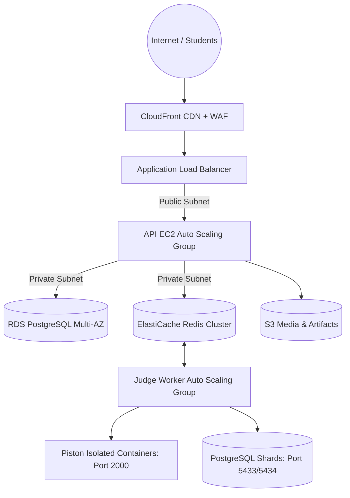

# CodeSkill Infrastructure, Cloud & Operations Reference

> **Ground-Truth Audit Document**  
> Source of truth: Terraform HCL configurations, GitHub Actions workflows, Docker deployment scripts, and k6 load test suites on `origin/main`. Covers 100% of cloud resources across 22 Terraform modules, 3 environments, and operational playbooks.

---

## Table of Contents

- [1. AWS Cloud Architecture & Network Topology](#1-aws-cloud-architecture--network-topology)
- [2. Exhaustive Terraform Module Catalog (22 Modules)](#2-exhaustive-terraform-module-catalog)
- [3. Terraform Deployment Environments](#3-terraform-deployment-environments)
- [4. CI/CD GitHub Actions Workflows](#4-cicd-github-actions-workflows)
- [5. Containerized Sandbox & Judge Deployment](#5-containerized-sandbox--judge-deployment)
- [6. Uptime Kuma Monitoring & WhatsApp/Discord Relays](#6-uptime-kuma-monitoring--whatsappdiscord-relays)
- [7. High-Concurrency k6 Load Testing Suites](#7-high-concurrency-k6-load-testing-suites)
- [8. Production Operations & Disaster Recovery Runbooks](#8-production-operations--disaster-recovery-runbooks)

---

## 1. AWS Cloud Architecture & Network Topology



---

## 2. Exhaustive Terraform Module Catalog (22 Modules)

### Module: `terraform/modules/alb`
- **Module Files:** `main.tf`, `outputs.tf`, `variables.tf`
- **Provisioned AWS Resources:** Managed AWS resources for `alb`.

### Module: `terraform/modules/application-asg`
- **Module Files:** `main.tf`, `outputs.tf`, `variables.tf`
- **Provisioned AWS Resources:** Managed AWS resources for `application-asg`.

### Module: `terraform/modules/asg`
- **Module Files:** `main.tf`, `outputs.tf`, `variables.tf`
- **Provisioned AWS Resources:** Managed AWS resources for `asg`.

### Module: `terraform/modules/cloudfront`
- **Module Files:** `main.tf`, `outputs.tf`, `variables.tf`
- **Provisioned AWS Resources:** Managed AWS resources for `cloudfront`.

### Module: `terraform/modules/cost-controls`
- **Module Files:** `main.tf`, `outputs.tf`, `variables.tf`
- **Provisioned AWS Resources:** Managed AWS resources for `cost-controls`.

### Module: `terraform/modules/ec2`
- **Module Files:** `main.tf`, `outputs.tf`, `variables.tf`
- **Provisioned AWS Resources:** Managed AWS resources for `ec2`.

### Module: `terraform/modules/ec2-asg`
- **Module Files:** `main.tf`, `outputs.tf`, `tests`, `variables.tf`
- **Provisioned AWS Resources:** Managed AWS resources for `ec2-asg`.

### Module: `terraform/modules/ecr`
- **Module Files:** `main.tf`, `outputs.tf`, `variables.tf`
- **Provisioned AWS Resources:** Managed AWS resources for `ecr`.

### Module: `terraform/modules/iam`
- **Module Files:** `main.tf`, `outputs.tf`, `variables.tf`
- **Provisioned AWS Resources:** Managed AWS resources for `iam`.

### Module: `terraform/modules/judge0`
- **Module Files:** `main.tf`, `outputs.tf`, `variables.tf`
- **Provisioned AWS Resources:** Managed AWS resources for `judge0`.

### Module: `terraform/modules/monitoring`
- **Module Files:** `main.tf`, `outputs.tf`, `variables.tf`
- **Provisioned AWS Resources:** Managed AWS resources for `monitoring`.

### Module: `terraform/modules/networking`
- **Module Files:** `main.tf`, `outputs.tf`, `variables.tf`
- **Provisioned AWS Resources:** Managed AWS resources for `networking`.

### Module: `terraform/modules/piston-execution`
- **Module Files:** `main.tf`, `outputs.tf`, `variables.tf`
- **Provisioned AWS Resources:** Managed AWS resources for `piston-execution`.

### Module: `terraform/modules/rds`
- **Module Files:** `main.tf`, `outputs.tf`, `variables.tf`
- **Provisioned AWS Resources:** Managed AWS resources for `rds`.

### Module: `terraform/modules/redis`
- **Module Files:** `main.tf`, `outputs.tf`, `tests`, `variables.tf`
- **Provisioned AWS Resources:** Managed AWS resources for `redis`.

### Module: `terraform/modules/route53`
- **Module Files:** `main.tf`, `outputs.tf`, `variables.tf`
- **Provisioned AWS Resources:** Managed AWS resources for `route53`.

### Module: `terraform/modules/s3`
- **Module Files:** `main.tf`, `outputs.tf`, `variables.tf`
- **Provisioned AWS Resources:** Managed AWS resources for `s3`.

### Module: `terraform/modules/security`
- **Module Files:** `main.tf`, `outputs.tf`, `variables.tf`
- **Provisioned AWS Resources:** Managed AWS resources for `security`.

### Module: `terraform/modules/service-discovery`
- **Module Files:** `main.tf`, `outputs.tf`, `variables.tf`
- **Provisioned AWS Resources:** Managed AWS resources for `service-discovery`.

### Module: `terraform/modules/shared-judges`
- **Module Files:** `main.tf`, `outputs.tf`, `userdata.sh.tftpl`, `variables.tf`
- **Provisioned AWS Resources:** Managed AWS resources for `shared-judges`.

### Module: `terraform/modules/vpc`
- **Module Files:** `main.tf`, `outputs.tf`, `variables.tf`
- **Provisioned AWS Resources:** Managed AWS resources for `vpc`.

### Module: `terraform/modules/waf`
- **Module Files:** `main.tf`, `outputs.tf`, `variables.tf`
- **Provisioned AWS Resources:** Managed AWS resources for `waf`.

---

## 3. Terraform Deployment Environments

CodeSkill defines three isolated infrastructure root environments in `terraform/environments/`:

1. **`production` (`terraform/environments/production/`):**
   - Multi-AZ VPC deployment across `ap-south-1` (Mumbai).
   - RDS Multi-AZ PostgreSQL 15, ElastiCache Redis Cluster with in-transit TLS.
   - WAF rate limiting rules, CloudFront CDN edge caching.
   - Application ASG (API) and Judge Worker ASG with scaling policies.
   - SSM Parameter Store configuration (`/codeskill-prod/*`) for secrets and runtime flags.
2. **`dev` (`terraform/environments/dev/`):**
   - Single-AZ lightweight sandbox environment for staging and integration tests.
3. **`judges` (`terraform/environments/judges/`):**
   - Independent Terraform root with dedicated state managing isolated judge infrastructure in `ap-south-1`.
   - **Compute Topology:** Provisions two private ARM64 `t4g.small` instances (2 vCPU, 2 GiB RAM each) with encrypted gp3 disks, dedicated IAM roles/instance profiles, and dedicated security groups.
     - `deployment_mode = "separate"` (default): Judge0 host managed under module address `shared_judges`; Piston host managed under `module.piston[0]`.
     - Optional `deployment_mode = "shared"` co-locates both providers for development/budget setups.
   - **Security & Network Isolation:**
     - Instances reside in private subnets with zero public IP addresses and no SSH port 22 access (`0.0.0.0/0:22`).
     - Remote administration is conducted strictly via **AWS Systems Manager (SSM) Session Manager**.
     - IMDSv2 is strictly enforced (`http_put_response_hop_limit = 1`). Untrusted container processes are blocked from accessing the AWS Instance Metadata Service (`169.254.169.254`) via host iptables rules (`iptables -I DOCKER-USER -d 169.254.169.254 -j DROP`).
     - Security group ingress restricts ports 2358 (Judge0) and 2001 (Piston) strictly to the backend application security group.
   - **Native ARM64 Sandboxing Engine:**
     - Native compilation and execution without cross-architecture emulation.
     - Built from pinned Judge0 and Piston sources using cgroup-v2 Isolate revision (obsolete cgroup-v1 switches removed).
     - Native runtimes: C (GCC), C++ (G++), Java (OpenJDK), Python 3, JavaScript (Node.js), and TypeScript.
     - Compilation and execution use separate sandbox cgroups so compiler CPU/memory limits cannot deplete student execution quotas.
     - Hard compiler artifact limit: **1 MiB**; program stdout/stderr capped at **64 KiB**.
   - **Automated Host Verification (`verify.py`):**
     - Runs automated multi-language smoke tests, I/O verification, auth checks, and resource limit audits upon EC2 bootstrap.
     - Only upon 100% test passage does it generate `verification.json` and publish `/<name_prefix>/status=verified` along with a SecureString authentication token to SSM Parameter Store.
     - Host bootstrap is logged to `/var/log/codeskill-judges-bootstrap.log`.
   - **Backend Integration & Rollback:**
     - Backend API and worker load settings dynamically from SSM parameter `/codeskill-prod/judges/backend_env` via pointer `JUDGE_CONFIG_PARAMETER`.
     - Rollback procedure: Preserve Judge0 volume (`/var/lib/docker/volumes`), restore prior native bundle (e.g., `separate-arm-*.tgz`), and rebuild in-place via SSM. Never run `docker compose down -v` or `terraform destroy` on judges.

---

## 4. CI/CD GitHub Actions Workflows

Located in `.github/workflows/`:

### 1. `deploy.yml` (Main Production Deployment Pipeline)
- **Repository Target:** Production deployment runs on pushes to `main` in `maaze18864-web/codeskill` (configured under **Settings → Secrets and variables → Actions**).
- **Triggers:** Push to `main` branch or manual `workflow_dispatch`.
- **Authentication Methods (Precedence & Credentials):**
  1. **AWS OIDC Federation (Recommended):** Configured via repository variable or secret `AWS_ROLE_TO_ASSUME` pointing to an existing IAM deployment role ARN. The role must trust GitHub's OIDC provider (`token.actions.githubusercontent.com`) for the `main` branch with audience `sts.amazonaws.com`. Workflow requests `id-token: write`.
  2. **Static Access Keys (Fallback):** Repository secrets `AWS_ACCESS_KEY_ID`, `AWS_SECRET_ACCESS_KEY`, and optional `AWS_SESSION_TOKEN`.
  3. **Resolution:** When both are present, OIDC takes precedence over static credentials.
- **Required IAM Permissions:**
  - S3 release upload: `s3:PutObject` on the deployment release bucket.
  - Auto Scaling instance refresh: `autoscaling:StartInstanceRefresh` on the target application ASG.
- **Configuration Check (`.github/scripts/check-aws-deployment-config.sh`):**
  - Runs early in the workflow before tests and builds to fail fast if AWS credentials are missing (`"AWS deployment is not configured"`).
  - Public PR validation executes the check with dummy values and completes static tests and builds without requiring AWS secrets.
- **Pipeline Execution Steps:**
  1. Checks out repository on Node.js 22 runner.
  2. Type-checks and runs automated unit tests for `backend-nestjs` (91 spec files) and `frontend-v2` (71 test files).
  3. Authenticates with AWS via OIDC role assumption (`AWS_ROLE_TO_ASSUME`) or access keys.
  4. Builds production bundles and packages the release archive.
  5. Uploads release bundle to S3 and triggers an Auto Scaling Group Instance Refresh with zero downtime.
  6. Reloads PM2 processes on target application instances (`npm run restart`).

### 2. `piston-validation.yml` (Sandbox Integrity Pipeline)
- **Triggers:** Changes to `scripts/piston/**` or `deployment/piston/**`.
- **Steps:**
  1. Syntax check on `scripts/piston/preflight.sh` (`bash -n`).
  2. Node.js syntax verification on `provision.mjs` and `smoke.mjs` (`node --check`).

---

## 5. Containerized Sandbox & Judge Deployment

Located in `deployment/judges/` and `deployment/piston/`:

- **Piston Sandboxing:** Uses Linux cgroup v1/v2 boundaries with unprivileged isolate wrappers to restrict CPU time, wall-clock duration, memory consumption (default: 512MB), and network access.
- **Judge0 Sandboxing:** Isolates code compilation and execution using Docker containers managed by docker-compose.
- **Provisioning Scripts:**
  - `scripts/piston/preflight.sh`: Validates host kernel cgroups and Docker daemon readiness.
  - `scripts/piston/provision.mjs`: Downloads and registers official language packages.
  - `scripts/piston/smoke.mjs`: Executes end-to-end smoke tests across C, C++, Java, and Python.

---

## 6. Uptime Kuma Monitoring & WhatsApp/Discord Relays

Located in `deployment/monitoring/uptime-kuma/`:

- **Stack:** Containerized Uptime Kuma instance with SQLite persistence (`docker-compose.yml`).
- **Active Monitors (`monitors.json`):** Monitors backend API `/health`, frontend root, WebSocket handshake, and Piston judge endpoints.
- **WhatsApp Alert Relay (`whatsapp-relay.js`):** A custom Node.js Baileys service that receives webhook alerts from Uptime Kuma and sends immediate WhatsApp messages to institutional coordinators.
- **Backups:** Automated shell scripts `backup-kuma.sh` and `restore-kuma.sh`.

---

## 7. High-Concurrency k6 Load Testing Suites

Located in `scripts/k6/` and `terraform/load-tests/`:

| Test Script | Concurrency Target | Scenario Simulated |
| :--- | :--- | :--- |
| `codeskill-100-students-assessment.js` | 100 Virtual Users | Simultaneous assessment start, autosave polling, and submission. |
| `codeskill-400-students-assessment.js` | 400 Virtual Users | High-concurrency campus lab examination surge. |
| `codeskill-load-audit.js` | Up to 1,000 VUs | Stress tests API endpoints, database connection pooling, and Redis limits. |

---

## 8. Production Operations & Disaster Recovery Runbooks

### Database Backup Runbook
```bash
# Run automated PostgreSQL backup script
node scripts/backup-databases.cjs
```

### PM2 Service Process Management & PM2.io SSM Monitoring

Both `backend-nestjs` and `frontend-v2` include PM2 as a production dependency and expose `npm run prod:start`. Production Docker containers run under `pm2-runtime` with systemd management.

- **PM2.io Enterprise Monitoring Integration:**
  - Docker containers link to PM2.io automatically at boot using `PM2_SECRET_KEY`, `PM2_PUBLIC_KEY`, and dynamic `PM2_MACHINE_NAME`.
  - Keys are stored securely in AWS SSM Parameter Store as a `SecureString` referenced by the Terraform variable `pm2_io_parameter_name` (default: `/codeskill-prod/monitoring/pm2`).
  - To provision PM2.io keys to SSM, create an owner-only, git-ignored `.env.pm2-ssm.json` file:
    ```json
    {
      "Name": "/codeskill-prod/monitoring/pm2",
      "Type": "SecureString",
      "Value": "{\"PM2_SECRET_KEY\":\"YOUR_SECRET_KEY\",\"PM2_PUBLIC_KEY\":\"YOUR_PUBLIC_KEY\"}",
      "Overwrite": true
    }
    ```
  - Provision via deployment profile:
    ```bash
    AWS_REGION=ap-south-1 bash scripts/configure-pm2-ssm.sh
    ```
  - Set `pm2_io_parameter_name = ""` to run PM2 Runtime without connecting to PM2.io.
  - In older `modules/asg` host deployments, setting `pm2_io_parameter_name` fetches the same keys from SSM and executes `pm2 link` under user `ec2-user`.

- **Operational Process Commands:**
  ```bash
  # Start all monorepo production processes locally or on bare EC2:
  npm start
  # Inspect running service status, memory, and restarts:
  pm2 status
  # Tail real-time aggregated logs:
  pm2 logs
  # Zero-downtime rolling reload with new environment variables:
  npm run restart
  ```