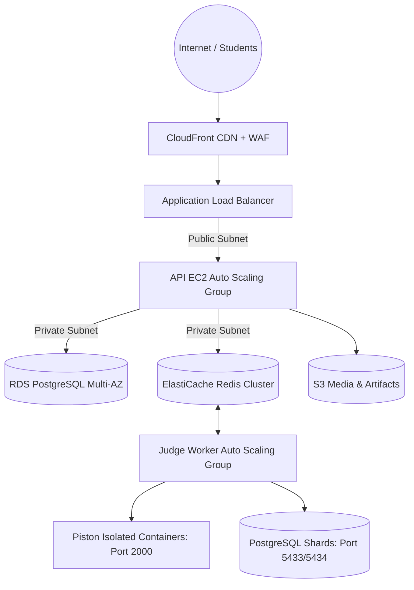

# CodeSkill Infrastructure, Cloud & Operations Reference

> **Ground-Truth Audit Document**  
> Source of truth: Terraform HCL configurations, GitHub Actions workflows, Docker deployment scripts, and k6 load test suites on `origin/main`. Covers 100% of cloud resources across 22 Terraform modules, 3 environments, and operational playbooks.

---

## Table of Contents

- [1. AWS Cloud Architecture & Network Topology](#1-aws-cloud-architecture--network-topology)
- [2. Exhaustive Terraform Module Catalog (22 Modules)](#2-exhaustive-terraform-module-catalog)
- [3. Terraform Deployment Environments](#3-terraform-deployment-environments)
- [4. CI/CD GitHub Actions Workflows](#4-cicd-github-actions-workflows)
- [5. Containerized Sandbox & Judge Deployment](#5-containerized-sandbox--judge-deployment)
- [6. Uptime Kuma Monitoring & WhatsApp/Discord Relays](#6-uptime-kuma-monitoring--whatsappdiscord-relays)
- [7. High-Concurrency k6 Load Testing Suites](#7-high-concurrency-k6-load-testing-suites)
- [8. Production Operations & Disaster Recovery Runbooks](#8-production-operations--disaster-recovery-runbooks)

---

## 1. AWS Cloud Architecture & Network Topology



---

## 2. Exhaustive Terraform Module Catalog (22 Modules)

### Module: `terraform/modules/alb`
- **Module Files:** `main.tf`, `outputs.tf`, `variables.tf`
- **Provisioned AWS Resources:** Managed AWS resources for `alb`.

### Module: `terraform/modules/application-asg`
- **Module Files:** `main.tf`, `outputs.tf`, `variables.tf`
- **Provisioned AWS Resources:** Managed AWS resources for `application-asg`.

### Module: `terraform/modules/asg`
- **Module Files:** `main.tf`, `outputs.tf`, `variables.tf`
- **Provisioned AWS Resources:** Managed AWS resources for `asg`.

### Module: `terraform/modules/cloudfront`
- **Module Files:** `main.tf`, `outputs.tf`, `variables.tf`
- **Provisioned AWS Resources:** Managed AWS resources for `cloudfront`.

### Module: `terraform/modules/cost-controls`
- **Module Files:** `main.tf`, `outputs.tf`, `variables.tf`
- **Provisioned AWS Resources:** Managed AWS resources for `cost-controls`.

### Module: `terraform/modules/ec2`
- **Module Files:** `main.tf`, `outputs.tf`, `variables.tf`
- **Provisioned AWS Resources:** Managed AWS resources for `ec2`.

### Module: `terraform/modules/ec2-asg`
- **Module Files:** `main.tf`, `outputs.tf`, `tests`, `variables.tf`
- **Provisioned AWS Resources:** Managed AWS resources for `ec2-asg`.

### Module: `terraform/modules/ecr`
- **Module Files:** `main.tf`, `outputs.tf`, `variables.tf`
- **Provisioned AWS Resources:** Managed AWS resources for `ecr`.

### Module: `terraform/modules/iam`
- **Module Files:** `main.tf`, `outputs.tf`, `variables.tf`
- **Provisioned AWS Resources:** Managed AWS resources for `iam`.

### Module: `terraform/modules/judge0`
- **Module Files:** `main.tf`, `outputs.tf`, `variables.tf`
- **Provisioned AWS Resources:** Managed AWS resources for `judge0`.

### Module: `terraform/modules/monitoring`
- **Module Files:** `main.tf`, `outputs.tf`, `variables.tf`
- **Provisioned AWS Resources:** Managed AWS resources for `monitoring`.

### Module: `terraform/modules/networking`
- **Module Files:** `main.tf`, `outputs.tf`, `variables.tf`
- **Provisioned AWS Resources:** Managed AWS resources for `networking`.

### Module: `terraform/modules/piston-execution`
- **Module Files:** `main.tf`, `outputs.tf`, `variables.tf`
- **Provisioned AWS Resources:** Managed AWS resources for `piston-execution`.

### Module: `terraform/modules/rds`
- **Module Files:** `main.tf`, `outputs.tf`, `variables.tf`
- **Provisioned AWS Resources:** Managed AWS resources for `rds`.

### Module: `terraform/modules/redis`
- **Module Files:** `main.tf`, `outputs.tf`, `tests`, `variables.tf`
- **Provisioned AWS Resources:** Managed AWS resources for `redis`.

### Module: `terraform/modules/route53`
- **Module Files:** `main.tf`, `outputs.tf`, `variables.tf`
- **Provisioned AWS Resources:** Managed AWS resources for `route53`.

### Module: `terraform/modules/s3`
- **Module Files:** `main.tf`, `outputs.tf`, `variables.tf`
- **Provisioned AWS Resources:** Managed AWS resources for `s3`.

### Module: `terraform/modules/security`
- **Module Files:** `main.tf`, `outputs.tf`, `variables.tf`
- **Provisioned AWS Resources:** Managed AWS resources for `security`.

### Module: `terraform/modules/service-discovery`
- **Module Files:** `main.tf`, `outputs.tf`, `variables.tf`
- **Provisioned AWS Resources:** Managed AWS resources for `service-discovery`.

### Module: `terraform/modules/shared-judges`
- **Module Files:** `main.tf`, `outputs.tf`, `userdata.sh.tftpl`, `variables.tf`
- **Provisioned AWS Resources:** Managed AWS resources for `shared-judges`.

### Module: `terraform/modules/vpc`
- **Module Files:** `main.tf`, `outputs.tf`, `variables.tf`
- **Provisioned AWS Resources:** Managed AWS resources for `vpc`.

### Module: `terraform/modules/waf`
- **Module Files:** `main.tf`, `outputs.tf`, `variables.tf`
- **Provisioned AWS Resources:** Managed AWS resources for `waf`.

---

## 3. Terraform Deployment Environments

CodeSkill defines three isolated infrastructure root environments in `terraform/environments/`:

1. **`production` (`terraform/environments/production/`):**
   - Multi-AZ VPC deployment across `ap-south-1`.
   - RDS Multi-AZ PostgreSQL 15, ElastiCache Redis Cluster with in-transit TLS.
   - WAF rate limiting rules, CloudFront CDN edge caching.
   - Application ASG (API) and Judge Worker ASG with scaling policies.
2. **`dev` (`terraform/environments/dev/`):**
   - Single-AZ lightweight sandbox environment for staging and integration tests.
3. **`judges` (`terraform/environments/judges/`):**
   - Dedicated Auto Scaling Group for Piston and Judge0 container execution nodes.

---

## 4. CI/CD GitHub Actions Workflows

Located in `.github/workflows/`:

### 1. `deploy.yml` (Main Deployment Pipeline)
- **Triggers:** Push to `main` branch or manual `workflow_dispatch`.
- **Steps:**
  1. Checks out repository on Node.js 22 runner.
  2. Runs type-checks and test suites for `backend-nestjs` and `frontend-v2`.
  3. Authenticates with AWS via OIDC role assumption (`AWS_ROLE_TO_ASSUME`).
  4. Executes remote SSH script on target production EC2 nodes.
  5. Compiles production assets and reloads processes via PM2 (`npm run restart`).

### 2. `piston-validation.yml` (Sandbox Integrity Pipeline)
- **Triggers:** Changes to `scripts/piston/**` or `deployment/piston/**`.
- **Steps:**
  1. Syntax check on `scripts/piston/preflight.sh` (`bash -n`).
  2. Node.js syntax verification on `provision.mjs` and `smoke.mjs` (`node --check`).

---

## 5. Containerized Sandbox & Judge Deployment

Located in `deployment/judges/` and `deployment/piston/`:

- **Piston Sandboxing:** Uses Linux cgroup v1/v2 boundaries with unprivileged isolate wrappers to restrict CPU time, wall-clock duration, memory consumption (default: 512MB), and network access.
- **Judge0 Sandboxing:** Isolates code compilation and execution using Docker containers managed by docker-compose.
- **Provisioning Scripts:**
  - `scripts/piston/preflight.sh`: Validates host kernel cgroups and Docker daemon readiness.
  - `scripts/piston/provision.mjs`: Downloads and registers official language packages.
  - `scripts/piston/smoke.mjs`: Executes end-to-end smoke tests across C, C++, Java, and Python.

---

## 6. Uptime Kuma Monitoring & WhatsApp/Discord Relays

Located in `deployment/monitoring/uptime-kuma/`:

- **Stack:** Containerized Uptime Kuma instance with SQLite persistence (`docker-compose.yml`).
- **Active Monitors (`monitors.json`):** Monitors backend API `/health`, frontend root, WebSocket handshake, and Piston judge endpoints.
- **WhatsApp Alert Relay (`whatsapp-relay.js`):** A custom Node.js Baileys service that receives webhook alerts from Uptime Kuma and sends immediate WhatsApp messages to institutional coordinators.
- **Backups:** Automated shell scripts `backup-kuma.sh` and `restore-kuma.sh`.

---

## 7. High-Concurrency k6 Load Testing Suites

Located in `scripts/k6/` and `terraform/load-tests/`:

| Test Script | Concurrency Target | Scenario Simulated |
| :--- | :--- | :--- |
| `codeskill-100-students-assessment.js` | 100 Virtual Users | Simultaneous assessment start, autosave polling, and submission. |
| `codeskill-400-students-assessment.js` | 400 Virtual Users | High-concurrency campus lab examination surge. |
| `codeskill-load-audit.js` | Up to 1,000 VUs | Stress tests API endpoints, database connection pooling, and Redis limits. |

---

## 8. Production Operations & Disaster Recovery Runbooks

### Database Backup Runbook
```bash
# Run automated PostgreSQL backup script
node scripts/backup-databases.cjs
```

### PM2 Service Process Management
```bash
# Start all monorepo production processes
npm start
# Inspect running service health and logs
pm2 status
pm2 logs
# Zero-downtime rolling reload with new environment variables
npm run restart
```