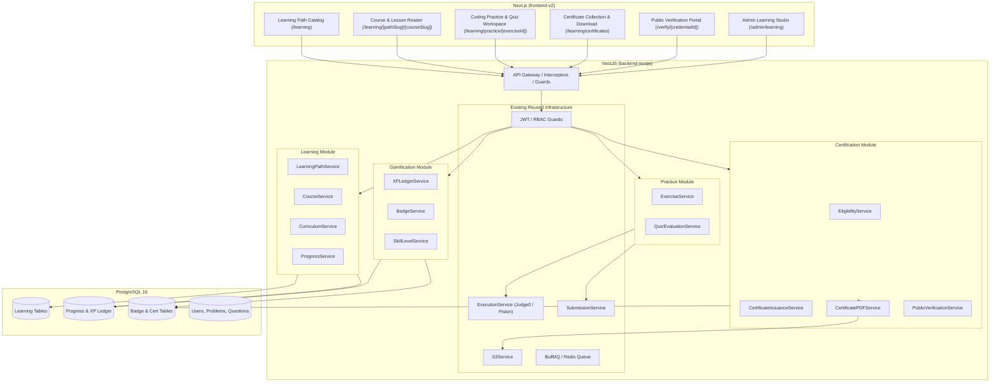

# CodeSkill Learning Module — Target Architecture (Batch 0)

**Date:** October 21, 2026  
**Status:** Approved for Implementation  
**Architecture Pattern:** Modular Monolith within existing NestJS backend & Next.js frontend  

---

## 1. Architectural Principles

1. **Modular Monolith**: Implement learning, practice, gamification, and certification as dedicated NestJS modules (`LearningModule`, `GamificationModule`, `CertificationModule`) within `backend-nestjs` to avoid premature microservice complexity.
2. **Reuse Core Engines**:
   - Reuse `ExecutionService` and sandbox execution for all coding exercises.
   - Reuse `AuthModule` and RBAC guards for access control.
   - Reuse `S3Service` for certificate PDF and asset storage.
   - Reuse `AuditLog` patterns for administrative changes.
3. **Server-Authoritative Progress**:
   - Zero trust in client claims: opening a lesson or attempting a question never marks it as completed.
   - All completions require server-side evaluation of criteria (e.g. accepted submission on coding exercises, passing score on quizzes).
4. **Content Versioning & Immutability**:
   - Curriculum updates use a `draft` → `review` → `published` revision model.
   - Enrolled learners retain progress against their enrolled path version; editing a course never silently invalidates completed student records.
5. **Idempotent Gamification & Issuance**:
   - XP awards and badge grants use unique event idempotency constraints.
   - Certificate issuance uses atomic database transactions to guarantee exactly one certificate per student per path completion.

---

## 2. High-Level System Architecture

---

## 3. Module Boundaries & Data Flow

### 3.1 Learning Practice & Evaluation Flow
1. Student attempts a coding exercise inside a lesson.
2. Code is submitted to `/learning/exercises/:id/submit`.
3. Backend retrieves exercise config and delegates to `ExecutionService`.
4. If verdict is `Accepted`:
   - An `exercise_attempt` is recorded.
   - `ProgressService` checks if all mandatory module exercises are complete.
   - `XPLedgerService` awards XP if this is the student's first accepted solution for this exercise.
   - `BadgeService` checks if badge award criteria are met.
   - Response returns updated progress, XP award, and unlocked badges.

### 3.2 Certificate Issuance Flow
1. Upon completing a learning path, student requests certification or system triggers auto-evaluation.
2. `EligibilityService` evaluates:
   - 100% completion of mandatory courses.
   - Passing threshold on milestone assessments.
   - Student identity verification.
3. If eligible, `CertificateIssuanceService` opens a PostgreSQL transaction:
   - Verifies no existing active certificate for `(student_id, path_id, version)`.
   - Generates unique cryptographically secure `credential_id` (format: `CS-YYYY-XXXXXX`).
   - Inserts record into `certificates`.
   - Queues asynchronous PDF rendering job with `@react-pdf/renderer` and uploads to S3.
   - Logs event into `certificate_events` and `audit_logs`.
