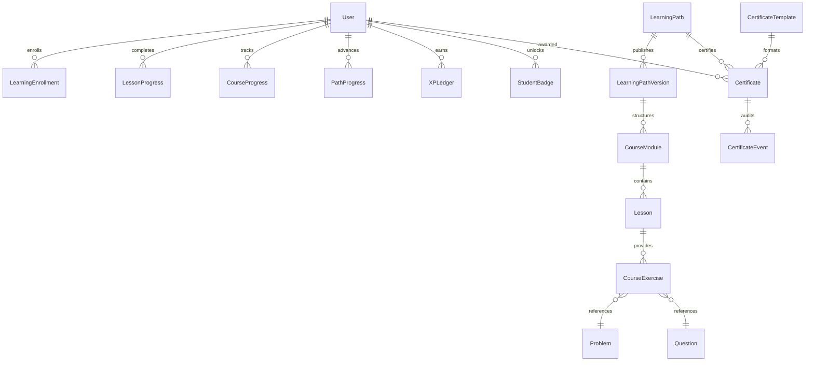

# CodeSkill Learning Module — Entity Reuse Map (Batch 0)

**Date:** October 21, 2026  
**Status:** Approved for Implementation  

---

## 1. Entity Classification

| Domain | Entity / Model | Status | Rationale / Mapping |
| :--- | :--- | :--- | :--- |
| **User & Identity** | `User` | **REUSE & EXTEND** | Reuse existing UUID `User` entity, JWT authentication, and roles. Keep profile info and existing stats intact. |
| **Coding Problems** | `Problem` | **REUSE DIRECTLY** | Coding exercises link to existing `Problem` statements, starter code, and test cases. |
| **Questions / MCQs**| `Question` | **REUSE DIRECTLY** | Quiz exercises can link to existing questions or embed knowledge-check configurations. |
| **Code Submissions**| `Submission` | **REUSE DIRECTLY** | Store exercise executions in `submissions` with `problemSource: 'question'` or new practice source tag. |
| **Audit Logging** | `AuditLog` | **REUSE DIRECTLY** | Administrative actions in Learning Studio record directly to `audit_logs`. |
| **Asset Storage** | `S3Service` | **REUSE DIRECTLY** | PDFs and badge graphics stored in S3/MinIO via existing service. |
| **Learning Paths** | `LearningPath` | **NEW** | Represents a structured learning track (e.g. JavaScript Mastery, DSA, SQL). |
| **Path Revisions** | `LearningPathVersion` | **NEW** | Immutable published revision of a path containing curriculum structure. |
| **Courses** | `Course` | **NEW** | Course metadata (title, slug, difficulty, duration). |
| **Course Modules** | `CourseModule` | **NEW** | Ordered sections within a course (e.g. Module 1: Fundamentals). |
| **Lessons** | `Lesson` | **NEW** | Structured reading, code snippets, diagrams, objectives (NO VIDEO). |
| **Course Exercises**| `CourseExercise` | **NEW** | Practice items (coding problem link, quiz, debugging challenge). |
| **Enrollments** | `LearningEnrollment` | **NEW** | Student enrollment tracking selected path and active version. |
| **Lesson Progress** | `LessonProgress` | **NEW** | Per-student, per-lesson started/completed status with timestamps. |
| **Course Progress** | `CourseProgress` | **NEW** | Derived course completion percentage, score, and status. |
| **Path Progress** | `PathProgress` | **NEW** | Aggregate path completion state and certificate eligibility flag. |
| **XP Ledger** | `XPLedger` | **NEW** | Append-only ledger of earned XP transactions with idempotency keys. |
| **Skill Definitions**| `SkillDefinition` | **NEW** | Defined competencies (e.g. Recursion, SQL Joins) with tier thresholds. |
| **Badge Definitions**| `BadgeDefinition` | **NEW** | Badge criteria, icon URL, rarity, and category. |
| **Student Badges** | `StudentBadge` | **NEW** | Unique student badge grants with earned timestamp. |
| **Cert Templates** | `CertificateTemplate`| **NEW** | Layout definition, issuer signatures, and visual styling. |
| **Certificates** | `Certificate` | **NEW** | Unique credential number, student ID, path ID, status, and PDF URL. |
| **Cert Events** | `CertificateEvent` | **NEW** | Audit trail for issuance, revocation, and verification. |

---

## 2. Relational Schema Blueprint

---

## 3. Database Constraints & Integrity Rules

1. **Enrollment Uniqueness**: `UNIQUE(student_id, path_id, version_id)` ensures a student has exactly one enrollment record per curriculum version.
2. **XP Idempotency**: `UNIQUE(student_id, idempotency_key)` guarantees duplicate requests or network retries never award XP more than once for the same milestone.
3. **Badge Uniqueness**: `UNIQUE(student_id, badge_definition_id)` ensures a badge is granted only once per student.
4. **Certificate Uniqueness**: `UNIQUE(student_id, path_id, path_version_id)` guarantees atomic, duplicate-free issuance.
5. **Credential Identifier**: `UNIQUE(credential_id)` formatted as `CS-YYYY-XXXXXX` indexed for sub-millisecond public verification.
