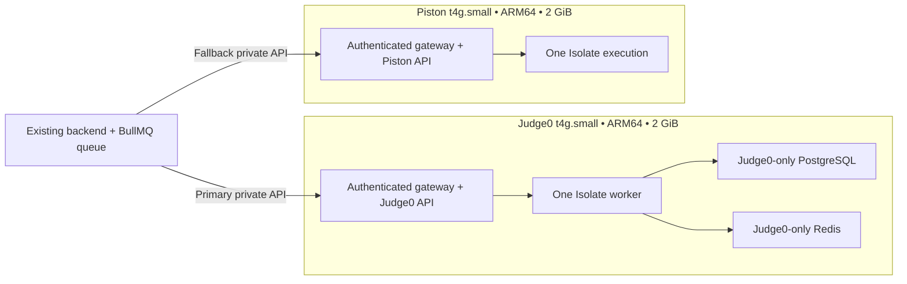

# Two native ARM judge machines

This is an independent Terraform root with independent state. It manages only a
two private `t4g.small` machines, their encrypted gp3 disks, dedicated security groups/rules,
and dedicated IAM roles/profiles. Existing VPC, private subnet and application
security groups are read-only data sources. Do not apply the repository's broad
root configuration to deploy these judges.



`deployment_mode = "separate"` is the default. Both machines use
`judge_instance_type = "t4g.small"`. The original `shared_judges` Terraform
module address is retained for Judge0 to avoid replacing its existing EC2;
`module.piston[0]` owns the new Piston machine. Each host has its own role,
security group, SecureString token and local memory/CPU limits. The optional
`shared` mode is available for an existing budget environment; it is not the
current production layout.


Both stock pinned judge images are AMD64. This deployment builds ARM64 images
on the ARM host without emulation, from pinned Judge0/Piston sources and the
cgroup-v2 Isolate revision used by Piston. Judge0's obsolete cgroup-v1 command
switches are removed. Native GCC, Python, OpenJDK, Node and TypeScript packages
are registered with actual versions, using the application's existing Judge0
language IDs. Only C, C++, Python, Java, JavaScript and TypeScript are provided.
Compilation and execution use fresh sandbox cgroups so compiler CPU/memory
cannot be charged against a student's runtime limit. Compiler artifacts have a
separate bounded 1 MiB limit; program output remains capped at 64 KiB. Piston
uses the submitted Java/TypeScript filename to select the compiled entry point.

## Deployment

1. Confirm current AWS account-plan eligibility, quotas, credits and pricing.
   The instance-type eligibility guard is enabled by default; eligible is not
   the same as permanently free. Existing private-subnet internet routing is
   required for source/image downloads. No NAT or VPC endpoint is created here.
2. Build a source archive (no credentials are included):
   ```bash
   deployment/judges/shared/package.sh /tmp/shared-arm-source.tgz
   aws s3 cp /tmp/shared-arm-source.tgz s3://YOUR_BUCKET/releases/judges/UNIQUE_KEY.tgz --sse AES256
   ```
3. Copy `terraform.tfvars.example`, supply existing network IDs and the exact
   S3 key/archive SHA-256. Copy `backend.tf.example` to a private backend config
   file, using a **different key from application Terraform state**. Preserve
   S3 versioning and encryption; restrict state/bundle access.
4. From this directory:
   ```bash
   terraform fmt -recursive
   terraform init -backend-config=/path/to/private/backend.hcl
   terraform validate
   terraform plan -out=tfplan
   # Review: only module.shared_judges and module.piston[0] resources.
   terraform apply tfplan
   ```
   The `.hcl` backend file contains the fields inside the example's backend
   block, not the enclosing Terraform blocks.
5. User-data installs Docker and builds a shared runtime layer plus the assigned
   provider image sequentially. A 2 GiB swap file protects the build; execution containers
   cannot use swap beyond their memory limits. Bootstrap log:
   `/var/log/codeskill-judges-bootstrap.log`. Administer through SSM, not SSH.
6. `verify.py` checks six languages, input/output, authentication, time/memory/
   output limits, network/filesystem/credential isolation and provider-specific native execution. Only success creates `verification.json` and
   publishes `/<name_prefix>/status=verified` plus a SecureString auth token.
   A created EC2 instance alone does not establish successful judge deployment.
7. Connect the existing backend only after verification. Use the Terraform URL
   outputs, fetch each host's token server-side, and apply `.env.example` limits. Never
   put tokens into Terraform variables, outputs, Git or browser JavaScript.
   Test the backend's actual Judge0-to-Piston fallback separately.

## Backend configuration and production verification

The production backend and worker load `/codeskill-prod/judges/backend_env`, a
dedicated encrypted SSM parameter, through their existing EC2 role. The PM2
`JUDGE_CONFIG_PARAMETER` points to it. `runtime-config.ts` loads it before judge
providers and the worker are imported, validates an explicit judge-only key
allowlist, and fails startup if it cannot load valid settings. It does not read
or rewrite the production database, authentication or OAuth parameter. The AWS
CLI must be available on the application host, and its role must have permission
to read this parameter and decrypt its managed-key SecureString. Local development
without `JUDGE_CONFIG_PARAMETER` keeps the normal `.env` workflow.

Keep only the 22 keys accepted by `runtime-config.ts` in this parameter. The
additional output/submission timeout examples in `.env.example` are optional
direct backend environment settings, not part of that parameter. Pin the six
actual Piston versions from authenticated `/runtimes` rather than requesting `*`.
Both provider concurrency limits and the backend worker concurrency are one;
the existing shared Redis/BullMQ queue absorbs bursts.

The deployed release was verified on 15 October 2026 (Asia/Kolkata):

| Check | Result |
|---|---|
| Judge0 and Piston hosts | Two private ARM64 `t4g.small` instances |
| Native languages | C, C++, Java, Python, JavaScript, TypeScript passed on each |
| Sandbox checks | Authentication, secret/filesystem/network isolation, time/memory/process/output limits passed |
| Backend integration | 16 checks passed, including fallback and no fallback for student verdicts |
| Production HTTPS student runs | Primary, controlled Judge0 outage fallback, and recovery passed |
| Terraform | Validated; final judge-only plan has no changes |

The existing application instance, frontend, production RDS/Redis, ALB, DNS and
NAT configuration were preserved. Only execution-related backend JavaScript
and two PM2 judge-parameter pointers were patched in the existing release;
2,054 unrelated archive entries were verified byte-identical. The archive stayed
inside AWS and its previous S3 version remains available for rollback. Current
source bundle: `separate-arm-e9f12aab91ee37d0.tgz`, SHA-256
`e9f12aab91ee37d03d0ffd30bf75e4f698319b4c5a7e6c4f8f91fe6e554347ac`.
Do not assume later CI releases include this change until these repository
changes are incorporated into the deployed branch.

## Isolation and operations

The judges have separate Docker networks; both are internal. Only the gateway
has an ingress network. AWS security-group ingress allows ports 2358/2001 only
from the existing backend groups; there is no public IP or SSH ingress. The
instance role can fetch one source archive and publish its own judge parameters;
it cannot read production environment parameters or the production database.
IMDSv2 is required with hop limit one, and Docker forwarding blocks metadata.
Isolate creates submission mount/PID/network namespaces. Student environments
do not inherit API/database credentials. Callbacks, additional files, compiler
options and student-controlled network enablement are disabled for Judge0.
Piston zero/unlimited resource requests are rejected. Runtime secrets are
created on the encrypted host volume and retained across restarts.

Only Judge0's worker and Piston require privileged Docker containers for the
sandbox. This is a dedicated untrusted execution host; never colocate the
application or production database here or mount their secrets. Judge0 1.13.1
uses legacy Rails/Ruby dependencies; this custom ARM build needs continuing
upstream security maintenance and is not an official supported ARM release.

Role selection generates `compose.runtime.json`; only the assigned provider and
its dependencies start. Docker logs rotate locally. No new CloudWatch resources/agent/log stream are
created. `docker compose ps`, `docker stats --no-stream`, and live execution
checks should be part of operational checks. The systemd unit restores the
metadata firewall rule and containers on reboot. Use a maintenance window for
updates; stop admission and allow active jobs to finish first.

Each host uses `standard` CPU credits to avoid unlimited-credit charges but constrain sustained
CPU once burst credits are exhausted. This small host is intended for low
concurrency with queuing, not proven simultaneous execution for 2,000 students.
The separate-host layout can fall back during a Judge0 host/API outage while
Piston remains healthy. The shared mode cannot survive its host failing.
Benchmark exam traffic before promising capacity.

## Rollback

Keep the previous backend judge settings and source bundle version. Restore
only the execution-related backend settings/release if integration fails.
The application host retains an execution-directory and PM2 configuration
backup under `backend-nestjs/.local-dev/judge-backup-*`. Drain the submissions
queue before restoring it and reload only `codeskill-backend,codeskill-worker`;
always resume the queue afterward. For future boots, republish the previous
version of `releases/latest.zip` inside S3 after checking for intervening releases.
The dedicated judge parameter can remain unused when the old PM2 pointer is
restored. Do not copy production secrets to a workstation for rollback.
Stop new job admission, wait for execution completion, then restore a prior
native source bundle and rebuild on the same host. Preserve the Judge0 volume.
Do not run `docker compose down -v`. Do not run Terraform destroy against any
application/production root. The judge instance has Terraform prevent_destroy
and EC2 termination protection; intentional removal requires a reviewed change
and explicit authorization.

After user-data/image changes, rebuild in place via SSM after draining, then
rerun verification. Terraform does not automatically replace this protected
host. Track the installed bundle SHA-256 and verification timestamp in the
release record; successful Terraform apply is distinct from runtime readiness.
